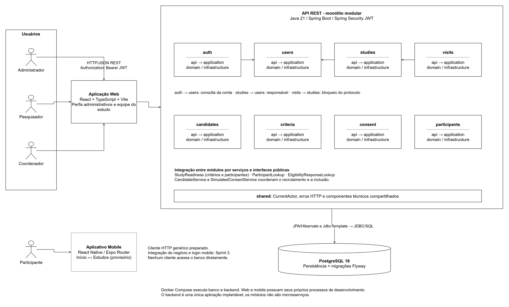
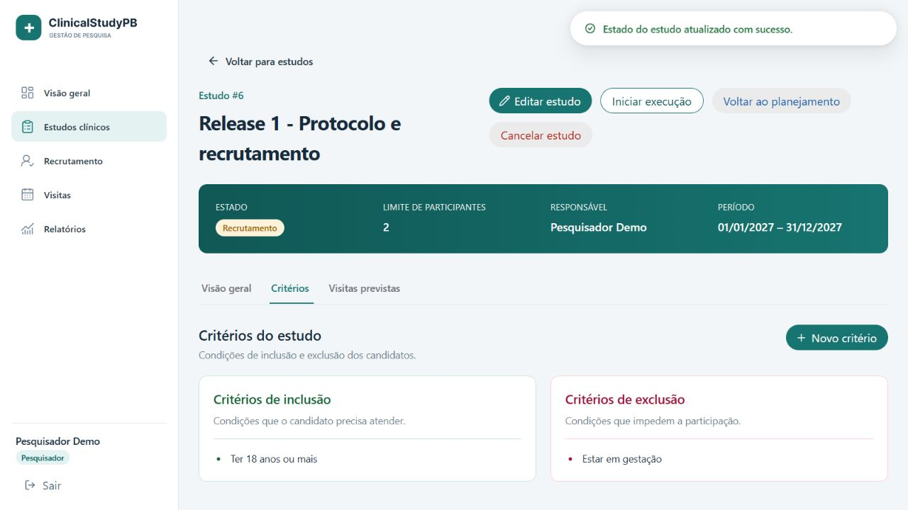
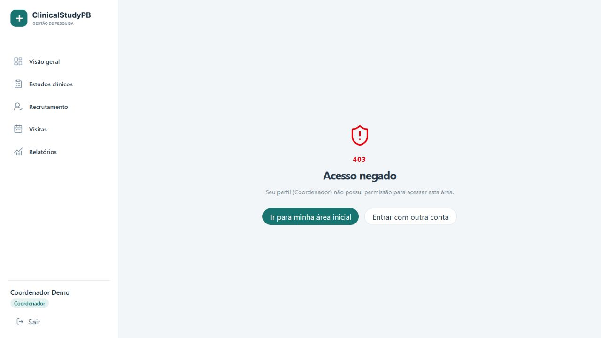

# ClinicalStudyPB

## 1. Projeto, escopo e equipe

ClinicalStudyPB é um sistema acadêmico de gestão de estudos clínicos. A Release 1 reúne administração de usuários, autenticação, estudos, protocolo e recrutamento (RF01–RF11), com backend Java, aplicação web e estrutura inicial mobile. O consentimento usa exclusivamente dados fictícios e não possui assinatura ou validade clínica/jurídica.

| Integrante | Sprint 1 | Sprint 2 |
| --- | --- | --- |
| Lívia | Gerência | Backend |
| Lucas | Backend | Gerência |
| Raffael | Web 1 | Web 1 |
| Allan | Web 2 | Web 2 |
| Júlio | Mobile | Mobile |
| Júlia | QA/DevOps | QA/DevOps |

Consulte as [entregas, evidências e pendências da Release 1](releases/release1/README.md), o [processo das duas sprints](releases/release1/processo/README.md), o [índice de releases](releases/README.md) e as [convenções de contribuição](CONTRIBUTING.md). O planejamento e acompanhamento da equipe ficam no [Azure DevOps TEAM5](https://dev.azure.com/engsw2/TEAM5).

## 2. Arquitetura e diagramas

O backend é um **monólito modular em camadas**, executado como uma aplicação Spring Boot. Os módulos `auth`, `users`, `studies`, `criteria`, `visits`, `candidates`, `consent` e `participants` separam `api`, `application`, `domain` e `infrastructure`. `shared` reúne autenticação HTTP, configurações e tratamento de erros comuns. Integrações entre módulos usam os serviços públicos; cada módulo mantém sua persistência interna.

A web chama a API REST com JWT; somente o backend acessa o PostgreSQL. O Flyway versiona o esquema e o Hibernate valida seu mapeamento. O mobile da Release 1 navega entre duas telas iniciais; a integração de login pertence à Sprint 3.

| Diagrama | Visualização no GitHub | Fonte editável | PDF |
| --- | --- | --- | --- |
| Casos de uso | [RF01–RF11](docs/diagrams/casos-de-uso.png) | [Draw.io](docs/diagrams/casos-de-uso.drawio) | [PDF](docs/diagrams/casos-de-uso.drawio.pdf) |
| Classes/domínio | [Estudos e protocolo](docs/diagrams/classes.png), [recrutamento](docs/diagrams/classes-recrutamento.png) | [Draw.io](docs/diagrams/classes.drawio) | [PDF, 2 páginas](docs/diagrams/classes.drawio.pdf) |
| Sequência | [Protocolo e estados](docs/diagrams/sequencia.png), [galeria dos seis fluxos](docs/diagrams/README.md#sequências) | [Draw.io](docs/diagrams/sequencia.drawio) | [PDF, 6 páginas](docs/diagrams/sequencia.drawio.pdf) |
| Arquitetura | [Aplicações, módulos e banco](docs/diagrams/arquitetura.png) | [Draw.io](docs/diagrams/arquitetura.drawio) | [PDF](docs/diagrams/arquitetura.drawio.pdf) |



Os arquivos mantêm a notação UML, as cores e o modelo Draw.io preexistentes. O [guia dos diagramas](docs/diagrams/README.md) explica páginas, relações e exportação. O [contrato OpenAPI](backend/openapi.yaml) e o [guia de integração de elegibilidade e participantes](backend/docs/eligibility-integration.md) complementam os diagramas.

## 3. Funcionalidades e demonstração

| Requisitos | Fluxo e perfil |
| --- | --- |
| RF01–RF03 | Administrador gerencia usuários; login/logout e autorização por perfil protegem as rotas web e HTTP. |
| RF04 | Pesquisador cadastra, consulta e edita seus estudos; coordenador consulta estudos. |
| RF05–RF07 | Pesquisador responsável cadastra critérios de inclusão/exclusão, configura visitas/atividades e altera o estado do estudo. |
| RF08–RF10 | Coordenador cadastra candidatos, responde critérios e registra consentimento simulado. |
| RF11 | Coordenador inclui candidato elegível com consentimento concedido e vaga disponível, pela API de inclusão. |

O [quadro RF01–RF11 da Release 1](releases/release1/README.md#rastreabilidade-dos-requisitos) identifica implementação, testes e integração de cada tela. A navegação de painel, visitas e relatórios que ainda usa protótipos não constitui evidência de persistência dessas funcionalidades.

Depois da instalação, use as contas fictícias abaixo e siga o roteiro:

1. Administrador: entre na web, abra **Usuários**, cadastre um usuário fictício e confira as validações de campos obrigatórios.
2. Pesquisador: abra **Estudos clínicos**, crie um estudo em planejamento, cadastre critérios dos dois tipos e uma visita com atividade. Abra o recrutamento. A tentativa sem protocolo completo deve apresentar a pendência retornada pela API.
3. Coordenador: em **Recrutamento**, selecione o estudo, cadastre candidato fictício, responda todos os critérios e salve a avaliação. Inclusões devem ser atendidas e exclusões não devem se aplicar para obter `ELIGIBLE`.
4. Registre o consentimento simulado como aceito. Para a inclusão via API, consulte a operação `POST /api/studies/{studyId}/candidates/{candidateId}/inclusion` no Swagger; não há corpo JSON. A listagem usa `GET /api/studies/{studyId}/participants`.
5. Faça logout e tente acessar diretamente uma rota protegida. Uma sessão ausente leva ao login; perfil sem permissão recebe acesso negado.
6. Mobile: abra **ClinicalStudyPB → Ver estudos → Voltar ao início** no Expo Go ou emulador.





A [galeria de capturas](releases/release1/images/README.md) contém sucesso e erro, ambiente, requisitos e passos de reprodução. A [validação Android](releases/release1/tests/t16-13/README.md) registra a abertura e a navegação confirmadas em dispositivo.

## 4. Stack e pré-requisitos

| Componente | Versão de referência |
| --- | --- |
| Java / Spring Boot | Java 21 (validação: JDK 21.0.7) / 3.5.16 |
| Maven Wrapper | 3.9.9 |
| PostgreSQL | Imagem `postgres:18` (validação: servidor 18.6) |
| Springdoc / OpenAPI | 2.8.17 / contrato em `backend/openapi.yaml` |
| Web | React 19.3.1, TypeScript 6.0.3, Vite 8.3.5 |
| Interface web | HeroUI 3.2.6, Tailwind CSS 4.3.3, Lucide React 1.61.0 |
| Mobile | Expo 58.0.19, React Native 0.88.0, React 19.3.0, TypeScript 6.0.3 |
| Testes | JaCoCo 0.8.13, Vitest 5.0.5, Playwright 1.64.1, Jest 30.5.2 |
| Node.js / npm | Node 22 no CI; validação com 22.23.4 / npm 10.9.9 |
| Docker / Compose | Validação com 29.9.2 / 5.6.1 |

As versões Java vêm do `backend/pom.xml` e do Wrapper; as dependências Java transitivas são gerenciadas pelo Spring Boot. As versões JavaScript instaladas são fixadas nos respectivos `package-lock.json`; use `npm ci`. A tag Docker `postgres:18` acompanha correções da série 18, portanto não fixa um patch ou digest.

Instale Git, Docker com Compose e Node.js 22 com npm. Para testes ou execução do backend fora do Docker, instale JDK 21 e configure `JAVA_HOME`. Os testes de integração precisam do Docker ativo para o Testcontainers. Para mobile, tenha um Android com Expo Go compatível com SDK 58, ou Android Studio com SDK/emulador configurados. O Maven é fornecido pelo repositório.

## 5. Instalação e execução

```bash
git clone https://github.com/livdenner/ClinicalStudyPB-project.git
cd ClinicalStudyPB-project
```

Execute os comandos na pasta indicada. Siga a ordem: banco/backend, carga fictícia, Swagger, web e mobile. O `npm test` da raiz não executa os testes das três aplicações. O `.env` é local; não copie bancos, `node_modules` ou `.env` de outra instalação para validar uma instalação limpa.

### Executando com Docker Compose

O arquivo `compose.yaml` sobe o PostgreSQL 18 e o backend. O banco só é acessível pela máquina local (`127.0.0.1`), e o backend fica disponível em `http://localhost:8080`. O `compose.yaml` já informa ao backend a conexão com o banco (`DB_URL`), por isso essa variável não faz parte do `.env`.

**Pré-requisito:** Docker com o Docker Compose instalado.

**1. Crie o arquivo `.env`** na raiz do repositório a partir do modelo (ele não é versionado):

```bash
cp .env.example .env
```

No Windows (PowerShell): `Copy-Item .env.example .env`.

**2. Preencha as variáveis** no `.env`:

| Variável | Obrigatória | Descrição |
| --- | --- | --- |
| `DB_USER` | Não | Usuário do banco. Padrão: `clinicalstudypb`. |
| `DB_PASSWORD` | Sim | Senha do banco. Escolha um valor só seu; não coloque no Git. |
| `DB_HOST_PORT` | Não | Porta do banco na máquina local. Padrão: `15432`. |
| `JWT_SECRET_BASE64` | Sim | Chave de assinatura dos JWTs: Base64 de pelo menos 32 bytes aleatórios. Gere com `openssl rand -base64 32`. Mantenha fora do Git. |
| `JWT_EXPIRATION_SECONDS` | Não | Validade do token em segundos. Padrão: `3600`. |

Sem `openssl`, gere uma chave com o Node.js (também funciona no PowerShell) e copie o resultado para `JWT_SECRET_BASE64` no `.env`:

```bash
node -e "console.log(require('node:crypto').randomBytes(32).toString('base64'))"
```

Substitua os valores de exemplo de `DB_PASSWORD` e `JWT_SECRET_BASE64`; o texto de exemplo da chave não é uma chave válida. Se uma dessas variáveis estiver vazia, o Docker Compose interrompe a execução e informa qual falta.

Se a porta `15432` já estiver ocupada, escolha uma porta livre em `DB_HOST_PORT` antes de iniciar. A porta `8080` deve estar livre para o backend. Os nomes de contêiner definidos no Compose também precisam estar disponíveis. Não remova contêineres ou volumes de outra instalação para contornar um conflito.

**3. Suba a stack** (a primeira execução constrói a imagem do backend):

```bash
docker compose up -d --build
docker compose ps
docker compose logs -f backend
```

O backend só inicia depois que o banco estiver saudável, e o Flyway aplica as migrações na primeira inicialização. Espere o log informar a inicialização da aplicação e confirme o Swagger UI antes de carregar o seed. Use `Ctrl+C` para sair do acompanhamento dos logs; os contêineres continuam ativos.

**4. (Opcional) Carregue os dados de demonstração** (contas, estudos e recrutamento), depois que o backend tiver iniciado e aplicado as migrações. Os comandos funcionam no bash e no PowerShell:

```bash
docker compose cp backend/dev/. db:/tmp/seed
docker compose exec db psql -U clinicalstudypb -d clinicalstudypb -v ON_ERROR_STOP=1 -f /tmp/seed/seed_demo_users.sql -f /tmp/seed/seed_demo_studies.sql -f /tmp/seed/seed_demo_recruitment.sql
```

Se você alterou `DB_USER`, use o seu valor no lugar de `clinicalstudypb` após `-U`.

**5. Pare a stack:**

```bash
docker compose stop     # para os contêineres e preserva os dados
docker compose down     # remove os contêineres e preserva os dados
docker compose down -v  # remove também o volume e APAGA o banco
```

Para iniciar novamente sem reconstruir a imagem, use `docker compose up -d`. Depois de alterar o código do backend, use `docker compose up -d --build`.

### Banco e usuários de demonstração

O backend recebe a conexão com o PostgreSQL pelas variáveis de ambiente `DB_URL`, `DB_USER` e `DB_PASSWORD`. Cada integrante configura esses valores para seu próprio ambiente. A senha de acesso ao banco não deve ser colocada no repositório.

A assinatura e a validação dos JWTs usam a variável `JWT_SECRET_BASE64`, que deve conter uma chave aleatória codificada em Base64 com pelo menos 32 bytes. Defina a mesma chave em cada instância do backend e mantenha-a fora do Git. A validade padrão é de 3600 segundos e pode ser alterada com `JWT_EXPIRATION_SECONDS`.

Ao iniciar o backend, o Flyway aplica as migrações pendentes: V1 cria `users`, V2 cria `studies`, V3 adiciona o estado do estudo, V4 cria o histórico de estados, visitas previstas e atividades, V5 cria candidatos, V6 cria critérios de estudo, V7 cria respostas de elegibilidade e V8 cria consentimentos simulados. V9 registra autoria e instante da avaliação; V10 prepara os vínculos de participantes para integração com a T15.1. A sequência e o protocolo de integração estão descritos em [elegibilidade e participantes](backend/docs/eligibility-integration.md). Estudos anteriores à V3 recebem `PLANNING`. O Hibernate valida a correspondência entre as tabelas e as entidades JPA, sem criar ou alterar tabelas automaticamente.

Para carregar as contas fictícias no ambiente local ou de demonstração, execute **manualmente** `backend/dev/seed_demo_users.sql` no banco `clinicalstudypb`, esquema `public`, depois da migração V1. O script pode ser executado novamente sem duplicar as contas. Ele não é uma migração Flyway e não roda na inicialização do backend.

| Perfil | E-mail | Senha de demonstração |
| --- | --- | --- |
| Pesquisador | `pesquisador@clinicalstudypb.test` | `Demo@Clinical2026` |
| Coordenador | `coordenador@clinicalstudypb.test` | `Demo@Clinical2026` |
| Administrador | `administrador@clinicalstudypb.test` | `Demo@Clinical2026` |
| Participante | `participante@clinicalstudypb.test` | `Demo@Clinical2026` |

Essas credenciais são apenas para demonstração e podem ser usadas para obter um token de acesso pelo endpoint de login.

Depois das contas, `backend/dev/seed_demo_studies.sql` cria um estudo fictício em cada estado, todos com o Pesquisador de demonstração como responsável. Cada estudo tem visitas previstas com atividades e um histórico de estados coerente com o estado atual. Esses dados permitem demonstrar estados e bloqueios de edição; o script não cria candidatos, avaliações, consentimentos ou participantes. A carga de recrutamento descrita a seguir complementa esses registros. O seed pode ser executado novamente: um estudo só é criado se ainda não houver outro com o mesmo título.

Em seguida, `backend/dev/seed_demo_recruitment.sql` acrescenta critérios, candidatos, respostas de elegibilidade, consentimentos simulados e participantes, todos fictícios. Pode ser executado novamente: um estudo só recebe esses dados se ainda não tiver critérios nem candidatos.

| Estudo | Estado | Visitas | Candidatos | Participantes / vagas | Para demonstrar |
| --- | --- | --- | --- | --- | --- |
| Adesão ao tratamento da hipertensão arterial | `PLANNING` | 2 | 0 | 0 / 60 | Edição do protocolo e abertura do recrutamento pela API. |
| Vacina contra influenza em idosos | `RECRUITMENT` | 3 | 8 | 2 / 120 | Candidatos em todas as situações de elegibilidade e consentimento; volta para `PLANNING` e cancelamento com justificativa. |
| Higiene do sono em trabalhadores noturnos | `RECRUITMENT` | 1 | 4 | 2 / 3 | Última vaga, com dois candidatos elegíveis e com consentimento concedido. |
| Controle glicêmico no diabetes tipo 2 | `EXECUTION` | 3 | 4 | 3 / 40 | Protocolo bloqueado para edição. |
| Reabilitação motora após AVC | `CLOSED` | 2 | 3 | 3 / 30 | Estado final: nenhuma transição é aceita. |
| Tratamento da asma em crianças | `CANCELLED` | 1 | 2 | 0 / 50 | Restauração para `RECRUITMENT`, o estado de origem. |

O teste `DemoSeedIntegrationTest` executa os três scripts no PostgreSQL do Testcontainers. Assim, uma migração nova que quebre o seed falha no CI. A stack de E2E também carrega os três scripts.


### Variáveis das aplicações cliente

| Arquivo modelo | Variável | Uso |
| --- | --- | --- |
| [web/.env.example](web/.env.example) | `VITE_API_BASE_URL` | Deixe vazia em desenvolvimento para usar `/api` pelo proxy Vite; para outra API, informe a origem sem `/api` (ex.: `http://localhost:8080`), pois os serviços já acrescentam `/api/...`. |
| [mobile/.env.example](mobile/.env.example) | `EXPO_PUBLIC_API_BASE_URL` | Base da API para a futura integração; exemplo Android emulador: `http://10.0.2.2:8080/api`. No telefone, use o IP da máquina na rede. |

São configurações públicas do aplicativo cliente: nunca coloque chaves privadas ou senhas nessas variáveis. Os modelos ficam versionados; arquivos `.env` e a chave JWT ficam fora do Git. O mobile inicial não precisa de conexão com a API para navegar.

### Aplicação web

A aplicação web fica em `web/` e usa React com TypeScript, Vite, Tailwind CSS, HeroUI e Lucide React. Para executá-la localmente, use:

```bash
cd web
npm ci
npm run dev
```

Mantenha o terminal aberto e acesse o endereço exibido pelo Vite, normalmente `http://localhost:5173`. O proxy de desenvolvimento encaminha `/api` para `http://localhost:8080`; inicie o backend antes de testar o login. Use uma das [contas fictícias](#banco-e-usuários-de-demonstração).

Em outro terminal, na pasta `web/`, valide o build com `npm run build`, os testes com `npm test` e a cobertura com `npm run test:coverage`. No PowerShell, use `npm.cmd` se a política de execução impedir o uso de `npm.ps1`.

Se a inicialização dos workers de teste falhar por timeout em uma máquina ocupada, encerre outras compilações e repita com `npm run test:coverage -- --maxWorkers=1`. Isso limita o paralelismo, preservando os testes e os timeouts configurados.

### Aplicativo mobile inicial

Abra outro terminal na raiz do repositório:

```bash
cd mobile
npm ci
npm start
```

Para telefone Android, conecte-o à mesma rede Wi-Fi do computador, abra o Expo Go e leia o QR code exibido pelo Expo. O Expo Go deve ser compatível com o Expo SDK 58 usado pelo projeto. Para emulador, inicie o dispositivo no Android Studio e execute `npm run android` na pasta `mobile/`, ou pressione `a` no terminal do Expo.

Confira a tela **ClinicalStudyPB**, toque em **Ver estudos** e depois em **Voltar ao início**. Essa é a navegação provisória da Release 1: não há login, sessão ou integração de negócio mobile; o login integrado está previsto para a Sprint 3. Não é necessário configurar a URL da API para abrir essas telas.

Em outro terminal, na pasta `mobile/`, execute:

```bash
npm test -- --runInBand
npx tsc --noEmit
npx expo install --check
```

No PowerShell, os equivalentes são `npm.cmd` e `npx.cmd`. A abertura em navegador não substitui a conferência em emulador ou dispositivo. Para configuração de API, alternativas de conexão e passagem de contexto, consulte [mobile/README.md](mobile/README.md).


### Backend fora do contêiner (alternativa)

Inicie somente o banco com `docker compose up -d db`. Exporte no terminal `DB_URL=jdbc:postgresql://localhost:15432/clinicalstudypb`, `DB_USER`, `DB_PASSWORD` e `JWT_SECRET_BASE64` com os valores do seu `.env` (ajuste a porta se mudou `DB_HOST_PORT`). O Spring Boot iniciado pelo Maven não lê automaticamente o `.env` da raiz. Na pasta `backend/`, execute `./mvnw spring-boot:run`, ou `.\mvnw.cmd spring-boot:run` no PowerShell, e mantenha esse terminal aberto. Não execute simultaneamente outro backend na porta 8080.

O [relatório de instalação limpa](releases/release1/tests/t16-13/README.md) registra os comandos conferidos, as migrações V1–V10, a repetição dos seeds e a navegação Android.

## 6. Testes, cobertura e qualidade

### Testes do backend

Na pasta `backend/`, com Java 21 e o Docker em execução:

```bash
./mvnw test
```

No PowerShell, use `.\mvnw.cmd test`. O Docker é necessário porque os testes de integração usam Testcontainers para subir um PostgreSQL descartável, removido ao final da execução. Sem ele, esses testes falham e o comando termina com erro.

Para executar Checkstyle, testes e a verificação da cobertura mínima de 80%, use `./mvnw verify` (PowerShell: `.\mvnw.cmd verify`). Os relatórios ficam em `backend/target/surefire-reports/` e `backend/target/site/jacoco/index.html`. A construção da imagem Docker pula os testes e não substitui essa verificação.

### Documentação Javadoc

As classes Java do backend, incluindo os testes, registram autor, data de introdução (`@since`) e versão (`@version`). Para gerar a documentação das classes de produção, execute na pasta `backend/`:

```bash
./mvnw javadoc:javadoc
```

No Windows, use `.\mvnw.cmd javadoc:javadoc`. O resultado fica em `backend/target/reports/apidocs/index.html`. O plugin Maven Javadoc 3.12.0 valida a documentação e falha se houver avisos.


### Web e mobile

Na pasta `web/`:

```bash
npm ci
npm run format:check
npm run lint
npm run test:coverage
npm run build
```

Se houver falha de inicialização dos workers por recursos da máquina, repita `npm run test:coverage -- --maxWorkers=1`. Os relatórios ficam em `web/coverage/index.html`.

Para os E2E existentes, ainda na pasta `web/`, mantenha as portas 18080 e 4173 livres:

```bash
npx playwright install chromium
npm run e2e:stack:up
npm run test:e2e
npm run test:e2e:report
npm run e2e:stack:down
```

No Linux, se faltarem dependências do navegador, use `npx playwright install --with-deps chromium`. A stack E2E tem banco descartável e backend próprios; não usa o volume do ambiente de desenvolvimento. O Playwright compila e serve a web com proxy para essa API. Os relatórios ficam em `web/playwright-report/` e `web/test-results/`.

Na pasta `mobile/`:

```bash
npm ci
npm test -- --ci --runInBand --coverage
npx tsc --noEmit
```

A cobertura fica em `mobile/coverage/`. Os testes de tela não substituem a abertura real no Android. A verificação de compatibilidade do Expo e suas observações ficam no [relatório da T16.13](releases/release1/tests/t16-13/README.md).

A [CI](.github/workflows/ci.yml) executa backend, web, E2E e mobile em PRs e pushes para `development` e `main`, publicando artefatos JaCoCo, JUnit, Vitest, Jest e Playwright. O JaCoCo exige **80% de linhas no backend**, com as exclusões técnicas declaradas no POM; não se aplica esse mesmo limite à cobertura web/mobile. Os [resultados versionados da Release 1](releases/release1/tests/README.md) identificam comandos, versão, contagens e evidências.

## 7. Swagger UI e contrato da API

Com a stack ativa, abra o [Swagger UI local](http://localhost:8080/swagger-ui/index.html) e o [OpenAPI gerado pela aplicação](http://localhost:8080/v3/api-docs). São endereços do ambiente em execução; o GitHub permite acessar o [contrato estático](backend/openapi.yaml) por link relativo.

No PowerShell, ambos devem responder `200`:

```powershell
(Invoke-WebRequest -UseBasicParsing http://localhost:8080/swagger-ui/index.html).StatusCode
(Invoke-WebRequest -UseBasicParsing http://localhost:8080/v3/api-docs).StatusCode
```

Em bash, use `curl -f http://localhost:8080/v3/api-docs`. Se a conexão falhar, consulte `docker compose ps` e `docker compose logs backend`.

Faça `POST /api/auth/login` com e-mail e senha fictícios, copie `accessToken` e use **Authorize** no Swagger para enviar o JWT Bearer. Operações protegidas exigem `Authorization: Bearer <token>`. O logout `POST /api/auth/logout` confirma o encerramento; o cliente remove o token. Como a autenticação é stateless, tokens emitidos continuam válidos até expirar.

As rotas usam `/api`, conforme o contrato. Gravações de visitas/atividades exigem `If-Match` com a `version` atual do estudo entre aspas; transições de estado enviam `expectedStatus`. Uma versão ou estado desatualizado recebe `409` e exige nova consulta antes de repetir. Consulte o [resumo dos contratos e regras](backend/docs/release1-api.md).
