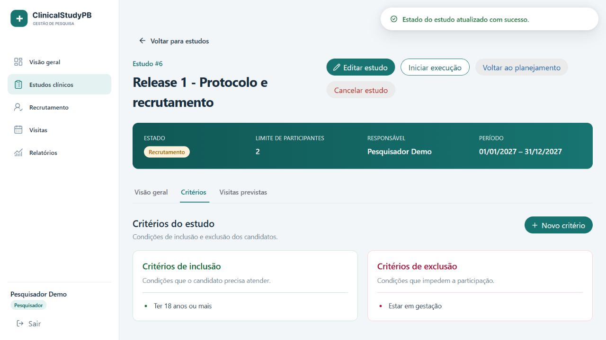
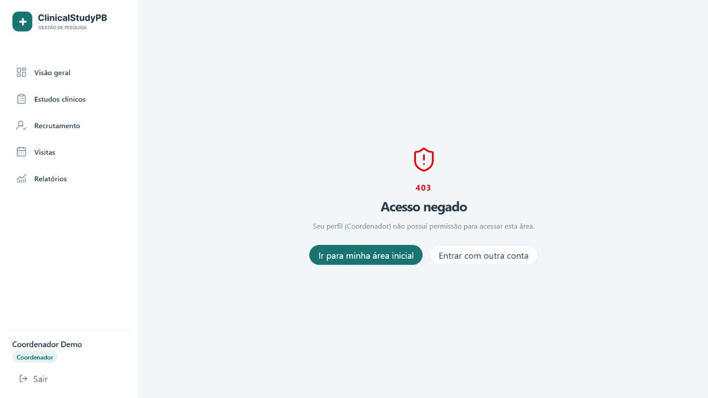

# ClinicalStudyPB

## 1. Projeto, escopo e equipe

ClinicalStudyPB é um sistema acadêmico de gestão de estudos clínicos. A Release 1 reúne administração de usuários, autenticação, estudos, protocolo e recrutamento (RF01–RF11), com backend Java, aplicação web e estrutura inicial mobile. O consentimento usa exclusivamente dados fictícios e não possui assinatura ou validade clínica/jurídica.

| Integrante | Sprint 1  | Sprint 2  |
| ---------- | --------- | --------- |
| Lívia      | Gerência  | Backend   |
| Lucas      | Backend   | Gerência  |
| Raffael    | Web 1     | Web 1     |
| Allan      | Web 2     | Web 2     |
| Júlio      | Mobile    | Mobile    |
| Júlia      | QA/DevOps | QA/DevOps |

Consulte as [entregas, evidências e pendências da Release 1](releases/release1/README.md), o [processo das duas sprints](releases/release1/processo/README.md), o [índice de releases](releases/README.md) e as [convenções de contribuição](CONTRIBUTING.md). O planejamento e acompanhamento da equipe ficam no [Azure DevOps TEAM5](https://dev.azure.com/engsw2/TEAM5).

## 2. Arquitetura e diagramas

O backend é um **monólito modular em camadas**, executado como uma aplicação Spring Boot. Os módulos `auth`, `users`, `studies`, `criteria`, `visits`, `candidates`, `consent` e `participants` separam `api`, `application`, `domain` e `infrastructure`. `shared` reúne autenticação HTTP, configurações e tratamento de erros comuns. Integrações entre módulos usam os serviços públicos; cada módulo mantém sua persistência interna.

A web e o aplicativo mobile chamam a API REST com JWT; somente o backend acessa o PostgreSQL. O Flyway versiona o esquema (V1–V15) e o Hibernate valida seu mapeamento. O mobile integra login, ativação por código, troca obrigatória de senha, convites com decisão de consentimento, estudos e visitas do participante pelas rotas `/api/auth` e `/api/me`.

| Diagrama        | Visualização no GitHub                                                                                            | Fonte editável                               | PDF                                                  |
| --------------- | ----------------------------------------------------------------------------------------------------------------- | -------------------------------------------- | ---------------------------------------------------- |
| Casos de uso    | [RF01–RF11](docs/diagrams/casos-de-uso.png)                                                                       | [Draw.io](docs/diagrams/casos-de-uso.drawio) | [PDF](docs/diagrams/casos-de-uso.drawio.pdf)         |
| Classes/domínio | [Estudos e protocolo](docs/diagrams/classes.png), [recrutamento](docs/diagrams/classes-recrutamento.png)          | [Draw.io](docs/diagrams/classes.drawio)      | [PDF, 2 páginas](docs/diagrams/classes.drawio.pdf)   |
| Sequência       | [Protocolo e estados](docs/diagrams/sequencia.png), [galeria dos seis fluxos](docs/diagrams/README.md#sequências) | [Draw.io](docs/diagrams/sequencia.drawio)    | [PDF, 6 páginas](docs/diagrams/sequencia.drawio.pdf) |
| Arquitetura     | [Aplicações, módulos e banco](docs/diagrams/arquitetura.png)                                                      | [Draw.io](docs/diagrams/arquitetura.drawio)  | [PDF](docs/diagrams/arquitetura.drawio.pdf)          |


Os arquivos mantêm a notação UML, as cores e o modelo Draw.io preexistentes. O [guia dos diagramas](docs/diagrams/README.md) explica páginas, relações e exportação. O [contrato OpenAPI](backend/openapi.yaml) e o [guia de integração de elegibilidade e participantes](backend/docs/eligibility-integration.md) complementam os diagramas.

## 3. Funcionalidades e demonstração

| Requisitos       | Fluxo e perfil                                                                                                             | Situação na Release 1                                  |
| ---------------- | -------------------------------------------------------------------------------------------------------------------------- | ------------------------------------------------------ |
| RF01–RF03        | Administrador gerencia usuários; login/logout e autorização por perfil protegem as rotas web e HTTP.                       | Backend e web concluídos.                              |
| RF04             | Pesquisador cadastra, consulta e edita seus estudos; coordenador consulta estudos.                                         | Backend e web concluídos.                              |
| RF05–RF07        | Pesquisador responsável cadastra critérios de inclusão/exclusão, configura visitas/atividades e altera o estado do estudo. | Backend e web concluídos.                              |
| RF08–RF10        | Coordenador cadastra candidatos, responde critérios e registra consentimento simulado.                                     | Backend e web concluídos.                              |
| RF11             | Coordenador inclui candidato elegível com consentimento concedido e vaga disponível, com painel de vagas e confirmação.    | Backend e web concluídos.                              |
| Mobile           | Estrutura inicial com navegação Início ↔ Estudos provisórios.                                                              | Escopo inicial concluído; login integrado na Sprint 3. |
| DevOps/Qualidade | Compose, Flyway, carga fictícia e CI de backend, web, E2E e mobile.                                                        | Ambiente e pipeline validados; relatórios na release.  |

O [quadro RF01–RF11 da Release 1](releases/release1/README.md#rastreabilidade-dos-requisitos) identifica implementação, testes e integração de cada tela. Painel e relatórios ainda usam protótipos; essa navegação não constitui evidência de persistência dessas funcionalidades. A tela de visitas consulta a API real, conforme o fluxo da T19.3 abaixo.

O [roteiro da Release 1](releases/release1/README.md#roteiro-de-demonstração) detalha a demonstração por perfil, do cadastro de usuários à inclusão. Para o mobile, confira **ClinicalStudyPB → Ver estudos → Voltar ao início**.





A [galeria de capturas](releases/release1/images/README.md) contém sucesso e erro, ambiente, requisitos e passos de reprodução. A [validação Android](releases/release1/tests/t16-13/README.md) registra a abertura e a navegação confirmadas em dispositivo.

## 4. Stack e pré-requisitos

| Componente          | Versão de referência                                              |
| ------------------- | ----------------------------------------------------------------- |
| Java / Spring Boot  | Java 21 (validação: JDK 21.0.7) / 3.5.16                          |
| Maven Wrapper       | 3.9.9                                                             |
| PostgreSQL          | Imagem `postgres:18` (validação: servidor 18.6)                   |
| Springdoc / OpenAPI | 2.8.17 / contrato em `backend/openapi.yaml`                       |
| Web                 | React 19.3.1, TypeScript 6.0.3, Vite 8.3.5                        |
| Interface web       | HeroUI 3.2.6, Tailwind CSS 4.3.3, Lucide React 1.61.0             |
| Mobile              | Expo 58.0.26, React Native 0.88.1, React 19.3.0, TypeScript 6.0.3 |
| Testes              | JaCoCo 0.8.13, Vitest 5.0.5, Playwright 1.64.1, Jest 30.5.2, Maestro |
| Node.js / npm       | Node 22 no CI; validação com 22.23.4 / npm 10.9.9                 |
| Docker / Compose    | Validação com 29.9.2 / 5.6.1                                      |

As versões Java vêm do `backend/pom.xml` e do Wrapper; as dependências Java transitivas são gerenciadas pelo Spring Boot. As versões JavaScript instaladas são fixadas nos respectivos `package-lock.json`; use `npm ci`. A tag Docker `postgres:18` acompanha correções da série 18, portanto não fixa um patch ou digest.

Instale Git, Docker com Compose e Node.js 22 com npm. Para testes ou execução do backend fora do Docker, instale JDK 21 e configure `JAVA_HOME`. Os testes de integração precisam do Docker ativo para o Testcontainers. Para mobile, tenha um Android com Expo Go compatível com SDK 58, ou Android Studio com SDK/emulador configurados. O Maven é fornecido pelo repositório.

## 5. Instalação e execução

```bash
git clone https://github.com/livdenner/ClinicalStudyPB-project.git
cd ClinicalStudyPB-project
```

Execute os comandos na pasta indicada. Siga a ordem: banco/backend, carga fictícia, Swagger, web e mobile. O `npm test` da raiz não executa os testes das três aplicações. O `.env` é local; não copie bancos, `node_modules` ou `.env` de outra instalação para validar uma instalação limpa.

### Executando com Docker Compose

O arquivo `compose.yaml` sobe o PostgreSQL 18 e o backend. O banco só é acessível pela máquina local (`127.0.0.1`), e o backend fica disponível em `http://localhost:8080`. O `compose.yaml` já informa ao backend a conexão com o banco (`DB_URL`), por isso essa variável não faz parte do `.env`.

**Pré-requisito:** Docker com o Docker Compose instalado.

**1. Crie o arquivo `.env`** na raiz do repositório a partir do modelo (ele não é versionado):

```bash
cp .env.example .env
```

No Windows (PowerShell): `Copy-Item .env.example .env`.

**2. Preencha as variáveis** no `.env`:

| Variável                 | Obrigatória | Descrição                                                                                                                         |
| ------------------------ | ----------- | --------------------------------------------------------------------------------------------------------------------------------- |
| `DB_USER`                | Não         | Usuário do banco. Padrão: `clinicalstudypb`.                                                                                      |
| `DB_PASSWORD`            | Sim         | Senha do banco. Escolha um valor só seu; não coloque no Git.                                                                      |
| `DB_HOST_PORT`           | Não         | Porta do banco na máquina local. Padrão: `15432`.                                                                                 |
| `JWT_SECRET_BASE64`      | Sim         | Chave de assinatura dos JWTs: Base64 de pelo menos 32 bytes aleatórios. Gere com `openssl rand -base64 32`. Mantenha fora do Git. |
| `JWT_EXPIRATION_SECONDS` | Não         | Validade do token em segundos. Padrão: `3600`.                                                                                    |

Sem `openssl`, gere uma chave com o Node.js (também funciona no PowerShell) e copie o resultado para `JWT_SECRET_BASE64` no `.env`:

```bash
node -e "console.log(require('node:crypto').randomBytes(32).toString('base64'))"
```

Substitua os valores de exemplo de `DB_PASSWORD` e `JWT_SECRET_BASE64`; o texto de exemplo da chave não é uma chave válida. Se uma dessas variáveis estiver vazia, o Docker Compose interrompe a execução e informa qual falta.

Se a porta `15432` já estiver ocupada, escolha uma porta livre em `DB_HOST_PORT` antes de iniciar. A porta `8080` deve estar livre para o backend. Os nomes de contêiner definidos no Compose também precisam estar disponíveis. Não remova contêineres ou volumes de outra instalação para contornar um conflito.

**3. Suba a stack** (a primeira execução constrói a imagem do backend):

```bash
docker compose up -d --build
docker compose ps
docker compose logs -f backend
```

O backend só inicia depois que o banco estiver saudável, e o Flyway aplica as migrações na primeira inicialização. Espere o log informar a inicialização da aplicação e confirme o Swagger UI antes de carregar o seed. Use `Ctrl+C` para sair do acompanhamento dos logs; os contêineres continuam ativos.

**4. (Opcional) Carregue os dados de demonstração** (contas, estudos, recrutamento e acompanhamento), depois que o backend tiver iniciado e aplicado as migrações. Os comandos funcionam no bash e no PowerShell:

```bash
docker compose cp backend/dev/. db:/tmp/seed
docker compose exec db psql -U clinicalstudypb -d clinicalstudypb -v ON_ERROR_STOP=1 -f /tmp/seed/seed_demo_users.sql -f /tmp/seed/seed_demo_studies.sql -f /tmp/seed/seed_demo_recruitment.sql -f /tmp/seed/seed_demo_followup.sql
```

Se você alterou `DB_USER`, use o seu valor no lugar de `clinicalstudypb` após `-U`.

**5. Pare a stack:**

```bash
docker compose stop     # para os contêineres e preserva os dados
docker compose down     # remove os contêineres e preserva os dados
docker compose down -v  # remove também o volume e APAGA o banco
```

Para iniciar novamente sem reconstruir a imagem, use `docker compose up -d`. Depois de alterar o código do backend, use `docker compose up -d --build`.

### Banco e usuários de demonstração

As contas abaixo são criadas por `backend/dev/seed_demo_users.sql`, após as migrações. Execute os quatro scripts na ordem do comando anterior. O Flyway aplica V1–V15 e o Hibernate valida o esquema; o [guia do backend](backend/docs/eligibility-integration.md#migrações) descreve a persistência.

| Perfil        | E-mail                               | Senha de demonstração |
| ------------- | ------------------------------------ | --------------------- |
| Pesquisador   | `pesquisador@clinicalstudypb.test`   | `Demo@Clinical2026`   |
| Coordenador   | `coordenador@clinicalstudypb.test`   | `Demo@Clinical2026`   |
| Administrador | `administrador@clinicalstudypb.test` | `Demo@Clinical2026`   |
| Participante  | `participante@clinicalstudypb.test`  | `Demo@Clinical2026`   |
| Candidato com convite pendente | `convite@clinicalstudypb.test` | Sem senha: primeiro acesso no aplicativo com o código `CONVITE-DEMO-2026` |

Essas credenciais são apenas para demonstração e podem ser usadas para obter um token de acesso pelo endpoint de login.

- **Participante:** criada por `seed_demo_users.sql`. `seed_demo_followup.sql` a vincula a uma participação ativa e a um convite aguardando decisão. Com ela é possível demonstrar o aplicativo sem passar pela ativação.
- **Candidato com convite pendente:** conta criada por `seed_demo_followup.sql`, ainda não ativada. O código vale 72 horas a partir da execução do script. Rodar o script de novo renova o prazo enquanto o código não tiver sido usado.
- **Demais candidatos da carga:** usam e-mails `demo-candidate-…@clinicalstudypb.invalid` e não entram no aplicativo.

A carga completa cria **seis estudos**, com visitas, critérios e cenários de recrutamento, incluindo **Higiene do sono em trabalhadores noturnos** e a disputa pela última vaga. Consulte a [tabela de estudos, candidatos e participantes/vagas](releases/release1/README.md#dados-e-seeds). Os scripts são repetíveis e também são verificados por `DemoSeedIntegrationTest` e pela stack E2E.

```text
backend/dev/
├── seed_demo_users.sql
├── seed_demo_studies.sql
├── seed_demo_recruitment.sql
└── seed_demo_followup.sql
```

#### Cenários do acompanhamento e do fluxo do candidato

`seed_demo_followup.sql` usa os estudos e participantes das cargas anteriores. Ele cobre o fluxo do candidato no aplicativo (PBI-17) e RF12 a RF18. Na carga de recrutamento, quem tem decisão de consentimento já ativou a conta, e a decisão fica registrada com o próprio candidato como autor.

| Cenário | Onde | Requisito |
| --- | --- | --- |
| Convite pendente com código conhecido | **Vacina contra influenza em idosos**: Rosa Helena Prates (`convite@…`, código `CONVITE-DEMO-2026`), elegível e com convite `INVITED`. | Primeiro acesso, troca de senha e decisão (RF10) |
| Participante ativo com senha definida | `participante@…`. Incluída em **Controle glicêmico no diabetes tipo 2**, com convite aguardando decisão (`CONSENT_PENDING`) na vacina. | RF10, RF17 e RF18 no aplicativo |
| Aceite e recusa do candidato | Vacina: Conceição Alves Prado (`GRANTED`) e Elza Martins Teixeira (`DECLINED`). Higiene do sono: Vera Lúcia Fonseca e Wilson Barbosa Leite aceitaram e disputam a última vaga. | RF10 e RF11 |
| Visita agendada | Diabetes: Irene e Participante Demo (acompanhamento de 3 meses) e João (avaliação inicial remarcada após a ausência). | RF12 |
| Realizada com resultados | Diabetes: avaliação inicial de Irene, Lúcia e Participante Demo, com hemoglobina glicada e orientação nutricional registradas. | RF13 e RF14 |
| Ausente | Diabetes: avaliação inicial de João Batista Freitas. | RF13 |
| Cancelada | Diabetes: acompanhamento de 3 meses de João, cancelado pelo coordenador com justificativa. | RF13 |
| Retirada | Diabetes: Lúcia Mendes Araújo, retirada em 10/11/2026. A visita futura foi cancelada com a nota "Retirada do participante". | RF15 e RF16 |

O roteiro abaixo usa apenas a carga, sem preparar dados à mão. Onde a tela ainda não foi integrada, o passo é feito pelo [Swagger UI](http://localhost:8080/swagger-ui/index.html), com o token da conta indicada em "Authorize".

| Passo | Conta | Onde | O que fazer e conferir |
| --- | --- | --- | --- |
| 1 | Coordenador | Web, **Recrutamento** | Na vacina, confira as situações Convidado, Aceitou, Recusou, Aguardando decisão e Incluído. Em **Higiene do sono**, inclua Vera ou Wilson na última vaga. A segunda inclusão é recusada por falta de vaga. |
| 2 | `convite@…` | Aplicativo (ou Swagger) | No app, faça o primeiro acesso com o código `CONVITE-DEMO-2026`, defina a senha e decida o convite em **Ver convites** (pela API, `GET /api/me/invitations` e `POST /api/me/invitations/{candidateId}/decision`). Na web, use **Atualizar lista** e veja a nova situação. |
| 3 | `participante@…` | Aplicativo (ou Swagger) | No app, abra **Ver estudos** (estudo de diabetes, RF17), **Ver visitas** (uma visita em **Próximas** e uma em **Histórico**, RF18) e **Ver convites** (convite da vacina, RF10); passo a passo em [mobile/README.md](mobile/README.md#roteiro-de-demonstração). Pela API, os endpoints equivalentes são `GET /api/me/studies`, `GET /api/me/visits` e `POST /api/me/invitations/{candidateId}/decision`. |
| 4 | Coordenador | Web, **Visitas** | No estudo de diabetes, filtre por **Situação** e confira os quatro desfechos. Registre o desfecho da visita remarcada de João. A visita de Lúcia aparece cancelada pela retirada. Pela API, o mesmo filtro é `GET /api/studies/{studyId}/visits?status=…`, e o registro é `POST …/visits/{visitId}/outcome` com `If-Match`. |
| 5 | Pesquisador | Web, **Visitas** | Em **Ver resultados**, confira os resultados da avaliação inicial de Irene. Em **Registrar resultados**, registre os da visita realizada no passo 4. Pela API, são `GET …/visits/{visitId}/results` e `PUT …/results/{activityId}`. |

O histórico do participante (RF15) já está na API desde a T21.1 (PR #103). No Swagger, `GET …/participants/{participantId}/history` mostra, para Lúcia, a inclusão, as visitas com resultados e a retirada. A tela da web para esse histórico ainda está em revisão no PR #119.

`DemoSeedIntegrationTest` executa os quatro scripts em PostgreSQL real e confere três pontos: a repetição sem duplicar dados, as regras da API (resultado só em visita realizada, retirada cancelando as visitas futuras e decisão com autoria do candidato) e a leitura pelos endpoints do coordenador e do aplicativo.

### Variáveis das aplicações cliente

| Arquivo modelo                             | Variável                   | Uso                                                                                                                                                                                      |
| ------------------------------------------ | -------------------------- | ---------------------------------------------------------------------------------------------------------------------------------------------------------------------------------------- |
| [web/.env.example](web/.env.example)       | `VITE_API_BASE_URL`        | Deixe vazia em desenvolvimento para usar `/api` pelo proxy Vite; para outra API, informe a origem sem `/api` (ex.: `http://localhost:8080`), pois os serviços já acrescentam `/api/...`. |
| [mobile/.env.example](mobile/.env.example) | `EXPO_PUBLIC_API_BASE_URL` | Base da API usada pelo aplicativo, terminada em `/api`; exemplo no emulador Android: `http://10.0.2.2:8080/api`. No telefone físico, use o IPv4 da máquina na rede. |

São configurações públicas do aplicativo cliente: nunca coloque chaves privadas ou senhas nessas variáveis. Os modelos ficam versionados; arquivos `.env` e a chave JWT ficam fora do Git. O aplicativo exige a API em execução para autenticação, ativação por código e telas do participante.

### Aplicação web

A aplicação web fica em `web/` e usa React com TypeScript, Vite, Tailwind CSS, HeroUI e Lucide React. Para executá-la localmente, use:

```bash
cd web
npm ci
npm run dev
```

Mantenha o terminal aberto e acesse o endereço exibido pelo Vite, normalmente `http://localhost:5173`. O proxy de desenvolvimento encaminha `/api` para `http://localhost:8080`; inicie o backend antes de testar o login. Use uma das [contas fictícias](#banco-e-usuários-de-demonstração).

No PowerShell, use `npm.cmd` se a política de execução impedir o uso de `npm.ps1`. Os comandos de validação estão na [seção de testes](#6-testes-cobertura-e-qualidade).

### Aplicativo mobile

Copie `mobile/.env.example` para `mobile/.env` e confirme `EXPO_PUBLIC_API_BASE_URL` (o padrão `http://10.0.2.2:8080/api` já atende o emulador Android; no telefone físico, use o IPv4 da máquina). Com o backend e as 4 seeds em execução, abra outro terminal na raiz do repositório:

```bash
cd mobile
npm ci
npm run android
```

No Windows (PowerShell), use `npm.cmd run android`. Para usar em telefone Android com o **Expo Go** (compatível com **Expo SDK 58**), conecte o celular à mesma rede Wi-Fi, ajuste o IPv4 em `mobile/.env` e rode `npm start` (ou `npm.cmd start`).

O app aceita apenas contas de participante: entre em **Primeiro acesso? → Ativar conta** com `convite@clinicalstudypb.test` e o código `CONVITE-DEMO-2026` (seguido de troca obrigatória de senha e decisão de convite), ou entre direto com `participante@clinicalstudypb.test` e `Demo@Clinical2026` para consultar estudos e visitas. Siga o guia completo no [README mobile](mobile/README.md), o [roteiro passo a passo no aplicativo](mobile/README.md#roteiro-de-demonstração), as [mudanças de configuração do Expo](mobile/README.md#configuração-do-expo-e-mudanças-registradas) e os [testes E2E com Maestro](mobile/README.md#testes-e2e-maestro). Execute também os [testes e a verificação de compatibilidade](#6-testes-cobertura-e-qualidade).

### Backend fora do contêiner (alternativa)

Inicie somente o banco com `docker compose up -d db`. Exporte no terminal `DB_URL=jdbc:postgresql://localhost:15432/clinicalstudypb`, `DB_USER`, `DB_PASSWORD` e `JWT_SECRET_BASE64` com os valores do seu `.env` (ajuste a porta se mudou `DB_HOST_PORT`). O Spring Boot iniciado pelo Maven não lê automaticamente o `.env` da raiz. Na pasta `backend/`, execute `./mvnw spring-boot:run`, ou `.\mvnw.cmd spring-boot:run` no PowerShell, e mantenha esse terminal aberto. Não execute simultaneamente outro backend na porta 8080.

O [relatório de instalação limpa](releases/release1/tests/t16-13/README.md) registra os comandos conferidos, as migrações V1–V10, a repetição dos seeds e a navegação Android.

### Cadastro de candidatos na Sprint 3 (T17.6)

Em `/recrutamento`, o coordenador informa nome, e-mail, telefone e idade inteira entre 1 e 130 anos. Todos os campos são obrigatórios. O telefone recebe uma máscara simples quando é informado com DDD no formato brasileiro; números internacionais com `+` continuam aceitos conforme o contrato. O cadastro usa `POST /api/studies/{studyId}/candidates` e apresenta os erros gerais e de campo recebidos da API sem substituir suas mensagens.

A confirmação distingue **Vinculado a conta existente** de **Convite emitido**. Um e-mail de participante ativo é vinculado ao estudo; uma conta nova ou com ativação pendente recebe um código. A mesma conta não pode ter duas candidaturas não canceladas no mesmo estudo. E-mail existente em outro estudo não é, por si só, um erro.

O código de ativação é um **recurso de demonstração**, apresentado somente ao coordenador na confirmação do cadastro, com opção de copiar e horário de validade. Ele fica apenas na confirmação aberta, não é salvo em armazenamento do navegador nem mantido na listagem, e é descartado ao fechar. O candidato usa o e-mail e o código no primeiro acesso; o backend só consome o código quando a definição da senha é concluída. A validade é de 72 horas, conforme o OpenAPI. Não há envio por e-mail nesta etapa.

O formulário usa o modal acessível já adotado no Web, com foco inicial, navegação por teclado, erros associados aos campos e apresentação responsiva. Os novos cenários automatizados do cadastro e do convite pertencem à T17.8; o andamento posterior do convite e da decisão pertence à T17.7. A validação completa no aplicativo depende da integração mobile da T17.9.

**Critério de aceite pendente — aplicativo (T17.9):** usar o e-mail e o código exibido no cadastro para definir a senha pelo aplicativo; em seguida, tentar reutilizar o mesmo código e confirmar sua rejeição. A validação direta pela API não substitui essa verificação pela interface mobile.

### Acompanhamento dos candidatos na Sprint 3 (T17.7)

Em `/recrutamento`, a coluna **Situação** apresenta diretamente o `status` recebido da API: Convidado (`INVITED`), Conta ativa (`ACTIVE`), Aguardando decisão (`CONSENT_PENDING`), Aceitou (`GRANTED`), Recusou (`DECLINED`), Incluído (`INCLUDED`) ou Cancelado (`CANCELLED`, quando retornado pela consulta). A elegibilidade permanece em uma coluna separada. O Web não deduz a situação a partir de cache, da lista de participantes ou do resultado de uma avaliação.

Na Sprint 3, o coordenador não registra nem reverte consentimento: a decisão é exclusiva do candidato autenticado no aplicativo e é final. O formulário antigo e sua chamada `PUT /api/studies/{studyId}/candidates/{candidateId}/consent` foram retirados do fluxo Web. A própria lista de candidatos já fornece `status` e `consentStatus`, sem consultas individuais de consentimento ou armazenamento local da decisão.

A ação **Incluir participante** aparece somente com `status=GRANTED`, `consentStatus=GRANTED` e `eligibilityStatus=ELIGIBLE`. Ela permanece desabilitada fora de `RECRUITMENT`, sem vagas ou enquanto a consulta de vagas não estiver disponível. Candidatos que recusaram, foram cancelados ou já foram incluídos não recebem essa ação; o backend mantém suas validações transacionais e rejeita inclusão sem aceite com HTTP 409.

O botão **Atualizar lista** consulta novamente candidatos e participantes do estudo selecionado. Recarregar a página também consulta os dados atuais, incluindo a decisão registrada no app. Após avaliação, a lista é buscada novamente; após inclusão, candidatos e painel de vagas são recarregados pela API. Participantes retirados continuam na contagem de vagas, conforme o contrato. Não há notificações nesta sprint.

O coordenador também pode **Cancelar candidatura**, somente em estudo `RECRUITMENT` e antes de `INCLUDED` ou `CANCELLED`. A confirmação exige motivo de 1 a 500 caracteres, desconsiderando espaços nas extremidades, e envia `POST /api/studies/{studyId}/candidates/{candidateId}/cancellation` com `{ "reason": "..." }`. Enquanto o envio está em andamento, o formulário impede nova confirmação e fechamento. O cancelamento preserva o histórico; a saída de quem já foi incluído pertence ao fluxo de retirada do participante.

Após sucesso, candidatos e painel de vagas são consultados novamente. A opção **Exibir candidaturas canceladas**, desmarcada por padrão, envia `includeCancelled=true` na listagem e permanece respeitada nas recargas após avaliação, inclusão, cancelamento e atualização manual. O filtro inclui os cancelados junto aos demais candidatos; não é uma lista exclusiva de cancelados. Quando retornado pela API, o cancelamento aparece com selo vermelho e motivo. Para corrigir um cadastro após cancelá-lo, use **Novo candidato** e informe os dados corretos; o cadastro e o vínculo de conta continuam sob validação do backend.

Os erros da operação de cancelamento são exibidos com o texto recebido da API. Em HTTP 409, incluindo `CANDIDATE_ALREADY_INCLUDED`, `CANDIDATE_ALREADY_CANCELLED` e `STUDY_NOT_RECRUITING`, o formulário mantém o motivo e consulta novamente candidato e estudo, além de atualizar as listas. Não há reenvio automático. A confirmação fica bloqueada enquanto faltarem dados atuais ou a situação não permitir o cancelamento; se a consulta falhar, o coordenador pode usar **Atualizar dados** na própria confirmação.

O serviço `obterConsentimentoSimulado` e o tipo `ConsentimentoSimuladoApi`, sem uso no fluxo atual, foram removidos. `StatusConsentimentoApi` continua necessário para conferir o aceite retornado na candidatura.

Os testes existentes afetados pelo novo fluxo foram adaptados; os testes do formulário descontinuado foram removidos junto com o componente. Os novos cenários específicos pertencem à T17.8, incluindo validação do motivo, controle de acesso, bloqueios por situação, HTTP 409, atualização das listas e manutenção do filtro de cancelados. Os testes de componente devem simular HTTP, sem chamar a API real. A validação ponta a ponta pelo aplicativo depende da T17.9.

### Agendamento de visitas do participante (T18.4)

Em `/recrutamento`, o painel **Participantes e vagas do estudo** oferece **Ver visitas** aos perfis autorizados para consulta e **Agendar** ao coordenador, somente para participantes `ACTIVE` em estudo `RECRUITMENT` ou `EXECUTION`. Participantes `WITHDRAWN` são identificados como retirados, mantêm o histórico consultável e continuam ocupando vaga; não recebem a ação de agendamento.

O formulário contém apenas visita prevista e data/hora, com o participante e o estudo identificados. As opções vêm de `GET /api/studies/{studyId}/planned-visits`. A data informada é interpretada em `America/Fortaleza` e enviada como instante ISO 8601 em `POST /api/studies/{studyId}/participants/{participantId}/visits`, independentemente do fuso do computador. O período do estudo é exibido como orientação; as regras de data futura, período e duplicidade são validadas pela API.

A agenda usa `GET /api/studies/{studyId}/participants/{participantId}/visits`, com horários em Fortaleza e filtro por situação: Agendada (`SCHEDULED`), Realizada (`DONE`), Ausente (`ABSENT`) ou Cancelada (`CANCELLED`). Após HTTP 201, a resposta confirmada é adicionada à lista em ordem cronológica, sem recarregar a página; o filtro volta para todas as situações para apresentar o novo registro.

Erros da API, inclusive HTTP 400 e 409, são exibidos no formulário com o texto recebido e sem limpar a visita ou a data/hora preenchida. Agendamentos `SCHEDULED` ou `DONE` bloqueiam outro para a mesma visita prevista e participante; `ABSENT` e `CANCELLED` permitem novo agendamento. O registro dos desfechos segue o fluxo próprio de RF13.

Os testes Web da T18.5 verificam formulário, mensagens literais, atualização da lista, filtros e restrições de agendamento, com HTTP simulado e dados fictícios. A [matriz de rastreabilidade RF12](docs/tests/rastreabilidade-agendamento-web.md) relaciona os casos aos arquivos. O comando `npm run test:coverage` exige pelo menos 81% de linhas individualmente nos três novos componentes, e seus resultados integram o relatório do PBI-25.

### Lista de visitas e registro de desfechos (T19.3)

Em `/visitas`, coordenador e pesquisador autorizado consultam as visitas agendadas do estudo selecionado. A listagem usa `GET /api/studies/{studyId}/visits`, com os filtros `status` e `participantId` enviados à API. Cada linha mostra participante, visita prevista, horário em Fortaleza e situação, sem repetir os dados do estudo. Participantes retirados permanecem disponíveis para consulta do histórico.

Somente o coordenador pode registrar **Realizada**, **Ausente** ou **Cancelar**, e as ações aparecem apenas para visitas `SCHEDULED` em estudos que permitem alterações. Estudos `CLOSED` ou `CANCELLED` ficam em consulta. Cada ação abre uma confirmação; o cancelamento exige justificativa não vazia de até 500 caracteres. O formulário bloqueia novo envio enquanto aguarda a resposta.

O registro usa `POST /api/studies/{studyId}/participants/{participantId}/visits/{visitId}/outcome`, com `If-Match` contendo a versão da própria visita entre aspas. Após sucesso, a resposta da API atualiza a linha e o feedback sem recarregar a página. As ações de desfecho desaparecem quando ele é final; se o novo estado não corresponder ao filtro escolhido, a linha deixa a lista filtrada.

A nota persistida em `outcomeNote` é apresentada abaixo do selo de situação nas listas do estudo e do participante. Para visitas canceladas, o texto é identificado como **Justificativa**; nos demais desfechos, como **Observação**. Registros sem nota não exibem esse complemento. O formulário Web solicita o campo somente no cancelamento, como justificativa obrigatória; observações de outros desfechos recebidas da API também podem ser consultadas.

Em HTTP 409, o texto retornado pela API permanece na confirmação e os dados atuais da visita e do estudo são consultados novamente. Não há reenvio automático: uma nova confirmação só é permitida depois da atualização e se a visita ainda estiver agendada e o estudo permitir alterações. Se a consulta falhar, é preciso usar **Atualizar visita** antes de confirmar. Outros erros da API também são apresentados com a mensagem recebida.

As listas do estudo e do participante compartilham as cores semânticas: agendada neutra, realizada verde, ausente amarela e cancelada vermelha. O teste existente da antiga página de visitas foi adaptado para o fluxo real com HTTP simulado. Os novos cenários específicos de desfecho pertencem à T19.4; os resultados das suítes executadas ficam em `docs/test-runs/`.

As evidências finais da implementação inicial, anteriores a esta revisão, estão na [execução completa da Web](docs/test-runs/2026-11-19_00-40_T19-3_completa-final.md) e na [conferência final de navegador com HTTP simulado](docs/test-runs/2026-11-19_00-32_T19-3_navegador-final.md). As execuções intermediárias também são preservadas, conforme as [regras de registro das execuções](docs/test-runs/README.md).

### Resultados fictícios das atividades de uma visita (T20.4)

Em `/visitas`, a ação **Registrar resultados** aparece apenas para visitas `DONE`, para o pesquisador responsável pelo estudo e quando o estudo permite alterações. Coordenadores e demais pesquisadores autorizados podem usar **Ver resultados**, sem editar. Estudos `CLOSED` ou `CANCELLED` ficam em consulta. Participantes retirados continuam com os resultados de suas visitas realizadas disponíveis; a retirada não impede registrar resultados de uma visita já realizada.

Ao abrir o formulário, o Web consulta `GET /api/studies/{studyId}/participants/{participantId}/visits/{visitId}/results` e os dados atuais do estudo. A resposta fornece atividades, ordem do protocolo e resultados existentes. Cada atividade apresenta um resultado obrigatório em texto livre, com até 200 caracteres, e uma observação opcional de até 500 caracteres, recolhida quando vazia para manter o formulário curto. São valores fictícios, sem cálculo automático.

O botão **Salvar resultado** executa um `PUT /api/studies/{studyId}/participants/{participantId}/visits/{visitId}/results/{activityId}` por atividade, criando (HTTP 201) ou substituindo (HTTP 200) o registro. A API é responsável por registrar autor e instante. A resposta confirmada atualiza o resultado e o horário da última gravação; reabrir a visita consulta novamente os dados persistidos. Não há salvamento em lote: cada atividade tem seu próprio feedback e os campos das demais permanecem preenchidos. Ao editar, esvaziar a observação remove a observação anterior, conforme o contrato.

As mensagens gerais e de campo recebidas da API são exibidas no formulário. Em HTTP 403, 404 ou 409, os dados da visita, atividades e estudo são consultados novamente sem repetir o `PUT`. Rascunhos de atividades que continuam no protocolo são preservados. Se a atualização falhar, novas gravações ficam bloqueadas até **Atualizar dados** ter sucesso; se o estudo ou a visita não permitirem mais alterações, o formulário passa a consulta. Um erro de atividade removida permanece visível no modal, mesmo após a atualização da lista. Gravações simultâneas e fechamento durante uma gravação são bloqueados na interface.

Os campos não salvos são descartados ao fechar o formulário. A interface usa as cores semânticas do PBI-24 e os botões de criação já adotados na Web. O teste existente da página foi adaptado para a opção de consulta após o desfecho; os novos cenários específicos de resultados pertencem à task de testes Web correspondente. Testes, lint e build desta implementação devem ser executados na pasta `web/` do worktree da T20.4.

### Testes Web de candidatos, desfechos e resultados (T17.8, T19.4 e T20.5)

As três tasks de testes são reunidas em uma branch própria a partir da `development`, com HTTP simulado e dados fictícios. A [matriz de rastreabilidade](docs/tests/rastreabilidade-candidatos-desfechos-resultados-web.md) relaciona cenários, requisitos e arquivos para o PBI-25.

As suítes existentes de elegibilidade e recrutamento foram preservadas e ampliadas. `ConsentimentoSimulado.test.tsx` foi recuperado e adaptado ao fluxo atual: a Web consulta a decisão do candidato e não registra nem reverte consentimento. Cadastro, convite, cancelamento e filtro de cancelados, desfechos com confirmação/conflito e resultados por atividade possuem cobertura própria. O controle exige 81% de linhas individualmente nos componentes abrangidos e mantém os limites de agendamento existentes. A confirmação desse percentual depende da execução de `npm run test:coverage -- --maxWorkers=2`.

Executar testes, lint e build em `web/` do worktree da branch de testes. O relatório JSON continua alimentando o PBI-25; as evidências locais devem seguir `docs/test-runs/README.md`. A preparação dos testes não representa uma execução aprovada.

### Sessão por aba (T24.4)

Agora dá para usar perfis diferentes em abas do mesmo navegador. A sessão fica no `sessionStorage`: recarregar mantém o login, mas sair ou deixar a sessão expirar afeta apenas aquela aba. Depois da expiração, é preciso entrar novamente.

Para testar, entre como administrador em uma aba. Abra outra pelo botão de nova aba do navegador, digite o endereço do sistema e entre como coordenador. Depois, saia de uma delas e confira se a outra continua funcionando, inclusive após recarregar.

Quem estava logado na versão anterior vai precisar entrar novamente. A sessão antiga do `localStorage` é removida, sem apagar os outros dados locais.

Evite duplicar uma aba já autenticada para fazer essa demonstração, pois o navegador pode copiar a sessão inicial. Nesse caso, as sessões ficam independentes depois da cópia.

O teste `web/e2e/auth/tab-session.spec.ts` verifica os dois perfis em abas do mesmo navegador, além da recarga, do logout e da expiração. Para rodar com a stack E2E preparada:

cd web
npm run test:e2e -- e2e/auth/tab-session.spec.ts

## 6. Testes, cobertura e qualidade

### Backend

Na pasta `backend/`, com Java 21 e Docker ativo, execute Checkstyle, testes e verificação da cobertura mínima de 80%:

```bash
./mvnw verify
```

No PowerShell, use `.\mvnw.cmd verify`. O Testcontainers cria um PostgreSQL descartável para os testes de integração. Os relatórios ficam em `backend/target/surefire-reports/` e `backend/target/site/jacoco/index.html`. A construção da imagem Docker pula testes e não substitui essa verificação. A [documentação Java](backend/docs/release1-api.md#documentação-java) tem instruções próprias de geração.

### Web e mobile

Na pasta `web/`:

```bash
npm ci
npm run format:check
npm run lint
npm run test:coverage
npm run build
```

Se houver falha de inicialização dos workers por recursos da máquina, repita `npm run test:coverage -- --maxWorkers=1`. Os relatórios ficam em `web/coverage/index.html`.

Para os E2E existentes, ainda na pasta `web/`, mantenha as portas 18080 e 4173 livres:

```bash
npx playwright install chromium
npm run e2e:stack:up
npm run test:e2e
npm run test:e2e:report
npm run e2e:stack:down
```

No Linux, se faltarem dependências do navegador, use `npx playwright install --with-deps chromium`. O [guia de contribuição](CONTRIBUTING.md#testes-e2e-playwright) detalha o Playwright e os padrões de qualidade. A stack E2E tem banco descartável e backend próprios; não usa o volume do ambiente de desenvolvimento. O Playwright compila e serve a web com proxy para essa API. Os relatórios ficam em `web/playwright-report/` e `web/test-results/`.

Na pasta `mobile/`:

```bash
npm ci
npm run test:report -- --runInBand --coverage
npx tsc --noEmit
npx expo install --check
```

Os testes Jest simulam HTTP sem chamadas reais de rede e exigem cobertura global mínima de **80% de linhas** (`coverageThreshold` em `mobile/package.json`). O relatório JSON e a cobertura ficam em `mobile/test-reports/` e `mobile/coverage/`. Os testes E2E mobile no emulador Android usam **Maestro** contra `compose.e2e.yaml` e estão documentados em [`mobile/README.md`](mobile/README.md#testes-e2e-maestro) e [`docs/tests/rastreabilidade-e2e-mobile.md`](docs/tests/rastreabilidade-e2e-mobile.md). Confira também a abertura real no emulador ou dispositivo; alterações de dependências do Expo devem ser registradas em [`mobile/README.md`](mobile/README.md#configuração-do-expo-e-mudanças-registradas) (histórico inicial no [relatório da T16.13](releases/release1/tests/t16-13/README.md)).

A [CI](.github/workflows/ci.yml) executa backend, web, E2E web e mobile Jest em PRs e pushes para `development` e `main`, publicando artefatos JaCoCo, JUnit, Vitest, Jest e Playwright; o workflow [E2E Mobile](.github/workflows/mobile-e2e.yml) executa o fluxo Maestro no emulador Android e publica `maestro-report`. O JaCoCo exige **80% de linhas no backend** (com as exclusões técnicas declaradas no POM) e o Jest exige **80% de linhas no mobile**; na web, o Vitest verifica a cobertura mínima configurada por componente. Os [resultados versionados da Release 1](releases/release1/tests/README.md) identificam comandos, versão, contagens e evidências da entrega anterior.

## 7. Swagger UI e contrato da API

Com a stack ativa, abra o [Swagger UI local](http://localhost:8080/swagger-ui/index.html) e o [OpenAPI gerado pela aplicação](http://localhost:8080/v3/api-docs). São endereços do ambiente em execução; o GitHub permite acessar o [contrato estático](backend/openapi.yaml) por link relativo.

No PowerShell, ambos devem responder `200`:

```powershell
(Invoke-WebRequest -UseBasicParsing http://localhost:8080/swagger-ui/index.html).StatusCode
(Invoke-WebRequest -UseBasicParsing http://localhost:8080/v3/api-docs).StatusCode
```

Em bash, use `curl -f http://localhost:8080/v3/api-docs`. Se a conexão falhar, consulte `docker compose ps` e `docker compose logs backend`.

Autentique com as credenciais fictícias em `POST /api/auth/login` e use **Authorize** com o JWT retornado. As rotas usam `/api`. Consulte operações, permissões, controle de versão e regras de negócio no [resumo da API](backend/docs/release1-api.md), incluindo `GET/POST /api/studies/{studyId}/criteria` e a inclusão de participantes.

## Retirada de participantes na web (T22.3)

O coordenador pode registrar a retirada no painel de participantes do recrutamento ou na aba Participantes do estudo. A ação aparece apenas para participantes ativos de estudos que não estejam encerrados ou cancelados. O modal pede um motivo de 1 a 500 caracteres e a confirmação. Em caso de falha, o erro da API fica no próprio modal.

Ao confirmar, a resposta da API atualiza o participante na tela, o selo passa para Retirado (neutro) e a ação desaparece. A retirada é definitiva: a vaga continua ocupada, o candidato não pode ser reincluído e o backend cancela as visitas futuras agendadas.

No painel de recrutamento, as ações **Ver visitas**, **Agendar** e **Registrar retirada** compartilham a mesma área do card. **Agendar** aparece apenas para participantes ativos, para o coordenador e em estudos em recrutamento ou execução. Após a retirada, **Agendar** e **Registrar retirada** desaparecem imediatamente, enquanto **Ver visitas** continua disponível para consultar o histórico. A regra é aplicada também na agenda do participante, que impede iniciar novos agendamentos para quem está retirado. Se a retirada ocorrer em outra sessão enquanto o formulário estiver aberto, o erro `PARTICIPANT_WITHDRAWN` da API é exibido sem cadastrar uma nova visita.
