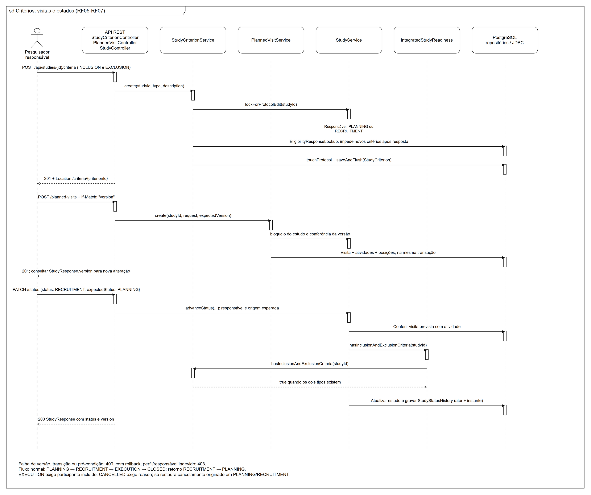

# Diagramas da Release 2

[Voltar ao projeto](../../README.md#2-arquitetura-e-diagramas) · [Contrato OpenAPI](../../backend/openapi.yaml) · [Diagramas da Release 1 (tag `release1`)](https://github.com/livdenner/ClinicalStudyPB-project/tree/release1/docs/diagrams)

Os quatro tipos de diagrama mantêm o modelo Draw.io e a notação UML em preto e branco usados no projeto. Os arquivos `.drawio` são as fontes editáveis; os PDFs incluem todas as páginas; os PNGs permitem leitura direta no GitHub. Amplie a imagem ou abra o PDF para conferir os detalhes. A versão entregue na Release 1 continua disponível na tag `release1`.

| Tipo | Fonte | Exportação |
| --- | --- | --- |
| Casos de uso | [casos-de-uso.drawio](casos-de-uso.drawio) | [PDF](casos-de-uso.drawio.pdf), [PNG](casos-de-uso.png) |
| Classes/domínio | [classes.drawio](classes.drawio) | [PDF, 3 páginas](classes.drawio.pdf), [protocolo](classes.png), [recrutamento](classes-recrutamento.png), [acompanhamento](classes-acompanhamento.png) |
| Sequência | [sequencia.drawio](sequencia.drawio) | [PDF, 7 páginas](sequencia.drawio.pdf), imagens abaixo |
| Arquitetura | [arquitetura.drawio](arquitetura.drawio) | [PDF](arquitetura.drawio.pdf), [PNG](arquitetura.png) |

## Casos de uso

RF01–RF18 são associados aos perfis efetivos. Alterações do protocolo e resultados das atividades pertencem ao pesquisador responsável; candidatos, inclusão, agenda, desfechos e retirada pertencem ao coordenador. Desde a Sprint 3, o próprio candidato ativa a conta e decide o consentimento no aplicativo mobile, alteração aprovada pelo PO; o coordenador apenas consulta a decisão. No aplicativo, o participante também consulta seus estudos (RF17) e suas visitas (RF18).


## Classes e domínio

Nomes de classes, atributos e enums acompanham `backend/src/main/java/clinicalstudypb/` e as migrações V1–V15. As associações representam chaves estrangeiras lógicas: vários módulos armazenam IDs em vez de associações JPA navegáveis. Entidades detalhadas em outra página aparecem como referência, apenas com os atributos usados na relação.

| Página | Conteúdo | Mudanças da Sprint 3 |
| --- | --- | --- |
| 1 | Estudos e protocolo (RF01, RF04–RF07) | `User` ganhou `activationPending` e os métodos de ativação e troca de senha. |
| 2 | Convite, recrutamento, inclusão e retirada (RF08–RF11, RF16) | `CandidateActivationInvite` e conta/cancelamento em `Candidate` (V11), situação e retirada em `Participant` (V13), autor da decisão em `SimulatedConsent` (V14). |
| 3 | Acompanhamento: agenda, desfecho e resultados (RF12–RF14) | `ScheduledVisit` (V12) e `ActivityResult` (V15). |

`PENDING` do consentimento e `CandidateStatus` são situações calculadas pela API, não colunas persistidas. O histórico (RF15) e as rotas `/api/me` (RF17/RF18) são consultas sobre essas tabelas e não têm entidade própria.


## Sequências

As quatro primeiras páginas conservam os fluxos da Release 1. A página 5 foi redesenhada porque o consentimento passou ao candidato, a página 6 registra a situação `ACTIVE` do participante incluído e a página 7 é nova. Retirada (RF16) e resultados (RF14) estão no domínio e nas notas da página 7, sem sequência própria. Chamadas HTTP abreviadas dentro de uma mesma linha de vida agrupam controllers do mesmo fluxo; não representam um novo controller Java. `Repositories / PostgreSQL` resume a persistência interna do módulo.

| Página no PDF | Fluxo | Imagem |
| --- | --- | --- |
| 1 | Autenticação e autorização (RF02–RF03) | [PNG](sequencia-autenticacao.png) |
| 2 | Cadastro de estudo (RF04) | [PNG](sequencia-estudo.png) |
| 3 | Critérios, visitas e estados (RF05–RF07) | [PNG](sequencia.png) |
| 4 | Candidato e elegibilidade (RF08–RF09) | [PNG](sequencia-elegibilidade.png) |
| 5 | Consentimento decidido pelo candidato (RF10) | [PNG](sequencia-consentimento.png) |
| 6 | Inclusão atômica e concorrência (RF11) | [PNG](sequencia-inclusao.png) |
| 7 | Agendamento e desfecho de visitas (RF12–RF13) | [PNG](sequencia-agendamento.png) |




## Arquitetura

Os doze módulos de negócio são executados no mesmo backend. `scheduling`, `results`, `history` e `me` entraram na Sprint 3; `history` e `me` são módulos de consulta, sem tabela própria. Os clientes não acessam o PostgreSQL diretamente. A web e o aplicativo mobile usam HTTP/JSON e JWT; o mobile chama `/api/auth` e `/api/me`.


## Como atualizar e exportar

Abra a fonte no diagrams.net/Draw.io e edite as páginas existentes, preservando a notação, o fundo branco e os nomes do código/contrato. Exporte PDF com **todas as páginas**, corte ao conteúdo e borda; exporte um PNG por página com fundo branco. Mantenha os nomes desta galeria e confira textos, setas e margens após a exportação.

As exportações desta revisão foram produzidas pelo Draw.io Desktop 29.6.1. Exemplo de CLI, adaptando os caminhos:

```bash
draw.io --export --format pdf --all-pages --crop --border 20 --embed-diagram --output classes.drawio.pdf classes.drawio
draw.io --export --format png --page-index 1 --scale 1.4 --border 20 --embed-diagram --output classes.png classes.drawio
draw.io --export --format png --page-index 2 --scale 1.4 --border 20 --embed-diagram --output classes-recrutamento.png classes.drawio
draw.io --export --format png --page-index 3 --scale 1.4 --border 20 --embed-diagram --output classes-acompanhamento.png classes.drawio
```

Nessa versão, `--page-index` inicia em 1 e a opção `--theme` não existe; sem `--transparent`, o PNG já sai com fundo branco. No Draw.io 32.x, acrescente `--theme light`. Mantenha fonte, PDF, PNG e links atualizados no mesmo PR.
