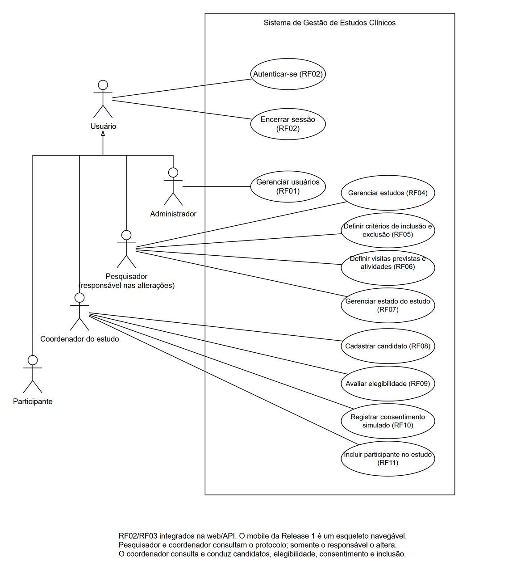
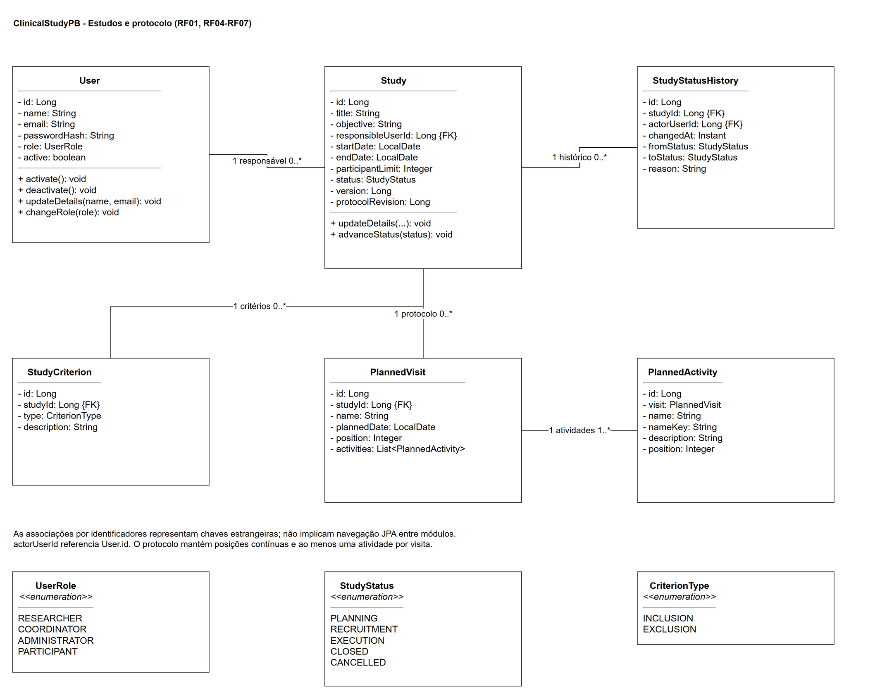
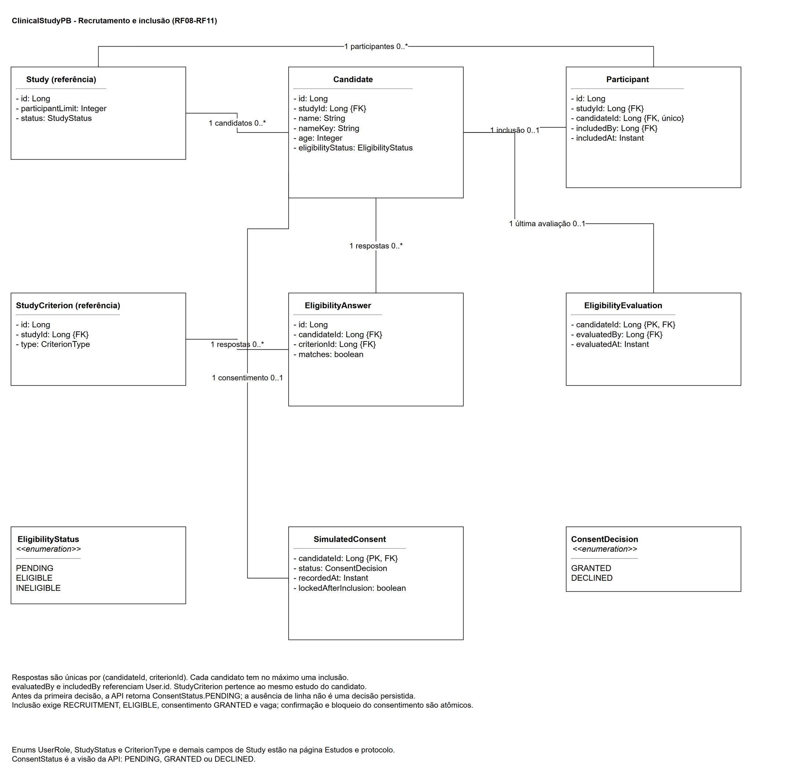
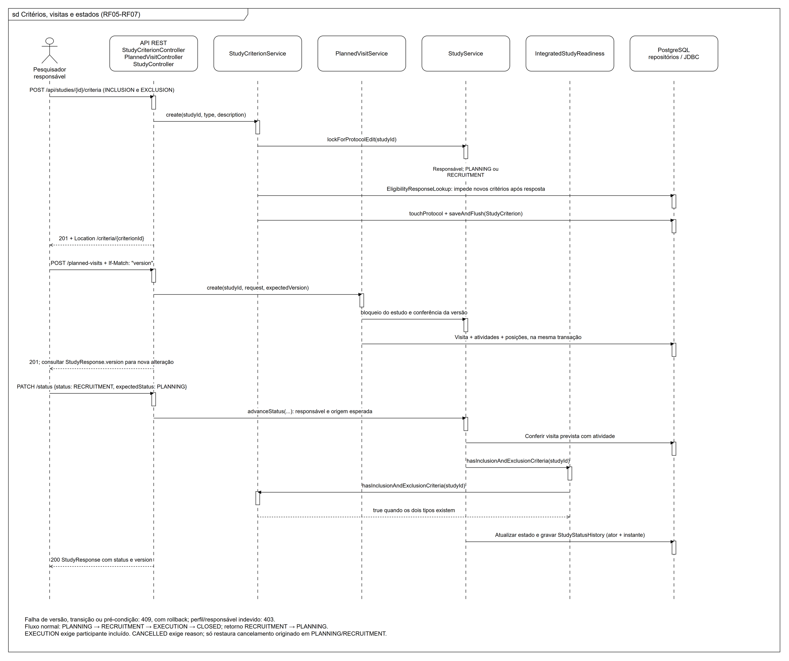
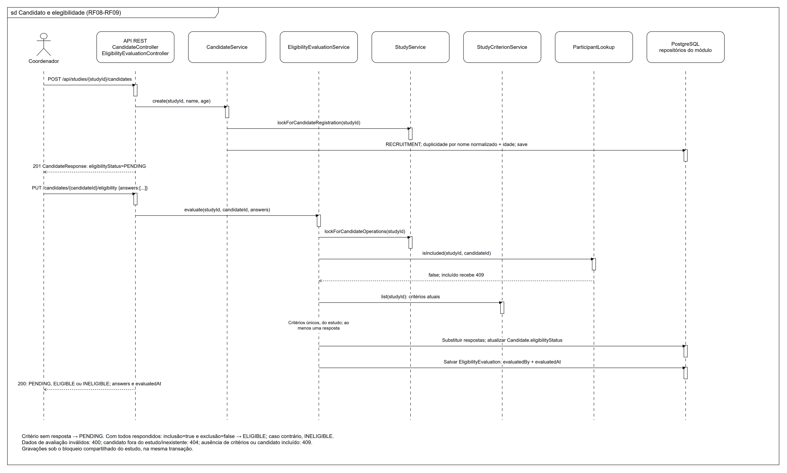
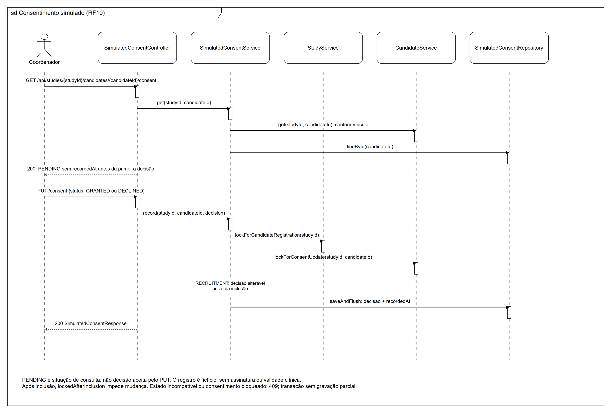
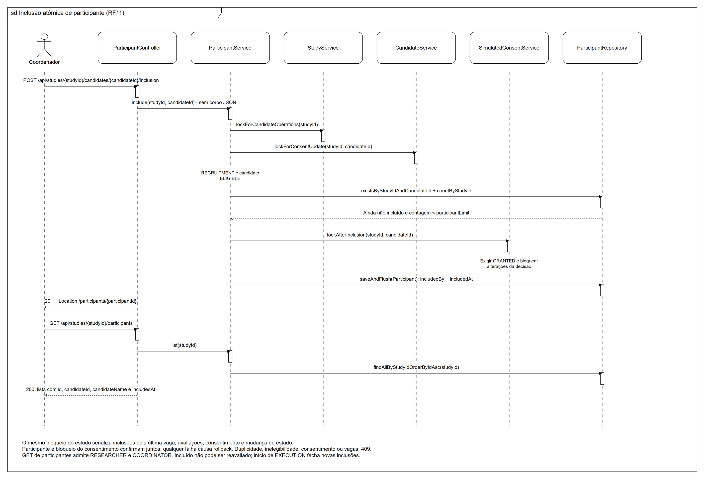
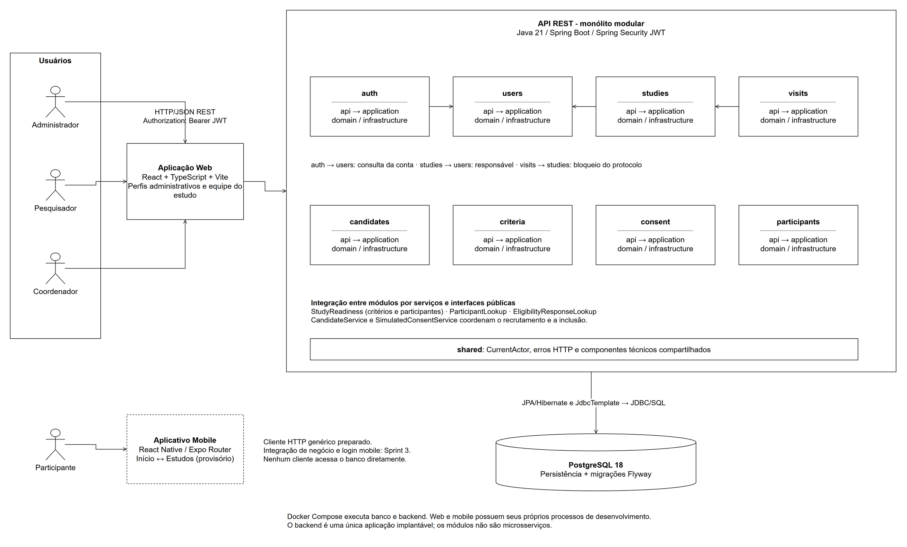

# Diagramas da Release 1

[Voltar ao projeto](../../README.md#2-arquitetura-e-diagramas) · [Contrato OpenAPI](../../backend/openapi.yaml)

Os quatro tipos de diagrama mantêm o modelo Draw.io e a notação UML em preto e branco usados no projeto. Os arquivos `.drawio` são as fontes editáveis; os PDFs incluem todas as páginas; os PNGs permitem leitura direta no GitHub. Amplie a imagem ou abra o PDF para conferir os detalhes.

| Tipo | Fonte | Exportação |
| --- | --- | --- |
| Casos de uso | [casos-de-uso.drawio](casos-de-uso.drawio) | [PDF](casos-de-uso.drawio.pdf), [PNG](casos-de-uso.png) |
| Classes/domínio | [classes.drawio](classes.drawio) | [PDF, 2 páginas](classes.drawio.pdf), [protocolo](classes.png), [recrutamento](classes-recrutamento.png) |
| Sequência | [sequencia.drawio](sequencia.drawio) | [PDF, 6 páginas](sequencia.drawio.pdf), imagens abaixo |
| Arquitetura | [arquitetura.drawio](arquitetura.drawio) | [PDF](arquitetura.drawio.pdf), [PNG](arquitetura.png) |

## Casos de uso

RF01–RF11 são associados aos perfis efetivos. Alterações do protocolo pertencem ao pesquisador responsável; candidatos, avaliação, consentimento e inclusão pertencem ao coordenador. O participante aparece no modelo de atores, mas o mobile desta release é a estrutura inicial navegável.



## Classes e domínio

Nomes de classes, atributos e enums acompanham `backend/src/main/java/clinicalstudypb/` e as migrações V1–V10. As associações representam chaves estrangeiras lógicas: vários módulos armazenam IDs em vez de associações JPA navegáveis. `Study`, `StudyCriterion` e `User` aparecem como referências na segunda página para evitar duplicar o modelo de protocolo. `PENDING` do consentimento é uma situação de consulta da API anterior ao registro, não uma decisão persistida em `ConsentDecision`.





## Sequências

As duas primeiras páginas conservam os fluxos de autenticação e cadastro de estudo. As páginas seguintes detalham os serviços efetivos dos RF05–RF11. Chamadas HTTP abreviadas dentro de uma mesma linha de vida agrupam controllers do mesmo fluxo; não representam um novo controller Java. `Repositories / PostgreSQL` resume a persistência interna do módulo.

| Página no PDF | Fluxo | Imagem |
| --- | --- | --- |
| 1 | Autenticação e autorização (RF02–RF03) | [PNG](sequencia-autenticacao.png) |
| 2 | Cadastro de estudo (RF04) | [PNG](sequencia-estudo.png) |
| 3 | Critérios, visitas e estados (RF05–RF07) | [PNG](sequencia.png) |
| 4 | Candidato e elegibilidade (RF08–RF09) | [PNG](sequencia-elegibilidade.png) |
| 5 | Consentimento simulado (RF10) | [PNG](sequencia-consentimento.png) |
| 6 | Inclusão atômica e concorrência (RF11) | [PNG](sequencia-inclusao.png) |









## Arquitetura

Os oito módulos de negócio são executados no mesmo backend. Os clientes não acessam o PostgreSQL diretamente. A web usa HTTP/JSON e JWT; o mobile inicial está separado da integração funcional prevista para a Sprint 3.



## Como atualizar e exportar

Abra a fonte no diagrams.net/Draw.io e edite as páginas existentes, preservando a notação, o fundo branco e os nomes do código/contrato. Exporte PDF com **todas as páginas**, corte ao conteúdo e borda; exporte um PNG por página com fundo branco. Mantenha os nomes desta galeria e confira textos, setas e margens após a exportação.

As exportações desta revisão foram produzidas pelo Draw.io Desktop 32.6.10. Exemplo de CLI, adaptando os caminhos:

```bash
draw.io --export --format pdf --all-pages --crop --border 20 --theme light --embed-diagram --output classes.drawio.pdf classes.drawio
draw.io --export --format png --page-index 1 --scale 1.4 --border 20 --theme light --embed-diagram --output classes.png classes.drawio
draw.io --export --format png --page-index 2 --scale 1.4 --border 20 --theme light --embed-diagram --output classes-recrutamento.png classes.drawio
```

Nesta versão do exportador, `--page-index` inicia em 1. Mantenha fonte, PDF, PNG e links atualizados no mesmo PR.
