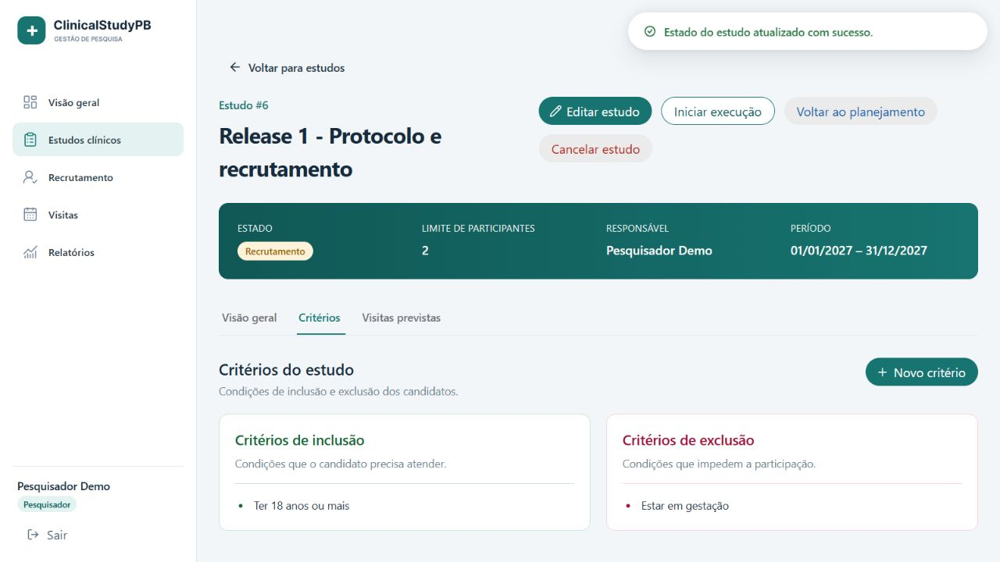
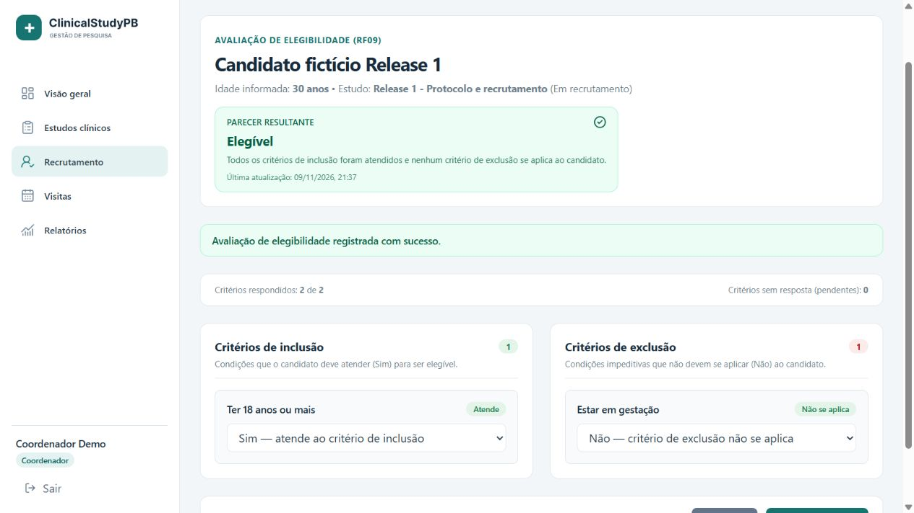
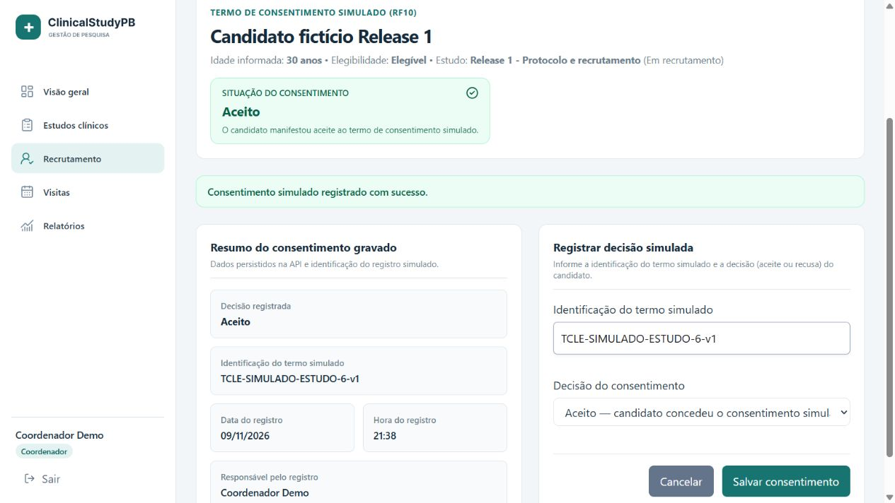
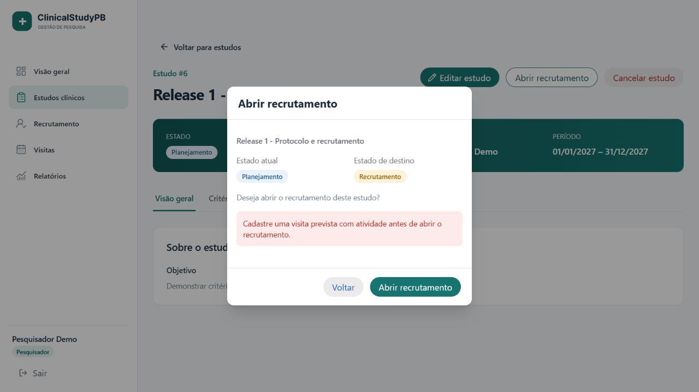
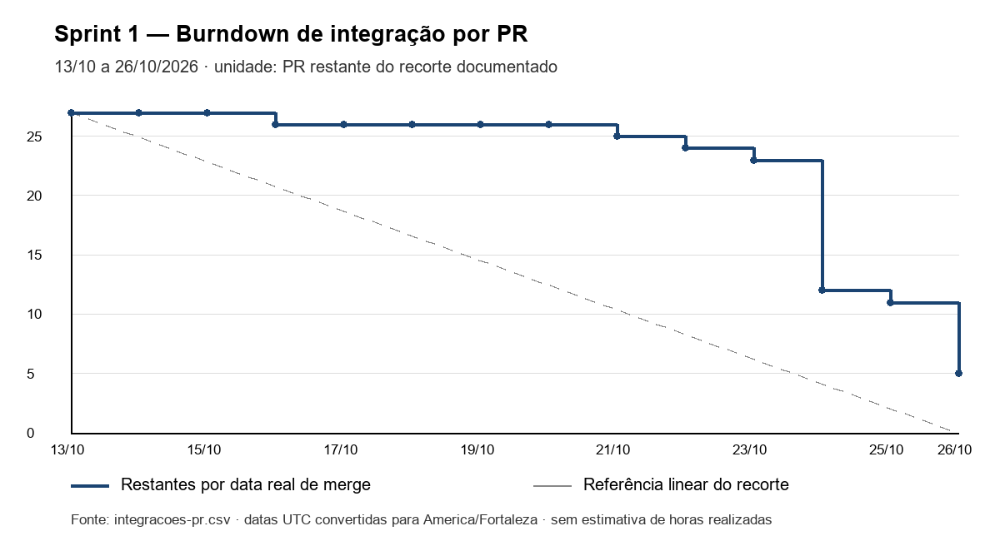
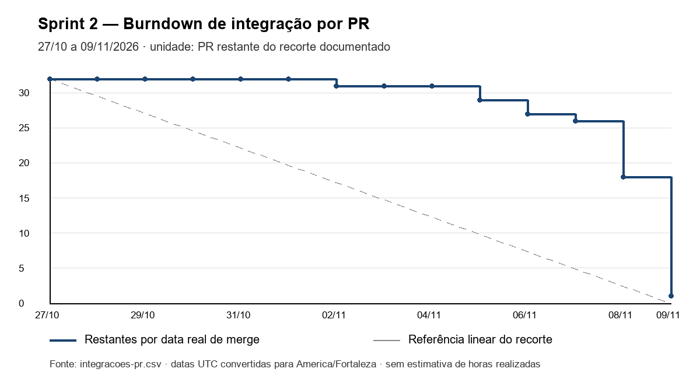

# Release 1 — Estrutura, protocolo e recrutamento

Entrega das Sprints **1 (13–26/10/2026)** e **2 (27/10–09/11/2026)**. Consolidação documental sobre `development` **6ab8cba**, em 09/11/2026 (America/Fortaleza). O projeto usa dados fictícios e consentimento estritamente simulado.

[Instalação e execução](../../README.md#5-instalação-e-execução) · [Diagramas](../../docs/diagrams/README.md) · [OpenAPI](../../backend/openapi.yaml) · [Capturas](images/README.md) · [Testes e cobertura](tests/README.md) · [Instalação limpa — T16.13](tests/t16-13/README.md) · [Processo das sprints](processo/README.md) · [Azure DevOps TEAM5](https://dev.azure.com/engsw2/TEAM5)

## Objetivo e escopo previsto

Disponibilizar a estrutura das três aplicações, usuários/autenticação/autorização, gestão de estudos, protocolo e recrutamento dos **RF01–RF11**. A Sprint 1 estabeleceu infraestrutura e RF01–RF04; a Sprint 2 acrescentou RF05–RF11 e consolidou integração, qualidade e documentação. O mobile permanece uma estrutura navegável, com login integrado previsto para a Sprint 3. RF12–RF22 pertencem às entregas posteriores.

## Rastreabilidade dos requisitos

Situação avaliada na versão acima. **Concluído** indica fluxo disponível no recorte contratado; **parcial** identifica a parte implementada e a integração restante. Dos 11 RF previstos: 10 concluídos e 1 parcial; nenhum RF está inteiramente sem implementação.

| RF | Requisito / situação | Implementação e tela | Evidência e testes | Justificativa ou pendência |
| --- | --- | --- | --- | --- |
| RF01 | Gestão de usuários — **concluído** | API `/api/users`; administrador em `/usuarios`: consulta, cadastro, edição e ativação. | [Sucesso](images/11-usuarios-sucesso.jpg), [validação](images/12-usuario-validacao.jpg); [UserIntegrationTest](../../backend/src/test/java/clinicalstudypb/users/UserIntegrationTest.java), [componentes](../../web/src/pages/usuarios/listagem.test.tsx). | Persistência e e-mail único; operações restritas ao administrador. |
| RF02 | Login/logout — **concluído** | `/api/auth/login`, `/api/auth/logout`, `/login` e sessão web. | [Senha inválida](images/01-login-erro.jpg), [logout](images/13-logout.jpg); [AuthIntegrationTest](../../backend/src/test/java/clinicalstudypb/auth/AuthIntegrationTest.java), [E2E](../../web/e2e/auth/login.spec.ts). | JWT stateless; logout remove token no cliente, sem revogação antecipada no servidor. |
| RF03 | Autorização por perfil — **concluído** | Spring Security, rotas protegidas e menu por perfil. | [403 na web](images/10-permissao-negada.jpg); [matriz HTTP](../../backend/src/test/java/clinicalstudypb/auth/AuthorizationIntegrationTest.java), [ProtectedRoute](../../web/src/components/auth/ProtectedRoute.test.tsx). | API também protege acessos diretos e verifica o responsável do estudo. |
| RF04 | Estudos — **concluído** | `/api/studies`; listagem, cadastro, consulta e edição em `/estudos`. | [Listagem](images/02-estudos-sucesso.jpg); [StudyIntegrationTest](../../backend/src/test/java/clinicalstudypb/studies/StudyIntegrationTest.java), [E2E de cadastro](../../web/e2e/studies/create-study.spec.ts). | Valida datas, responsável e limite; limite não pode ficar abaixo das inclusões existentes. |
| RF05 | Critérios de inclusão/exclusão — **concluído** | `/criteria`; aba Critérios do estudo; cadastro e consulta por tipo. | [Sucesso](images/05-criterios-sucesso.jpg), [erro obrigatório](images/04-criterios-validacao.jpg); [StudyCriterionIntegrationTest](../../backend/src/test/java/clinicalstudypb/criteria/StudyCriterionIntegrationTest.java), [web](../../web/src/pages/estudos/criterios.test.tsx). | Apenas responsável em estado editável; critérios são preservados para auditoria e não admitem acréscimo após respostas de elegibilidade. |
| RF06 | Visitas previstas e atividades — **concluído** | `/planned-visits`; aba Visitas previstas, ordem e atividades do protocolo. | [Visita cadastrada](images/06-visita-sucesso.jpg); [PlannedVisitIntegrationTest](../../backend/src/test/java/clinicalstudypb/visits/PlannedVisitIntegrationTest.java), [web](../../web/src/pages/estudos/visitas-previstas.test.tsx). | Versão do estudo em `If-Match`, posição contínua, atividade mínima e edição conforme estado. |
| RF07 | Estados do estudo — **concluído** | PATCH `/status`, GET `/status-history`; ações e selo na web. | [Protocolo incompleto](images/03-recrutamento-validacao.jpg), [recrutamento aberto](images/05-criterios-sucesso.jpg); [StudyLifecycleIntegrationTest](../../backend/src/test/java/clinicalstudypb/studies/StudyLifecycleIntegrationTest.java), [web](../../web/src/pages/estudos/visualizar.test.tsx). | Pré-condições, cancelamento justificado, restauração e conflitos são validados no backend. |
| RF08 | Candidatos — **concluído** | `/candidates`; coordenador em `/recrutamento`, com filtro por estudo. | [Cadastro](images/07-candidato-sucesso.jpg); [CandidateIntegrationTest](../../backend/src/test/java/clinicalstudypb/candidates/CandidateIntegrationTest.java), [web](../../web/src/pages/recrutamento/recrutamento.test.tsx). | Exige recrutamento; duplicidade por nome normalizado + idade no mesmo estudo. |
| RF09 | Elegibilidade — **concluído** | GET/PUT `/eligibility`; avaliação com critérios de inclusão/exclusão e parecer. | [Elegível após salvar](images/08-elegibilidade-sucesso.jpg); [integração](../../backend/src/test/java/clinicalstudypb/candidates/EligibilityEvaluationIntegrationTest.java), [regras](../../backend/src/test/java/clinicalstudypb/candidates/EligibilityEvaluationServiceTest.java). | Respostas incompletas mantêm `PENDING`; grava autor/instante; incluído não pode ser reavaliado. A tela foi validada na sessão real; não há suíte específica de componentes dessa avaliação nesta base. |
| RF10 | Consentimento simulado — **concluído** | GET/PUT `/consent`; coordenador registra aceite ou recusa. | [Aceite](images/09-consentimento-sucesso.jpg); [SimulatedConsentIntegrationTest](../../backend/src/test/java/clinicalstudypb/consent/SimulatedConsentIntegrationTest.java), [bloqueio após inclusão](tests/rf11-api.json). | Decisão e horário persistem na API; identificação textual do termo e responsável exibido são dados auxiliares da interface. Sem assinatura/validade clínica; sem suíte específica de componentes do consentimento nesta base. |
| RF11 | Inclusão de participante — **parcial** | POST `/inclusion`, GET `/participants`: API com validação atômica, lista e consulta individual. | [Sessão real HTTP](tests/rf11-api.json); [ParticipantIntegrationTest](../../backend/src/test/java/clinicalstudypb/participants/ParticipantIntegrationTest.java), [concorrência](../../backend/src/test/java/clinicalstudypb/participants/ParticipantConcurrencyIntegrationTest.java). | Backend e testes concluídos; T15.3/T15.4 completam ação/lista de inclusão na web e seus testes. A galeria não apresenta uma tela ainda não integrada. |
| Mobile | Estrutura inicial — **concluída no escopo da Release 1** | React Native/Expo Router, telas Início e Estudos provisórias e cliente HTTP genérico. | [Guia mobile](../../mobile/README.md), [Android e testes da T16.13](tests/t16-13/README.md). | Abertura e navegação validadas; login e integração de negócio mobile pertencem à Sprint 3. |
| DevOps/Qualidade | Ambiente, seeds e CI — **concluídos no recorte verificado** | Compose, Flyway V1–V10, três cargas repetíveis e quatro jobs de CI. | [Instalação limpa](tests/t16-13/README.md), [relatórios atuais](tests/README.md), [convenções e E2E](../../CONTRIBUTING.md). | Meta de 80% de linhas backend atendida; ampliação do E2E de recrutamento e fechamento gerencial constam nas pendências. |

As rotas abreviadas acima pertencem ao estudo/candidato informado no [contrato OpenAPI](../../backend/openapi.yaml). O [resumo da API](../../backend/docs/release1-api.md) descreve permissões, estados, concorrência e respostas HTTP. A [sequência de inclusão](../../docs/diagrams/sequencia-inclusao.png) representa o fluxo efetivo do backend.

## Resumo técnico por frente

### Backend

Os RF01–RF11 têm APIs implementadas nos módulos de usuários, autenticação, estudos, critérios, visitas, candidatos, consentimento e participantes. O [contrato OpenAPI](../../backend/openapi.yaml) reúne as operações; o [resumo da API](../../backend/docs/release1-api.md) apresenta as rotas e regras. A inclusão já está integrada: `POST /api/studies/{studyId}/candidates/{candidateId}/inclusion` cria o vínculo e `GET /api/studies/{studyId}/participants` consulta a lista. O [guia de elegibilidade e participantes](../../backend/docs/eligibility-integration.md) explica bloqueios, autoria, consentimento e rollback.

### Web

Os RF01–RF10 possuem interface integrada. Na Sprint 2 entraram [critérios](../../web/src/pages/estudos/criterios.tsx) (RF05), [visitas previstas e atividades](../../web/src/pages/estudos/visitas-previstas.tsx) (RF06), estados do estudo (RF07), [candidatos por estudo](../../web/src/pages/recrutamento/recrutamento.tsx) (RF08), [avaliação de elegibilidade](../../web/src/components/candidatos/AvaliacaoElegibilidade.tsx) (RF09) e [consentimento simulado](../../web/src/components/candidatos/ConsentimentoSimulado.tsx) (RF10). RF11 tem backend e testes prontos, com ação/lista web atribuídas às T15.3/T15.4. A matriz acima e a [galeria](images/README.md) identificam a evidência de cada fluxo.

### Mobile

A entrega é a estrutura inicial navegável, com telas provisórias, cliente HTTP genérico e dois testes existentes. A execução no Android e a navegação de ida/volta estão registradas na [T16.13](tests/t16-13/README.md). O [README mobile](../../mobile/README.md) orienta instalação, execução, configuração pública de API e continuidade na Sprint 3.

### Dados e seeds

Após as migrações V1–V10, execute a carga manual na seguinte ordem, conforme o [comando de instalação](../../README.md#executando-com-docker-compose):

1. [seed_demo_users.sql](../../backend/dev/seed_demo_users.sql): contas fictícias por perfil.
2. [seed_demo_studies.sql](../../backend/dev/seed_demo_studies.sql): seis estudos, visitas, atividades e histórico de estados.
3. [seed_demo_recruitment.sql](../../backend/dev/seed_demo_recruitment.sql): critérios, candidatos, respostas, consentimentos e participantes fictícios.

| Estudo | Estado | Visitas | Candidatos | Participantes / vagas | Para demonstrar |
| --- | --- | --- | --- | --- | --- |
| Adesão ao tratamento da hipertensão arterial | `PLANNING` | 2 | 0 | 0 / 60 | Edição do protocolo e abertura do recrutamento pela API. |
| Vacina contra influenza em idosos | `RECRUITMENT` | 3 | 8 | 2 / 120 | Candidatos em todas as situações de elegibilidade e consentimento; volta para `PLANNING` e cancelamento com justificativa. |
| Higiene do sono em trabalhadores noturnos | `RECRUITMENT` | 1 | 4 | 2 / 3 | Última vaga, com dois candidatos elegíveis e com consentimento concedido. |
| Controle glicêmico no diabetes tipo 2 | `EXECUTION` | 3 | 4 | 3 / 40 | Protocolo bloqueado para edição. |
| Reabilitação motora após AVC | `CLOSED` | 2 | 3 | 3 / 30 | Estado final: nenhuma transição é aceita. |
| Tratamento da asma em crianças | `CANCELLED` | 1 | 2 | 0 / 50 | Restauração para `RECRUITMENT`, o estado de origem. |

`DemoSeedIntegrationTest` executa os três scripts em PostgreSQL real, verifica a repetição sem duplicação e a consistência dos cenários, incluindo a última vaga. Os scripts não são migrações Flyway; são cargas de demonstração executadas após a aplicação do esquema.

### DevOps e qualidade

A [CI](../../.github/workflows/ci.yml) verifica backend, web, E2E e mobile. O [CONTRIBUTING](../../CONTRIBUTING.md) concentra convenções, revisão e o procedimento de E2E Playwright com uma stack isolada. Os [relatórios de testes](tests/README.md) distinguem componentes com HTTP simulado, integração PostgreSQL, concorrência e demonstração real.

## Demonstração e capturas reais

A [galeria](images/README.md) relaciona 13 capturas a RF, pré-condições e passos de reprodução. As imagens foram obtidas com API e PostgreSQL reais e dados fictícios. O estudo da sessão tem critérios dos dois tipos, visita com atividade e recrutamento aberto; o coordenador cadastrou e avaliou um candidato, registrou consentimento e depois o incluiu pela API.

O [README principal](../../README.md#3-funcionalidades-e-demonstração) apresenta os perfis e o acesso inicial. As três cargas `seed_demo_users.sql`, `seed_demo_studies.sql` e `seed_demo_recruitment.sql` criam cenários fictícios e repetíveis, incluindo a disputa pela última vaga. No mobile, a [T16.13](tests/t16-13/README.md) registra abertura no Android físico e navegação de ida/volta confirmadas pelo responsável pelo dispositivo.

### Roteiro de demonstração

Depois da [instalação e carga das contas fictícias](../../README.md#5-instalação-e-execução), siga o roteiro:

1. Administrador: entre na web, abra **Usuários**, cadastre um usuário fictício e confira as validações de campos obrigatórios.
2. Pesquisador: abra **Estudos clínicos**, crie um estudo em planejamento, cadastre critérios dos dois tipos e uma visita com atividade. Abra o recrutamento. A tentativa sem protocolo completo deve apresentar a pendência retornada pela API.
3. Coordenador: em **Recrutamento**, selecione o estudo, cadastre candidato fictício, responda todos os critérios e salve a avaliação. Inclusões devem ser atendidas e exclusões não devem se aplicar para obter `ELIGIBLE`.
4. Registre o consentimento simulado como aceito. Para a inclusão via API, consulte a operação `POST /api/studies/{studyId}/candidates/{candidateId}/inclusion` no Swagger; não há corpo JSON. A listagem usa `GET /api/studies/{studyId}/participants`.
5. Faça logout e tente acessar diretamente uma rota protegida. Uma sessão ausente leva ao login; perfil sem permissão recebe acesso negado.
6. Mobile: abra **ClinicalStudyPB → Ver estudos → Voltar ao início** no Expo Go ou emulador.

## Testes e cobertura

| Verificação | Resultado real | Evidência |
| --- | --- | --- |
| Backend: Checkstyle, JUnit, integração PostgreSQL e JaCoCo | **487 testes aprovados**, cobertura **97,27%** das linhas (891/916); meta 80% atendida | [Log](tests/consolidacao/backend-verify.txt), [suítes](tests/consolidacao/backend-suites.csv), [JaCoCo CSV](tests/consolidacao/backend-coverage.csv) |
| Web: Vitest e cobertura | **166 testes em 21 arquivos**, cobertura de linhas **74,60%** | [Log completo](tests/consolidacao/web-tests.txt) |
| Web: formatação, ESLint, TypeScript e build | Aprovados na exportação LF dos arquivos versionados | [Log](tests/consolidacao/web-quality-build.txt) |
| E2E web: navegador + API + PostgreSQL na CI | **7 testes aprovados** | [Log da CI](tests/consolidacao/ci-e2e.txt) |
| Mobile: Jest e cobertura na CI | **2 testes em 2 suítes**, cobertura de linhas **76,47%** | [Log da CI](tests/consolidacao/ci-mobile.txt) |

O [relatório de testes](tests/README.md) informa versão, ambiente, comandos, cobertura de ramos, exclusões do JaCoCo, tentativa web inicial e limites dos E2E. A meta de 80% é do backend, não das três aplicações em conjunto. A [CI do commit 6ab8cba](https://github.com/livdenner/ClinicalStudyPB-project/actions/runs/42728167544) concluiu seus quatro jobs com sucesso. O [histórico anterior](tests/historico-antes-t16-12.md) preserva as medições das versões anteriores sem misturá-las à tabela atual.

A [validação de instalação limpa da T16.13](tests/t16-13/README.md) e seus logs preservam os resultados do recorte `2c6e854` (450 testes backend e 157 web). A tabela acima apresenta a consolidação posterior em `6ab8cba` (487 backend e 166 web); as duas execuções permanecem identificadas por versão.

## Processo das Sprints 1 e 2

O [documento de processo](processo/README.md) reúne backlog, estimativas, papéis, contribuições com PRs, burndowns de integração com dados diários e revisão de cada sprint. Lívia foi gerente e Lucas backend na Sprint 1; na Sprint 2, Lucas assumiu gerência e Lívia backend. Os demais papéis permaneceram iguais.

Os gráficos usam PRs restantes por data real de merge, com fonte em CSV e definição explícita no processo. Não são apontamentos de horas nem substituem o aceite funcional da matriz RF.

## Pendências e passagem para a próxima entrega

- Integrar a interface de inclusão e lista de participantes e os testes T15.3/T15.4; então atualizar RF11 e acrescentar as capturas correspondentes.
- Ampliar o smoke E2E para protocolo → candidato → elegibilidade → consentimento → inclusão; os sete cenários atuais cobrem principalmente login e cadastro de estudo. Testes específicos de componentes de elegibilidade/consentimento completam a cobertura das novas telas.
- Na interface de consentimento, a identificação do termo é auxiliar/local e o responsável exibido deriva da sessão; a API persiste `status` e `recordedAt`. Não tratar esses rótulos como auditoria persistida do termo ou da autoria.
- A Gerência conclui revisão/integração dos PRs, DoD, tag e GitHub Release `release1` na T16.15. Este documento não declara publicação de tag/release antes desse fechamento.
- Na Sprint 3, integrar login e fluxos mobile. Manter o esqueleto e a navegação já validados; conferir as recomendações de patches compatíveis do Expo registradas na T16.13 antes de alterar o lockfile.

Para a equipe que continuar o projeto, o [README de instalação](../../README.md), os [diagramas editáveis e exportados](../../docs/diagrams/README.md), o [contrato da API](../../backend/openapi.yaml) e os [relatórios versionados](tests/README.md) formam a referência desta entrega.
