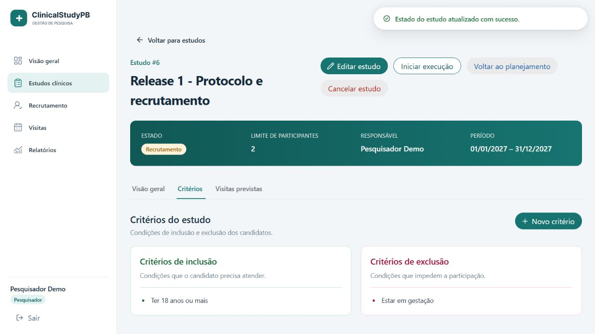
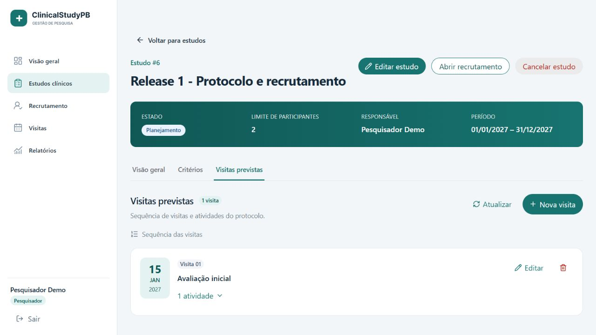
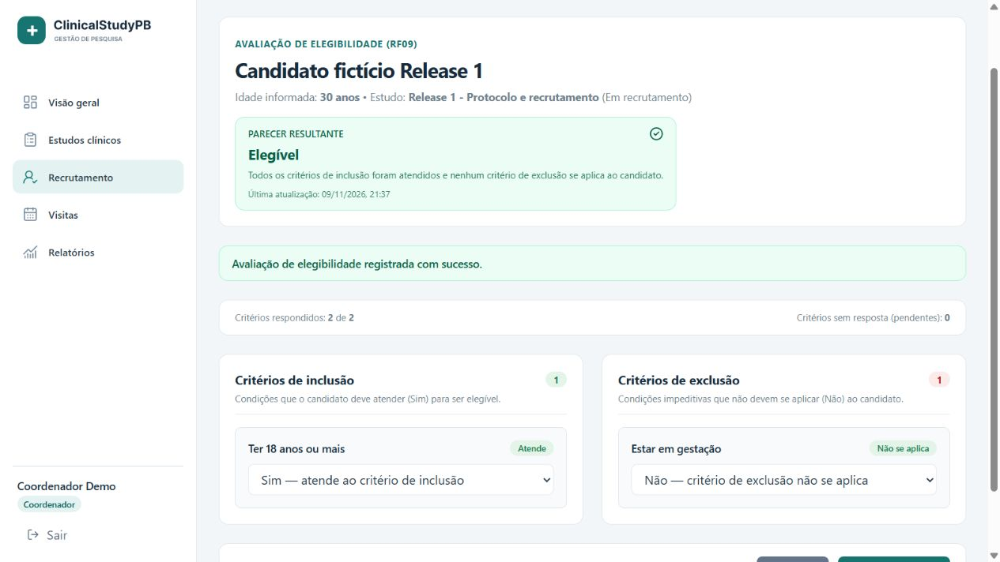
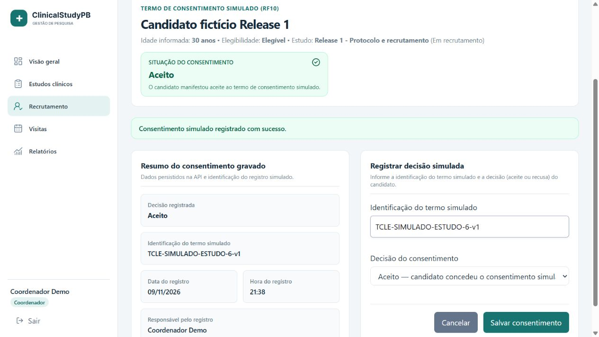
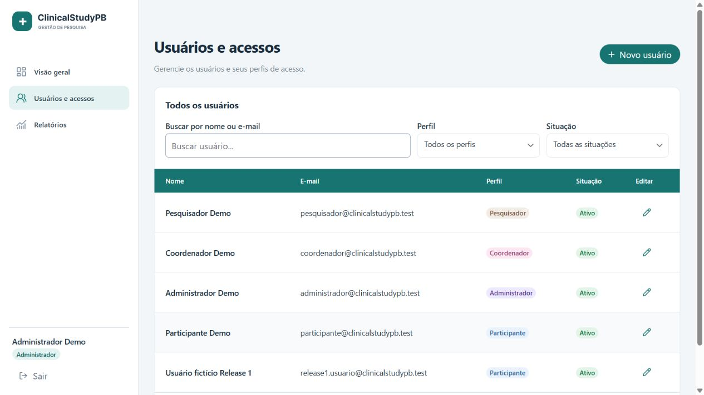
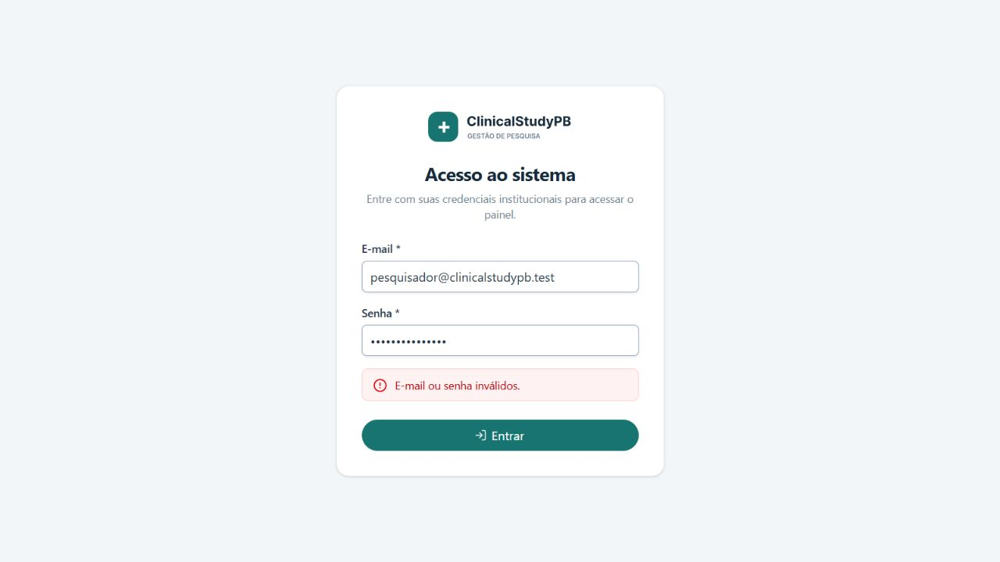
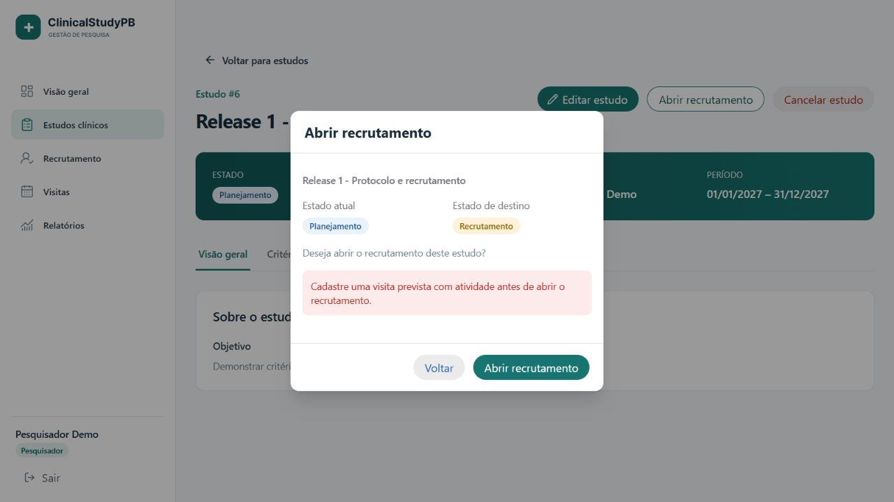
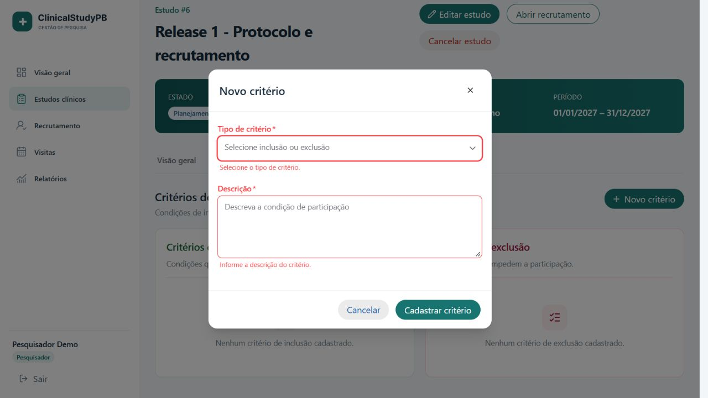
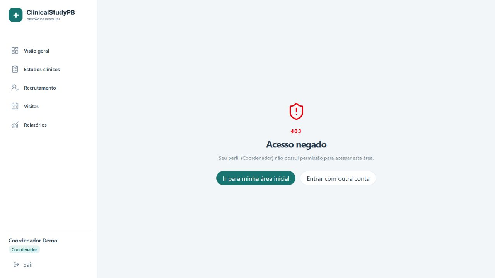
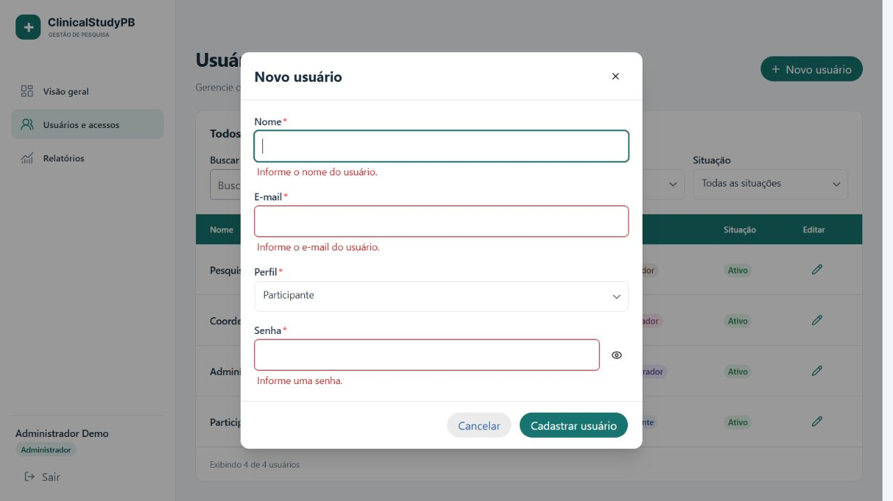

# Capturas web da Release 1

[Voltar à Release 1](../README.md)

Capturas obtidas em 09/11/2026 (America/Fortaleza), no navegador, com a web real, proxy Vite e API Spring Boot/PostgreSQL. Não houve interceptação de respostas HTTP. Dados, contas e termos são fictícios. A web corresponde ao código integrado até `2a83f3d`; o backend de demonstração tem o mesmo código de produção de `6ab8cba`. A carga inicial desta sessão usou os dois seeds da T16.13; o estudo e os registros adicionais foram criados durante a demonstração.

O estudo da sessão é **Release 1 - Protocolo e recrutamento**, limite 2, período 01/01/2027–31/12/2027. O candidato é **Candidato fictício Release 1**, 30 anos. IDs, horários e total de registros variam em uma nova execução. Os arquivos são capturas de viewport, sem montagem ou alteração do conteúdo.

| Evidência | RF | Como reproduzir e resultado |
| --- | --- | --- |
| [01 — Login inválido](01-login-erro.jpg) | RF02 | Enviar senha incorreta; mensagem genérica e permanência no login. |
| [02 — Estudos](02-estudos-sucesso.jpg) | RF04 | Entrar como pesquisador; registros reais retornados pela API na listagem. |
| [03 — Protocolo incompleto](03-recrutamento-validacao.jpg) | RF06–RF07 | Tentar abrir recrutamento sem visita/atividade; bloqueio informado pela API. |
| [04 — Critério inválido](04-criterios-validacao.jpg) | RF05 | Enviar formulário sem tipo/descrição; erros obrigatórios visíveis. |
| [05 — Critérios e estado](05-criterios-sucesso.jpg) | RF05–RF07 | Cadastrar inclusão/exclusão e abrir recrutamento após concluir protocolo; listas e estado atualizados. |
| [06 — Visita e atividade](06-visita-sucesso.jpg) | RF06 | Cadastrar visita Avaliação inicial, 15/01/2027, com atividade Entrevista inicial. |
| [07 — Candidato](07-candidato-sucesso.jpg) | RF08 | Coordenador seleciona estudo em recrutamento e cadastra candidato; parecer inicial pendente. |
| [08 — Elegibilidade](08-elegibilidade-sucesso.jpg) | RF09 | Responder Sim à inclusão e Não à exclusão; salvar e obter Elegível com horário. |
| [09 — Consentimento](09-consentimento-sucesso.jpg) | RF10 | Salvar aceite simulado; decisão e horário persistidos na API; identificação do termo e coordenador são dados auxiliares exibidos pela interface. |
| [10 — Acesso negado](10-permissao-negada.jpg) | RF03 | Coordenador tenta `/usuarios`; página 403. |
| [11 — Usuários](11-usuarios-sucesso.jpg) | RF01 | Administrador cadastra Usuário fictício Release 1; registro aparece na lista. |
| [12 — Usuário inválido](12-usuario-validacao.jpg) | RF01 | Enviar novo usuário sem campos obrigatórios; mensagens de validação. |
| [13 — Logout](13-logout.jpg) | RF02 | Sair da sessão administrativa; formulário de login exibido. |

## Sucesso

## Validações e sessão

RF11 tem evidência de API e testes no [relatório de testes](../tests/README.md). Estas imagens não apresentam uma tela de inclusão ainda não integrada. A navegação mobile foi [validada em Android](../tests/t16-13/README.md), sem captura do dispositivo nesta galeria web.
