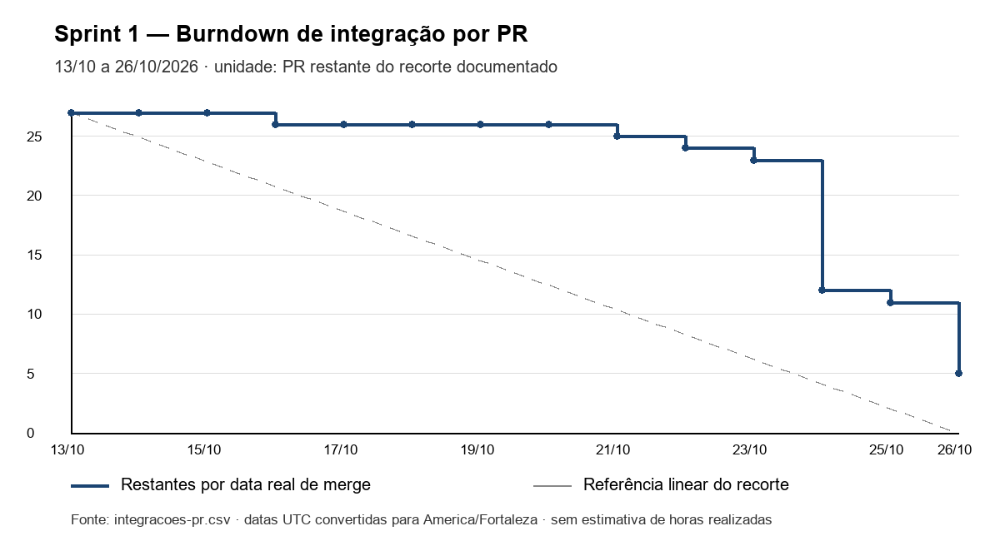
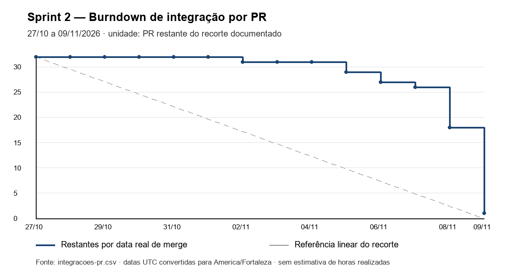

# Processo das Sprints 1 e 2

[Release 1](../README.md) · [Board da equipe no Azure DevOps](https://dev.azure.com/engsw2/TEAM5)

## Planejamento e backlog

| Sprint | Período | Objetivo | Planejamento |
| --- | --- | --- | --- |
| 1 | 13–26/10/2026 | Infraestrutura, estruturas das três aplicações, RF01–RF04 web/API e protótipos | [8 PBIs + cerimônias](backlog-sprint1.csv); [36 tasks e 6 registros de cerimônias](tarefas-sprint1.csv). |
| 2 | 27/10–09/11/2026 | Protocolo e recrutamento RF05–RF11, integração, qualidade e documentação da Release 1 | [8 PBIs + cerimônias](backlog-sprint2.csv), [42 tasks e 6 registros de cerimônias](tarefas-sprint2.csv). |

Os CSVs transcrevem o planejamento fornecido pela equipe: **Sprint 1 - Planning.pdf** e **Sprint2_Planejamento.xlsm**. Horas são estimativas de planejamento, não apontamentos de trabalho realizado. O snapshot da planilha não substitui a situação das entregas na [matriz de requisitos](../README.md#rastreabilidade-dos-requisitos).

| Composição de carga | Sprint 1 | Sprint 2 |
| --- | --- | --- |
| Tasks de implementação | 76 h | 99 h |
| Cerimônias e revisão cruzada | 12 h | 12 h |
| Total de tasks + cerimônias | 88 h | 111 h |
| Reserva | 24 h | 12 h |
| Alocação total planejada | 112 h | 123 h |
| Capacidade informada | 120 h | A confirmar no planejamento fornecido |

## Papéis e contribuições

A mudança confirmada da Sprint 1 para a Sprint 2 foi a troca entre Lívia e Lucas. Os demais papéis foram mantidos.

| Pessoa / GitHub | Sprint 1 | Sprint 2 | Contribuições verificáveis |
| --- | --- | --- | --- |
| Lívia / `livdenner` | Gerência | Backend | Estrutura, autenticação e autorização: PRs [#1](https://github.com/livdenner/ClinicalStudyPB-project/pull/1), [#10](https://github.com/livdenner/ClinicalStudyPB-project/pull/10), [#17](https://github.com/livdenner/ClinicalStudyPB-project/pull/17). Critérios, candidatos, elegibilidade e inclusão: [#40](https://github.com/livdenner/ClinicalStudyPB-project/pull/40), [#38](https://github.com/livdenner/ClinicalStudyPB-project/pull/38), [#52](https://github.com/livdenner/ClinicalStudyPB-project/pull/52), [#56](https://github.com/livdenner/ClinicalStudyPB-project/pull/56). |
| Lucas / `lucrasn` | Backend | Gerência | Estudos e diagramas: [#5](https://github.com/livdenner/ClinicalStudyPB-project/pull/5), [#19](https://github.com/livdenner/ClinicalStudyPB-project/pull/19). Contrato, estados, visitas e consentimento: [#31](https://github.com/livdenner/ClinicalStudyPB-project/pull/31), [#33](https://github.com/livdenner/ClinicalStudyPB-project/pull/33), [#36](https://github.com/livdenner/ClinicalStudyPB-project/pull/36), [#45](https://github.com/livdenner/ClinicalStudyPB-project/pull/45). |
| Raffael / `Raffael-Wagner` | Web 1 | Web 1 | Usuários e estudos: [#21](https://github.com/livdenner/ClinicalStudyPB-project/pull/21), [#24](https://github.com/livdenner/ClinicalStudyPB-project/pull/24). Estados, visitas e critérios: [#41](https://github.com/livdenner/ClinicalStudyPB-project/pull/41), [#44](https://github.com/livdenner/ClinicalStudyPB-project/pull/44), [#59](https://github.com/livdenner/ClinicalStudyPB-project/pull/59). |
| Allan / `allangrm` | Web 2 | Web 2 | Componentes, login, rotas e protótipos: [#3](https://github.com/livdenner/ClinicalStudyPB-project/pull/3), [#16](https://github.com/livdenner/ClinicalStudyPB-project/pull/16), [#23](https://github.com/livdenner/ClinicalStudyPB-project/pull/23), [#26](https://github.com/livdenner/ClinicalStudyPB-project/pull/26). Candidatos, avaliação e consentimento: [#32](https://github.com/livdenner/ClinicalStudyPB-project/pull/32), [#50](https://github.com/livdenner/ClinicalStudyPB-project/pull/50), [#60](https://github.com/livdenner/ClinicalStudyPB-project/pull/60). |
| Júlio / `julioP-dev` | Mobile | Mobile | Estrutura Expo [#14](https://github.com/livdenner/ClinicalStudyPB-project/pull/14), classes [#22](https://github.com/livdenner/ClinicalStudyPB-project/pull/22). Responsabilidade planejada na Sprint 2: T16.10–T16.13 (diagramas, READMEs, evidências e instalação). |
| Júlia / `juliaPamplona` | QA/DevOps | QA/DevOps | Docker, convenções, integração e Playwright: [#8](https://github.com/livdenner/ClinicalStudyPB-project/pull/8), [#13](https://github.com/livdenner/ClinicalStudyPB-project/pull/13), [#29](https://github.com/livdenner/ClinicalStudyPB-project/pull/29), [#30](https://github.com/livdenner/ClinicalStudyPB-project/pull/30). CI, seeds e protocolo: [#46](https://github.com/livdenner/ClinicalStudyPB-project/pull/46), [#55](https://github.com/livdenner/ClinicalStudyPB-project/pull/55), [#58](https://github.com/livdenner/ClinicalStudyPB-project/pull/58). |

Os papéis indicam responsabilidades do plano. A autoria de PR registra quem submeteu a alteração no GitHub; colaboração e revisão podem cruzar os papéis. A T16.13 foi submetida pela conta `livdenner` na [PR #61](https://github.com/livdenner/ClinicalStudyPB-project/pull/61).

## Burndown de integração

Os gráficos abaixo são reconstruídos das datas públicas de merge, com a unidade **PR restante**, para um recorte fixo de entregas de cada sprint. Não são gráficos de horas realizadas ou de aprovação de critérios de aceite. O recorte inclui correções e testes associados ao escopo; PRs substituídas e encerradas sem merge (#6 e #9) são excluídas. Entregas de Sprint 1 integradas depois de 26/10 continuam restantes no fechamento desse gráfico.

O [CSV de integrações](integracoes-pr.csv) explicita cada PR, sprint de escopo, autor, data e link. Para cada data: `restantes = PRs do recorte - PRs com merge até o fim do dia`. As datas UTC do GitHub foram convertidas para America/Fortaleza. A reta cinza é apenas referência linear entre o total e zero; não representa estimativa diária fornecida pela equipe. A extração corresponde ao fechamento documental sobre `6ab8cba`, com a PR #61 ainda aberta.

| Sprint | PRs no recorte | Restantes no último dia | Série para conferência |
| --- | --- | --- | --- |
| 1 | 27 | 5 | [CSV diário](burndown-sprint1.csv) |
| 2 | 32 | 1 | [CSV diário](burndown-sprint2.csv) |

## Revisão da Sprint 1

O incremento reuniu autenticação/autorização, usuários e estudos persistidos, layout e protótipos web, estrutura mobile, Docker e os quatro tipos de diagramas. Os registros de merge mostram concentração das integrações no fim da sprint. Os testes de componentes de estudos e usuários (#27 e #25) foram integrados em 27/10; a consolidação de convenções/CI (#13), E2E (#30) e integração backend (#29) ocorreu depois do período planejado. Essas datas explicam o saldo do gráfico sem atribuir uma data de conclusão fictícia às tasks.

A revisão técnica consolidada preserva a [regressão de usuários e estudos e os resultados históricos](../tests/historico-antes-t16-12.md). O mobile permaneceu inicial, conforme escopo; não se apresenta login integrado como entrega da Sprint 1.

## Revisão da Sprint 2

O protocolo passou a controlar critérios, ordem de visitas/atividades e estados; o recrutamento ganhou candidatos, avaliação persistida, consentimento simulado e inclusão atômica. As [capturas web](../images/README.md) demonstram os fluxos e as validações. Os [relatórios de testes](../tests/README.md) medem a versão consolidada e distinguem testes de componentes, integração PostgreSQL, concorrência e abertura mobile.

Foram incorporadas as correções de limite de participantes (#51), build Docker/Checkstyle (#47), regressão de usuários/estudos (#28) e atualização de permissões e integração do protocolo (#49/#58). A carga de recrutamento/última vaga (#55) permite repetir os cenários sem dados pessoais.

O fechamento funcional e as pendências específicas ficam na [matriz RF01–RF11](../README.md#rastreabilidade-dos-requisitos), incluindo a integração da interface de inclusão. Tag/GitHub Release e integração final dos PRs pertencem à T16.15 da Gerência.

## Aprendizados e ações para a continuidade

Esta síntese deriva de mudanças e verificações registradas no repositório; não atribui falas, reuniões ou decisões de retrospectiva não documentadas.

| Evidência observada | Aprendizado e ação |
| --- | --- |
| Integrações de testes/CI da Sprint 1 ocorreram depois do período planejado. | Integrar testes e ambiente junto de cada fluxo; acompanhar saldo de integração diariamente. |
| API e telas mudaram ao acrescentar estados, versões e permissões. | Conferir contrato OpenAPI antes da integração; preservar cenários de regressão e mensagens de conflito. |
| Inclusão e redução de capacidade disputam a mesma linha de estudo. | Manter bloqueio compartilhado, transação e teste da última vaga; não fazer contagem somente no cliente. |
| Seeds repetíveis e dados fictícios passaram a cobrir recrutamento. | Reutilizar as três cargas na demonstração e testar idempotência e chaves estrangeiras. |
| Instalação limpa e Android foram exercitados pela T16.13. | Manter comandos executáveis no README e validar novamente quando dependências ou Compose mudarem. |

A DoD permanece: revisão por colega, CI verde, ao menos 80% de linhas do backend, critérios demonstráveis, documentação atualizada, autorização/validações e persistência verificadas. As fontes de planejamento e os relatórios históricos não são promovidos a evidência de uma execução atual.
