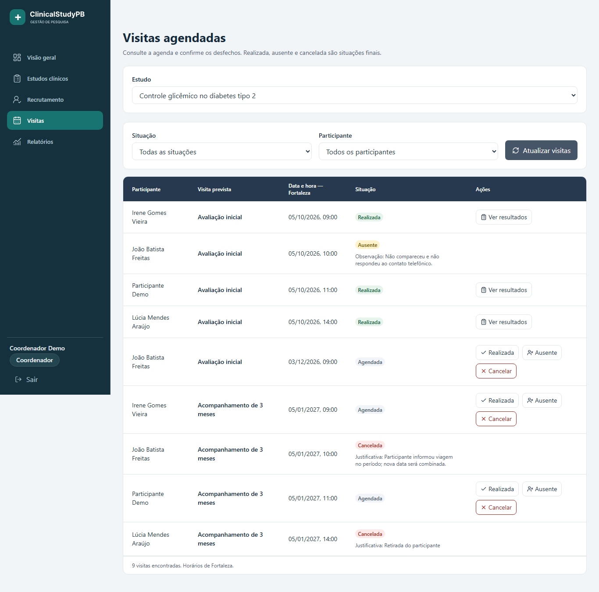
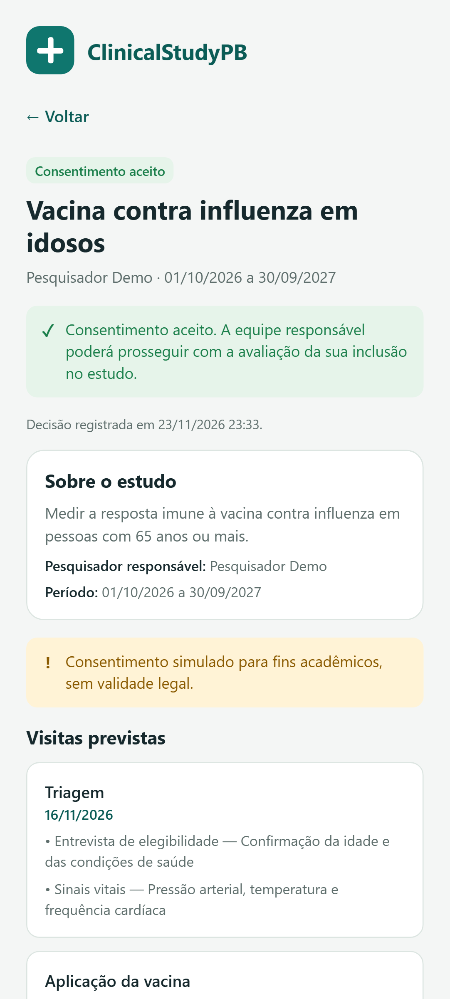
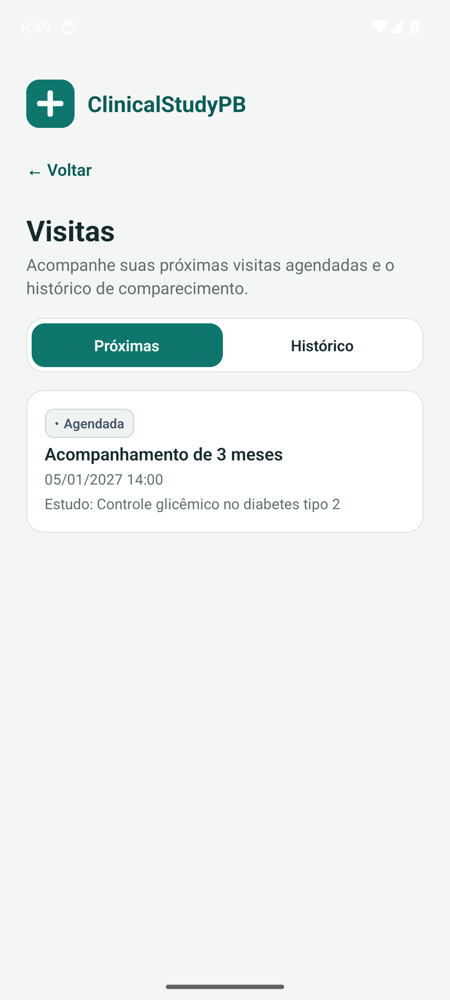
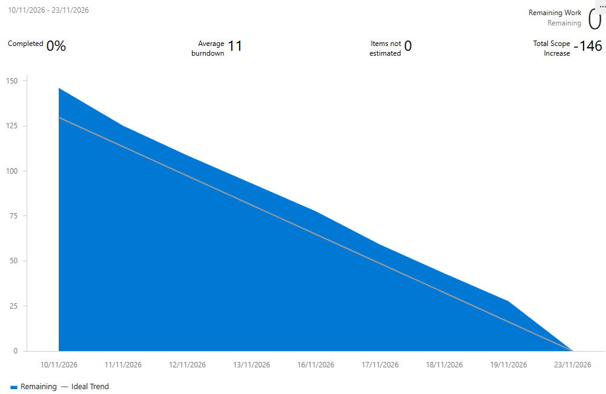
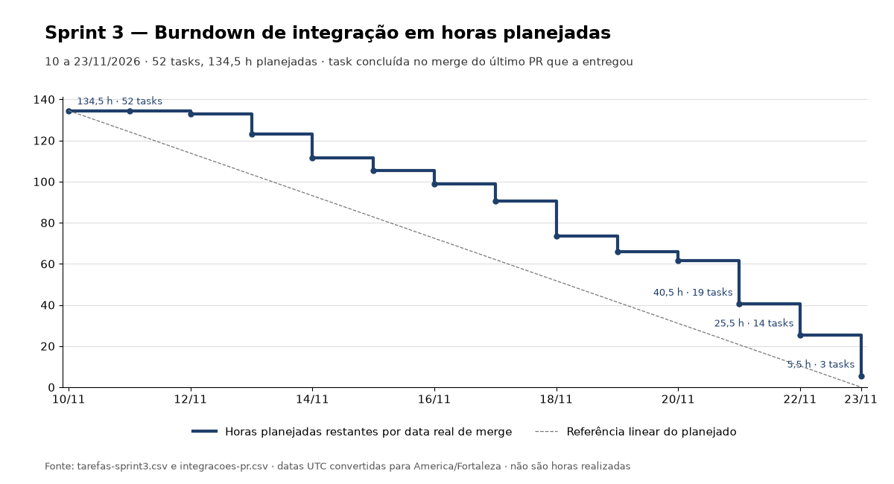

# Release 2 — Acompanhamento de participantes e aplicativo

Entrega das Sprints **3 (10–23/11/2026)** e **4 (24/11–07/12/2026)**. Este documento registra a Sprint 3 (T26.4); a Sprint 4 completa RF19–RF22, e a tag `release2` será publicada no fechamento dela. O projeto usa dados fictícios e consentimento estritamente simulado.

[Instalação e execução](../../README.md#5-instalação-e-execução) · [Diagramas](../../docs/diagrams/README.md) · [OpenAPI](../../backend/openapi.yaml) · [Capturas](images/README.md) · [Testes e cobertura](tests/README.md) · [Processo da Sprint 3](processo/README.md) · [Release 1](../release1/README.md) · [Azure DevOps TEAM5](https://dev.azure.com/engsw2/TEAM5)

## Situação da Sprint 3

| Item | Valor |
| --- | --- |
| Commit avaliado | `development` **e975d92** (merge do PR #113, 23/11/2026), o último da sprint, sem PR aberto naquela data. A [CI 45287852924](https://github.com/livdenner/ClinicalStudyPB-project/actions/runs/45287852924) aprovou Backend, Web, E2E Web e Mobile. |
| Integração | 53 PRs da equipe, do #71 ao #126, todos revisados por outra frente antes do merge ([lista](processo/integracoes-pr.csv)). |
| Tasks | 49 de 52 integradas até 23/11. Na madrugada de 24/11 entraram a T25.2 (evidências, PR #124) e a T26.5 (regressão RF01–RF11 e instalação limpa, PR #126); a T26.4 é este registro. |
| Versão publicada | Nenhuma ainda: a tag `release2` e a GitHub Release saem no fechamento da Sprint 4, em 07/12/2026. |

## Objetivo e escopo

A Release 2 leva o estudo do recrutamento ao acompanhamento e põe o participante no aplicativo. A Sprint 3 entregou, na web, agenda, desfecho, resultados, histórico e retirada (RF12–RF16) e, no aplicativo, login, primeiro acesso e as áreas de estudos e visitas do participante (RF02, RF03, RF17 e RF18). Também atendeu às observações urgentes da professora sobre a Release 1: identidade e consentimento do candidato (PBI-17), UX da web e sessão por aba (PBI-24) e rastreabilidade dos testes (PBI-25).

A Sprint 4 fica com confirmação de presença e solicitação de reagendamento (RF19) e de retirada (RF20) no aplicativo, painel (RF21) e relatório (RF22) na web, a integração completa e os testes integrados. Notificações, caixa de mensagens e a simplificação geral da navegação, também pedidas pela professora, foram adiadas para a Sprint 4 ou para o backlog.

## Alterações de escopo aprovadas pelo PO

### Identidade do candidato e decisão de consentimento no aplicativo (PBI-17)

**Origem:** observação da professora sobre a Release 1, pedindo candidato com mais dados, conta mínima, primeiro login no aplicativo com troca de senha e decisão de consentimento pelo próprio candidato. A mudança foi aprovada pelo PO no planejamento da Sprint 3 e altera a interface de RF10 prevista no enunciado: a decisão sai da web do coordenador e passa ao aplicativo do candidato.

| Aspecto | Release 1 | Release 2 |
| --- | --- | --- |
| Dados do candidato | Nome e idade. | Nome, idade, e-mail e telefone; o e-mail identifica a conta do candidato. |
| Conta do candidato | Não existia. | Conta `PARTICIPANT` criada no cadastro, ou vinculada se o e-mail já tiver conta de participante. |
| Primeiro acesso | — | No aplicativo, com e-mail e código de ativação de uso único (72 horas), seguido de troca obrigatória de senha. |
| Decisão de consentimento (RF10) | Registrada pelo coordenador na web, com possibilidade de troca até a inclusão. | Registrada pelo próprio candidato no aplicativo, uma única vez; o coordenador só consulta e recebe 403 se tentar registrar. |
| Inclusão (RF11) | Coordenador, com elegibilidade `ELIGIBLE` e consentimento `GRANTED`. | Sem mudança de regra: continua com o coordenador e exige o aceite do candidato. |

Sem envio de e-mail nesta sprint: o código de ativação é exibido ao coordenador na web, como recurso de demonstração, e repassado ao candidato. Notificações e caixa de mensagens ficaram para a Sprint 4.

O contrato está definido no [`openapi.yaml`](../../backend/openapi.yaml) (T17.1); a implementação no backend, na web e no aplicativo foi feita nas tarefas T17.2 a T17.10, e o E2E do fluxo, na T17.11.

### Decisões do PO na Sprint 3

Regras de negócio definidas pelo PO em 12/11/2026, antes dos contratos OpenAPI, e seguidas pela implementação.

| Tema | Regra adotada |
| --- | --- |
| Código de ativação | Vale 72 horas e só pode ser usado uma vez. O coordenador pode gerar um novo código, que invalida o anterior. |
| Convite e termo simulado | O convite mostra os dados do estudo, as visitas previstas e um termo fictício, sem valor legal. A decisão do candidato é única. |
| E-mail de conta da equipe | O cadastro do candidato é recusado com 409. Se o e-mail já for de um participante, a candidatura é vinculada à conta existente. |
| Agendamento | Só em estudo em recrutamento ou execução, e só para participante incluído e ativo. |
| Resultados | Só o pesquisador responsável pelo estudo registra e edita; o coordenador apenas consulta. |
| Retirada | A vaga continua ocupada, e o participante retirado não pode ser reincluído no mesmo estudo. |
| Estudo com visitas agendadas | Para encerrar, é preciso registrar antes o desfecho de todas as visitas agendadas (409 `STUDY_HAS_SCHEDULED_VISITS`). Cancelar o estudo cancela as visitas agendadas. |

## Rastreabilidade dos requisitos

Situação avaliada no commit final da Sprint 3, `development` **e975d92**. **Concluído** indica fluxo disponível de ponta a ponta, com testes automatizados e captura. As linhas de RF02, RF03, RF08, RF10 e RF11 registram o que mudou com o PBI-17. As capturas estão na [galeria](images/README.md), e os números de testes, em [Testes e cobertura](#testes-e-cobertura).

| RF | Requisito / situação | Implementação e tela | Evidência e testes | Observação ou pendência |
| --- | --- | --- | --- | --- |
| RF02, RF03 | Login, primeiro acesso e perfil no aplicativo — **concluído** | `POST /api/auth/login`, `POST /api/auth/activation` e `PUT /api/auth/password`; telas de login, ativação e troca de senha no aplicativo, que aceita só `PARTICIPANT`. | [Credenciais inválidas](images/rf02-app-erro-credenciais.png), [senha definida](images/rf02-app-sucesso-senha-definida.png), [perfil sem acesso](images/rf03-app-erro-perfil-sem-acesso.png); [ActivationIntegrationTest](../../backend/src/test/java/clinicalstudypb/auth/ActivationIntegrationTest.java), [telas de autenticação](../../mobile/src/__tests__/authScreens.test.tsx), [E2E mobile](../../mobile/e2e/maestro/login-proximas-visitas.yaml). | Código de ativação de uso único, válido por 72 horas; a troca de senha é obrigatória antes de qualquer tela do participante. PRs #73, #77 e #95. |
| RF08 | Candidatos com conta e convite — **concluído, alterado** | `POST …/candidates` com nome, idade, e-mail e telefone: cria a conta `PARTICIPANT` ou vincula a existente e emite o código de ativação; [cadastro](../../web/src/components/candidatos/ModalNovoCandidato.tsx) e [confirmação](../../web/src/components/candidatos/ResultadoCadastroCandidato.tsx) na web. | [Campos obrigatórios](images/rf08-erro-campos-obrigatorios.png), [convite emitido](images/rf08-sucesso-candidato-com-convite.png); [CandidateIntegrationTest](../../backend/src/test/java/clinicalstudypb/candidates/CandidateIntegrationTest.java), [matriz de permissões](../../backend/src/test/java/clinicalstudypb/candidates/CandidateFlowPermissionMatrixIntegrationTest.java), [modal de cadastro](../../web/src/components/candidatos/ModalNovoCandidato.test.tsx). | A duplicidade passou a ser verificada pela conta, não por nome e idade. Sem envio de e-mail: o código aparece para o coordenador, como recurso de demonstração. PRs #76, #84 e #96. |
| RF10 | Consentimento decidido pelo candidato — **concluído, alterado** | `GET /api/me/invitations` e `POST /api/me/invitations/{candidateId}/decision`; convites no aplicativo. A web só consulta a decisão. | [Convite aceito](images/rf10-app-sucesso-convite-aceito.png), [decisões na web](images/rf10-consulta-decisoes-na-web.png); [StudyInvitationServiceTest](../../backend/src/test/java/clinicalstudypb/consent/StudyInvitationServiceTest.java), [SimulatedConsentIntegrationTest](../../backend/src/test/java/clinicalstudypb/consent/SimulatedConsentIntegrationTest.java), [convites no app](../../mobile/src/__tests__/invitations.test.tsx), [E2E do fluxo completo](../../web/e2e/flows/full-recruitment.spec.ts). | Decisão única, com autoria do candidato; o coordenador recebe 403 se tentar registrar. PRs #93, #109 e #106. |
| RF11 | Inclusão após o aceite — **concluído** | `POST …/inclusion` exige elegibilidade `ELIGIBLE` e aceite do candidato; modal de confirmação e painel de vagas na web. | [Limite de vagas](images/rf11-erro-limite-de-vagas.png); [ParticipantIntegrationTest](../../backend/src/test/java/clinicalstudypb/participants/ParticipantIntegrationTest.java), [E2E do fluxo completo](../../web/e2e/flows/full-recruitment.spec.ts). | Regra da Release 1 mantida. O E2E percorre convite, decisão pela API e inclusão pela web (T17.11, PR #106). |
| RF12 | Agendamento de visitas — **concluído** | `POST` e `GET …/participants/{participantId}/visits`, `GET /api/studies/{studyId}/visits`; [agendamento](../../web/src/components/visitas/ModalAgendarVisita.tsx) pelo card do participante na web. | [Visita agendada](images/rf12-sucesso-visita-agendada.png), [agendamento duplicado](images/rf12-erro-agendamento-duplicado.png); [ScheduledVisitIntegrationTest](../../backend/src/test/java/clinicalstudypb/scheduling/ScheduledVisitIntegrationTest.java), [modal de agendamento](../../web/src/components/visitas/ModalAgendarVisita.test.tsx), [E2E do fluxo de referência](../../web/e2e/flows/reference-flow.spec.ts). | Só para participante incluído e ativo, visita prevista do protocolo e data futura; a duplicidade considera visitas agendadas e realizadas. PRs #71, #79, #86 e #99. |
| RF13 | Desfecho de visitas — **concluído** | `POST …/visits/{visitId}/outcome` com `If-Match`; tela [Visitas](../../web/src/pages/visitas/visitas.tsx), com filtro por situação e [confirmação do desfecho](../../web/src/components/visitas/ModalDesfechoVisita.tsx). | [Quatro desfechos](images/rf13-agenda-com-quatro-desfechos.png), [cancelamento sem justificativa](images/rf13-erro-cancelamento-sem-justificativa.png); [ScheduledVisitServiceTest](../../backend/src/test/java/clinicalstudypb/scheduling/ScheduledVisitServiceTest.java), [modal de desfecho](../../web/src/components/visitas/ModalDesfechoVisita.test.tsx), [E2E do fluxo de referência](../../web/e2e/flows/reference-flow.spec.ts). | Realizada, ausente ou cancelada com justificativa; estados finais não mudam; atualização concorrente retorna 409. PRs #88, #102, #100 e #116. |
| RF14 | Resultados fictícios das avaliações — **concluído** | `GET …/visits/{visitId}/results` e `PUT …/results/{activityId}`; [resultados da visita](../../web/src/components/visitas/ModalResultadosVisita.tsx) na tela Visitas. | [Resultado salvo](images/rf14-sucesso-resultado-registrado.png), [resultado obrigatório](images/rf14-erro-resultado-obrigatorio.png); [ActivityResultIntegrationTest](../../backend/src/test/java/clinicalstudypb/results/ActivityResultIntegrationTest.java), [modal de resultados](../../web/src/components/visitas/ModalResultadosVisita.test.tsx). | Só em visita realizada e para as atividades da visita prevista. PRs #75, #97, #114, #104 e #116. |
| RF15 | Histórico do participante — **concluído, com pendência** | `GET …/participants/{participantId}/history`; **Ver histórico** na aba Participantes do estudo ([linha do tempo](../../web/src/components/estudos/HistoricoParticipante.tsx)). | [Histórico](images/rf15-historico-participante.png); [ParticipantHistoryIntegrationTest](../../backend/src/test/java/clinicalstudypb/history/ParticipantHistoryIntegrationTest.java), [linha do tempo](../../web/src/components/estudos/HistoricoParticipante.test.tsx). | Pesquisador responsável ou coordenador; participante de outro estudo não aparece. **Pendência:** os resultados mostram o identificador da atividade ("Atividade #10"), porque a resposta do histórico não traz o nome. PRs #103, #119 e #120. |
| RF16 | Retirada de participante — **concluído** | `POST …/participants/{participantId}/withdrawal` com motivo; **Registrar retirada** no recrutamento e na aba Participantes ([modal](../../web/src/components/participantes/ModalRegistrarRetirada.tsx)). | [Retirada registrada](images/rf16-sucesso-retirada-registrada.png), [motivo obrigatório](images/rf16-erro-motivo-obrigatorio.png); [ParticipantWithdrawalIntegrationTest](../../backend/src/test/java/clinicalstudypb/participants/ParticipantWithdrawalIntegrationTest.java), [modal de retirada](../../web/src/components/participantes/ModalRegistrarRetirada.test.tsx), [E2E da retirada](../../web/e2e/participants/withdrawal.spec.ts). | Só o coordenador; cancela as visitas futuras, bloqueia novos agendamentos e mantém a vaga ocupada; retirada duplicada retorna 409. PRs #81, #89, #110 e #111. |
| RF17 | Estudos do participante no aplicativo — **concluído** | `GET /api/me/studies`; **Ver estudos** e o protocolo do estudo no [aplicativo](../../mobile/src/app/studies/index.tsx). | [Meus estudos](images/rf17-app-meus-estudos.png), [protocolo](images/rf17-app-protocolo-do-estudo.png); [ParticipantSelfIntegrationTest](../../backend/src/test/java/clinicalstudypb/me/ParticipantSelfIntegrationTest.java), [telas de estudos](../../mobile/src/__tests__/studies.test.tsx). | O participante vem do token; outros perfis recebem 403 em `/api/me`. PRs #94 e #112. |
| RF18 | Visitas do participante no aplicativo — **concluído** | `GET /api/me/visits`; **Ver visitas**, com **Próximas** e **Histórico**, no [aplicativo](../../mobile/src/app/visits/index.tsx). | [Próximas](images/rf18-app-emulador-proximas-visitas.png) e [histórico](images/rf18-app-emulador-historico-visitas.png) no emulador; [ParticipantSelfIntegrationTest](../../backend/src/test/java/clinicalstudypb/me/ParticipantSelfIntegrationTest.java), [telas de visitas](../../mobile/src/__tests__/visits.test.tsx), [E2E mobile](../../mobile/e2e/maestro/login-proximas-visitas.yaml). | O detalhe da visita reserva o espaço do RF19, sem botões ativos. PRs #94, #117 e #121. |
| RF19 | Confirmar presença prevista ou solicitar reagendamento (aplicativo) — **Sprint 4** | — | — | Confirmar presença não comprova comparecimento; a realização continua sendo registrada no RF13. |
| RF20 | Solicitar retirada voluntária (aplicativo) — **Sprint 4** | — | — | Solicitar (RF20) e registrar a retirada (RF16) são eventos diferentes; a relação será refinada antes da implementação. |
| RF21 | Painel com candidatos, incluídos e visitas (web) — **Sprint 4** | A **Visão geral** da web ainda é protótipo. | — | — |
| RF22 | Relatório de recrutamento e acompanhamento por estudo (web) — **Sprint 4** | A tela **Relatórios** ainda é protótipo. | — | — |
| RF01–RF11 | Regressão da Release 1 — **aprovada (T26.5)** | RF01 ganhou a proteção da própria conta e do último administrador ativo (PR #85). | [Relatório da T26.5](tests/t26-5/README.md), [rastreabilidade por RF](../../docs/tests/rastreabilidade-regressao-release1.md), [regressão web de RF04–RF11 da T24.5](tests/t24-5/README.md). | Instalação limpa com V1–V15 e as quatro cargas, executadas duas vezes sem duplicar; suítes, E2E e conferência manual sem regressão. |

As rotas abreviadas pertencem ao estudo, candidato, participante ou visita informados no [contrato OpenAPI](../../backend/openapi.yaml).

## Resumo técnico por frente

### Backend

O contrato OpenAPI foi definido antes das implementações (T17.1, T18.1 e T20.1) e reúne as rotas novas: ativação e troca de senha em `/api/auth`; agenda, desfecho, resultados, histórico e retirada em `/api/studies/{studyId}`; convites, estudos e visitas do participante em `/api/me`. Entraram quatro módulos e as migrações V11–V15, descritos na [alteração de arquitetura](#alteração-de-arquitetura-t263).

### Web

A lista de recrutamento passou a cadastrar o candidato com e-mail e telefone, mostrar o código de ativação e acompanhar o convite até a decisão. Os cards dos participantes ganharam **Agendar** e **Registrar retirada**; a tela **Visitas** lista a agenda do estudo e registra desfechos e resultados; a aba **Participantes** do estudo mostra o histórico. O PBI-24 reorganizou as ações do estudo por estado, aplicou cores semânticas, alinhou os cards em 1366 e 375 px e isolou a sessão por aba do navegador (`sessionStorage`).

### Mobile

O aplicativo deixou de ser uma navegação provisória: aceita só contas de participante e cobre login, primeiro acesso com código, troca obrigatória de senha, convites com a decisão do consentimento, estudos e visitas. O [README mobile](../../mobile/README.md) explica configuração, emulador, conta de demonstração e o E2E com Maestro.

### Dados e seeds

As três cargas da Release 1 ganharam a quarta, `seed_demo_followup.sql` (T26.6), com convite pendente de código conhecido, participante com senha definida, os quatro desfechos, resultados e uma retirada. Os cenários estão no [README principal](../../README.md#cenários-do-acompanhamento-e-do-fluxo-do-candidato).

### DevOps e qualidade

Cada execução de testes, local ou na CI, gera um Markdown com uma linha por teste (T25.1); na CI, o bot `clinicalstudypb-ci-reports[bot]` versiona esses relatórios em [docs/test-ci](../../docs/test-ci/README.md). O workflow [E2E Mobile](../../.github/workflows/mobile-e2e.yml) roda o Maestro num emulador Android.

## Alteração de arquitetura (T26.3)

A arquitetura continua sendo um monólito modular em camadas, com um único backend Spring Boot e um único PostgreSQL. A Sprint 3 acrescentou módulos ao backend e ligou o aplicativo à API. Os [diagramas da Release 2](../../docs/diagrams/README.md) mostram o estado atual, e os da Release 1 continuam na [tag `release1`](https://github.com/livdenner/ClinicalStudyPB-project/tree/release1/docs/diagrams).

| Aspecto | Release 1 | Release 2 |
| --- | --- | --- |
| Módulos do backend | Oito: `auth`, `users`, `studies`, `criteria`, `visits`, `candidates`, `consent` e `participants`. | Doze. Entram `scheduling` (agenda e desfecho, RF12–RF13), `results` (resultados das atividades, RF14), `history` (histórico do participante, RF15) e `me` (convites, estudos e visitas do participante, RF10, RF17 e RF18). `history` e `me` só consultam dados de outros módulos e não têm tabela própria. |
| Módulos existentes | — | `candidates` passa a criar ou vincular a conta do candidato e o convite de ativação; `consent` registra quem decidiu; `participants` ganha situação e retirada (RF16). |
| Aplicativo mobile | Navegação provisória, sem chamadas à API. | Cliente da API com JWT, só para o perfil `PARTICIPANT`: login, ativação e troca de senha em `/api/auth`, convites, estudos e visitas em `/api/me`. |
| Integração entre módulos | Serviços públicos. | Sem mudança de regra. As novas dependências usam interfaces públicas, como `StudySchedulingLifecycle`, `ParticipantSchedulingLookup`, `ParticipantWithdrawalVisits`, `PlannedVisitLookup` e `ActivityResultLookup`. |
| Banco | Flyway V1–V10. | Flyway V1–V15: `V11__candidate_accounts_and_invitations`, `V12__create_scheduled_visits`, `V13__add_participant_withdrawal`, `V14__add_consent_actor` e `V15__create_activity_results`. Os clientes continuam sem acesso direto ao banco. |

| Diagrama | O que mudou |
| --- | --- |
| [Casos de uso](../../docs/diagrams/casos-de-uso.png) | Vai de RF01 a RF18. O candidato decide o consentimento no aplicativo; entram agenda, desfecho, retirada, resultados, histórico e a área do participante. |
| [Classes](../../docs/diagrams/README.md#classes-e-domínio) | Página 2 com convite de ativação, conta e cancelamento do candidato, retirada do participante e autor da decisão. Página 3, nova, com visita agendada e resultado da atividade. |
| [Sequência](../../docs/diagrams/README.md#sequências) | Página 4 com o cadastro por e-mail e telefone, a criação ou o vínculo da conta, o convite e a duplicidade verificada pela conta. Página 5 redesenhada para a decisão pelo candidato. Página 7, nova, com agendamento e desfecho. |
| [Arquitetura](../../docs/diagrams/arquitetura.png) | Doze módulos e o aplicativo ligado à API. |

## Demonstração e capturas

A [galeria](images/README.md) relaciona 31 capturas de sucesso, erro e consulta aos RF, com ambiente, passos e resultado (T25.2). Foram obtidas com API e PostgreSQL reais e a carga fictícia, sobre o commit avaliado; as do emulador Android vêm do E2E mobile da CI. As capturas do E2E do fluxo de referência ficam em [evidencias/t19-5-fluxo-referencia](evidencias/t19-5-fluxo-referencia/README.md).

 

### Roteiro de demonstração

O roteiro usa apenas a carga de demonstração, sem preparar dados à mão. Antes de começar, siga a [instalação](../../README.md#5-instalação-e-execução): suba a stack, carregue os quatro scripts de `backend/dev/`, abra a [web](../../README.md#aplicação-web) e o [aplicativo](../../mobile/README.md#configurar-a-url-da-api) apontando para a API. As contas e os cenários da carga estão em [Banco e usuários de demonstração](../../README.md#banco-e-usuários-de-demonstração). A senha das contas da equipe é `Demo@Clinical2026`.

| Passo | Conta | Onde | O que fazer e conferir |
| --- | --- | --- | --- |
| 1 | `coordenador@…` | Web, **Recrutamento** | No estudo **Vacina contra influenza em idosos**, confira as situações Convidado, Aceitou, Recusou, Aguardando decisão e Incluído. Em **Higiene do sono em trabalhadores noturnos**, inclua Vera Lúcia Fonseca na última vaga. A inclusão de Wilson Barbosa Leite é recusada: "O estudo atingiu o limite de participantes" (RF11). Em seguida, use **Agendar** no card de Vera, escolha a visita prevista e uma data futura (RF12). |
| 2 | `convite@…` | Aplicativo | Em **Primeiro acesso? → Ativar conta**, informe o e-mail e o código `CONVITE-DEMO-2026` e defina a senha. Em **Ver convites**, abra o convite da vacina e use **Aceitar convite** (RF10). Na web, o coordenador usa **Atualizar lista** e vê Rosa Helena Prates como Aceitou. |
| 3 | `participante@…` | Aplicativo | **Ver estudos** mostra **Controle glicêmico no diabetes tipo 2** (RF17). **Ver visitas** mostra o acompanhamento de 3 meses em **Próximas** e a avaliação inicial em **Histórico** (RF18). Em **Ver convites**, recuse o convite da vacina; a decisão fica somente leitura. |
| 4 | `coordenador@…` | Web, **Visitas** | No estudo de diabetes, filtre por **Situação** e confira os quatro desfechos: agendada, realizada, ausente e cancelada. Registre como realizada a avaliação inicial remarcada de João Batista Freitas (RF13). A visita de Lúcia Mendes Araújo aparece cancelada com a nota "Retirada do participante". |
| 5 | `pesquisador@…` | Web, **Visitas** | Em **Ver resultados**, confira hemoglobina glicada e orientação nutricional na avaliação inicial de Irene Gomes Vieira. Em **Registrar resultados**, registre os da visita de João realizada no passo 4 (RF14). |
| 6 | `coordenador@…` | Web, **Estudos clínicos** → estudo de diabetes → aba **Participantes** | Use **Registrar retirada** para Irene, com um motivo, e confirme. O selo passa a Retirado, a visita futura dela é cancelada e a vaga continua ocupada (RF16). Em **Ver histórico**, confira a linha do tempo de Irene e a de Lúcia: visita realizada com os resultados, visita cancelada e retirada (RF15). |
| 7 | `pesquisador@…` e `administrador@…` | Web, duas abas do mesmo navegador | Como pesquisador, abra **Estudos clínicos** → **Vacina contra influenza em idosos**: o selo mostra o estado com a cor semântica, e as mudanças de estado permitidas ficam no menu **Alterar estado**. Em outra aba, entre como administrador: as duas sessões ficam ativas ao mesmo tempo, e **Sair** numa aba não encerra a outra (PBI-24). |

Os passos 1 a 6 também podem ser feitos pelo [Swagger UI](http://localhost:8080/swagger-ui/index.html), com o token da conta indicada:

| Passo | Endpoints |
| --- | --- |
| 1 | `GET /api/studies/{studyId}/candidates`, `POST …/candidates/{candidateId}/inclusion` e `POST …/participants/{participantId}/visits` |
| 2 | `POST /api/auth/activation`, `PUT /api/auth/password`, `GET /api/me/invitations` e `POST /api/me/invitations/{candidateId}/decision` |
| 3 | `GET /api/me/studies`, `GET /api/me/visits` e `POST /api/me/invitations/{candidateId}/decision` |
| 4 | `GET /api/studies/{studyId}/visits?status=…` e `POST …/visits/{visitId}/outcome` com `If-Match` |
| 5 | `GET …/visits/{visitId}/results` e `PUT …/results/{activityId}` |
| 6 | `POST …/participants/{participantId}/withdrawal` e `GET …/participants/{participantId}/history` |

As ações do roteiro são definitivas: inclusão, decisões, código de ativação usado, desfecho, resultados e retirada. Executar os scripts de novo não as desfaz. Para repetir a demonstração do início, recrie o banco com `docker compose down -v`, suba a stack e carregue a carga outra vez.

Em 22/11/2026, os seis passos foram executados pela API sobre a `development` em `008dabb`, numa stack descartável com a carga completa: todas as respostas e situações descritas acima foram confirmadas. As telas correspondentes são cobertas pelos testes da web e do aplicativo. O agendamento do passo 1 e o passo 7 entraram no registro da sprint (T26.4): o agendamento tem [captura](images/rf12-sucesso-visita-agendada.png) e E2E na T19.5, e o passo 7, que só existe na web, é coberto pelos [testes da T24.5](tests/t24-5/README.md).

A demonstração cobre do PBI-17 ao PBI-24, só com dados fictícios:

| PBI | Passos |
| --- | --- |
| PBI-17 — identidade, primeiro acesso e consentimento do candidato | 1, 2 e 3 |
| PBI-18 — agendamento (RF12) | 1 e 4 |
| PBI-19 — desfecho (RF13) | 4 |
| PBI-20 — resultados (RF14) | 5 |
| PBI-21 — histórico (RF15) | 6 |
| PBI-22 — retirada (RF16) | 6 |
| PBI-23 — estudos e visitas no aplicativo (RF17 e RF18) | 3 |
| PBI-24 — UX da web e sessão por aba | 7 |

## Testes e cobertura

Números do commit avaliado, `development` **e975d92**, na [CI 45287852924](https://github.com/livdenner/ClinicalStudyPB-project/actions/runs/45287852924) (T25.2). O [relatório de testes](tests/README.md) traz logs, suítes, cobertura por módulo e o relatório teste a teste.

| Evidência | Resultado | Onde |
| --- | --- | --- |
| CI do commit avaliado | [Execução 45287852924](https://github.com/livdenner/ClinicalStudyPB-project/actions/runs/45287852924): Backend, Web, E2E Web e Mobile aprovados; 1737 testes, nenhuma falha. | [Logs e relatório](tests/ci-e975d92/README.md) |
| Cobertura do backend (JaCoCo) | **97,96% das linhas (1972/2013)**, acima da meta de 80%; ramos 87,15%. A CI reprova o build abaixo de 80%. | [Cobertura por módulo](tests/ci-e975d92/README.md#cobertura-do-backend-jacoco), [CSV](tests/ci-e975d92/backend-coverage.csv) |
| Web, E2E e mobile | 513 testes Vitest (89,69% das linhas), 24 E2E Playwright, 260 testes Jest (92,66% das linhas) e E2E mobile no emulador Android aprovado. | [Testes da Release 2](tests/README.md) |
| Capturas das telas novas | 31 capturas de sucesso, erro e consulta, nomeadas por RF, cobrindo RF02, RF03, RF08, RF10 e RF12–RF18 na web e no aplicativo, sem credenciais. | [Galeria](images/README.md) |

A meta de 80% é das linhas do backend e é verificada pela própria CI. O histórico automático de cada execução fica em [docs/test-ci](../../docs/test-ci/README.md).

### Regressão RF01–RF11 e instalação limpa (T26.5)

Em 24/11/2026, a `development` em **e975d92** (fim da Sprint 3) foi instalada do zero seguindo o [README principal](../../README.md#5-instalação-e-execução), com o mesmo procedimento da T16.13. Relatório completo: [tests/t26-5](tests/t26-5/README.md). Rastreabilidade por requisito: [regressão RF01–RF11](../../docs/tests/rastreabilidade-regressao-release1.md).

| Item | Resultado |
| --- | --- |
| Instalação limpa | Clone novo, `.env` do modelo, `docker compose up -d --build`: Flyway aplicou **V1–V15**; Swagger UI e OpenAPI responderam 200. |
| Seeds | Os quatro scripts executados duas vezes: saída 0 e contagens idênticas nas 14 tabelas, **sem duplicação**. |
| Suítes | Backend 940 testes (JaCoCo 97,96% das linhas), web 513, mobile 260, E2E 24/24 com um worker; nenhuma falha de RF. |
| Conferência manual | Login e logout, usuários, permissões, estudos, critérios, visitas previstas e estados (RF01–RF07): 12 verificações aprovadas. Aplicativo aberto em Android físico com login, estudos e visitas. |
| Regressões | **Nenhuma** em RF01–RF11. |

O README principal foi corrigido em quatro pontos encontrados na instalação: carga no Git Bash, finais de linha no clone do Windows, seção do aplicativo (login e `EXPO_PUBLIC_API_BASE_URL`) e roteiro e versões desatualizados. Fica recomendada como task prioritária a estabilização do login no E2E local (achado A3): com vários workers, ou no primeiro login após a stack subir, o teste excede o tempo de espera de 5 s.

### Regressão web de UX e sessão (T24.5)

A [matriz da T24.5](tests/t24-5/README.md) relaciona as observações sobre ações, cores, cards e sessão aos testes executados, com a regressão das telas RF04–RF11, os resultados históricos de 21/11/2026 e a revalidação após integrar a development. O fluxo completo de recrutamento foi adaptado pela T17.11 e já está integrado pela PR #106.

### Rastreabilidade e testes do aplicativo mobile (T23.4)

Em **21/11/2026** (commit `3b2f7b0`), a suíte Jest do aplicativo mobile atingiu **23 suítes e 260 testes aprovados (0 falhas)** usando Jest + React Native Testing Library com HTTP inteiramente simulado e **zero chamadas reais de rede**, além de validação de tipos via `npx.cmd tsc --noEmit`. A meta mínima global de **80% de linhas** está configurada em [`mobile/package.json`](../../mobile/package.json) (`coverageThreshold.global.lines`), e todos os casos executados estão registrados em [`2026-11-21_22-15_T23-4_mobile-jest.md`](../../docs/test-runs/2026-11-21_22-15_T23-4_mobile-jest.md).

#### Matriz de rastreabilidade mobile por RF

| RF | Requisito e telas cobertas | Cenários verificados (sucesso, vazio/validação e erro) | Suítes de teste |
| --- | --- | --- | --- |
| RF02 | Login, primeiro acesso por código, troca de senha e expiração de sessão (`login.tsx`, `activation.tsx`, `change-password.tsx`, `index.tsx`, `AuthProvider`) | **Sucesso:** login via `POST /api/auth/login` sem alterar a senha digitada, ativação via `POST /api/auth/activation`, definição de senha inicial (`PUT /api/auth/password` sem `currentPassword`), troca em conta ativa e logout local resiliente. **Validação/vazio:** campos obrigatórios, formato de e-mail, política de senha (8–72 caracteres, letra e número) e divergência de confirmação. **Erro e expiração:** erro `401` genérico no login/sessão, `503` e falha de rede (`TypeError`), código expirado/inválido, `CURRENT_PASSWORD_INVALID`, `PASSWORD_POLICY`, descarte de sessão vencida/corrompida, deduplicação de `401` concorrente e vencimento por timer/retorno ao primeiro plano. | [`authScreens.test.tsx`](../../mobile/src/__tests__/authScreens.test.tsx), [`navigation.test.tsx`](../../mobile/src/__tests__/navigation.test.tsx), [`authProvider.test.tsx`](../../mobile/src/__tests__/authProvider.test.tsx), [`authApi.test.ts`](../../mobile/src/__tests__/authApi.test.ts), [`authErrors.test.ts`](../../mobile/src/__tests__/authErrors.test.ts), [`loginForm.test.ts`](../../mobile/src/__tests__/loginForm.test.ts), [`activationForm.test.ts`](../../mobile/src/__tests__/activationForm.test.ts), [`passwordPolicy.test.ts`](../../mobile/src/__tests__/passwordPolicy.test.ts), [`session.test.ts`](../../mobile/src/__tests__/session.test.ts), [`secureSessionStorage.test.ts`](../../mobile/src/__tests__/secureSessionStorage.test.ts), [`authenticatedSession.test.ts`](../../mobile/src/__tests__/authenticatedSession.test.ts), [`apiClient.test.ts`](../../mobile/src/__tests__/apiClient.test.ts) |
| RF03 | Bloqueio de acesso, restrição por perfil e fluxo bloqueado antes da troca de senha obrigatória (`_layout.tsx`, `Stack.Protected` e rotas privadas) | **Bloqueio pré-troca (CA):** contas com `mustChangePassword = true` ou respostas `403 PASSWORD_CHANGE_REQUIRED` permanecem bloqueadas em todo o fluxo privado (`/`, `/invitations`, `/invitations/[candidateId]`, `/studies`, `/studies/[participantId]`, `/visits`, `/visits/[visitId]`), com redirecionamento contínuo para `/change-password` até a conclusão de `PUT /api/auth/password`. **Perfil e isolamento:** recusa imediata de perfis não participantes (ex.: `COORDINATOR`) no login, na ativação e no armazenamento persistido; bloqueio de rotas privadas sem sessão; descarte de dados da conta anterior após logout/troca de conta. | [`authScreens.test.tsx`](../../mobile/src/__tests__/authScreens.test.tsx), [`navigation.test.tsx`](../../mobile/src/__tests__/navigation.test.tsx), [`authProvider.test.tsx`](../../mobile/src/__tests__/authProvider.test.tsx), [`authenticatedSession.test.ts`](../../mobile/src/__tests__/authenticatedSession.test.ts), [`invitations.test.tsx`](../../mobile/src/__tests__/invitations.test.tsx), [`studies.test.tsx`](../../mobile/src/__tests__/studies.test.tsx), [`visits.test.tsx`](../../mobile/src/__tests__/visits.test.tsx) |
| RF10 | Convites e decisão de consentimento simulado pelo candidato (`invitations/index.tsx`, `invitations/[candidateId].tsx`, `PlannedVisitCard`) | **Sucesso:** listagem separando pendentes e decisões registradas, detalhe por `candidateId` com protocolo, datas civis e termo simulado, confirmação única de aceite (`GRANTED`) e recusa (`DECLINED`) com exibição somente leitura após decisão e atualização ao retornar à lista. **Vazio/validação:** lista vazia sem conteúdo falso, recusa de ID inválido na rota antes de chamar a API e cancelamento na confirmação sem envio. **Erro:** falha na listagem com recuperação, proteção contra duplo envio, `CANDIDATE_CANCELLED`, `STUDY_NOT_RECRUITING`, `CONSENT_ALREADY_DECIDED`, recuperação de resposta incerta por reconsulta, `401`, `403 PASSWORD_CHANGE_REQUIRED` e descarte de resposta tardia. | [`invitations.test.tsx`](../../mobile/src/__tests__/invitations.test.tsx), [`plannedVisitCard.test.tsx`](../../mobile/src/__tests__/plannedVisitCard.test.tsx), [`invitationApi.test.ts`](../../mobile/src/__tests__/invitationApi.test.ts), [`invitationErrors.test.ts`](../../mobile/src/__tests__/invitationErrors.test.ts), [`invitationPresentation.test.ts`](../../mobile/src/__tests__/invitationPresentation.test.ts) |
| RF17 | Consulta de estudos e protocolo pelo participante (`studies/index.tsx`, `studies/[participantId].tsx`, `PlannedVisitCard`) | **Sucesso:** listagem de `/api/me/studies` com separação semântica de `studyStatus` e `participationStatus` (incluindo `WITHDRAWN` e `CLOSED`), navegação para detalhe direto por rota com objetivo, período civil e visitas previstas (**Data prevista** e atividades). **Vazio/validação:** lista vazia orientando acesso aos convites, protocolo sem visitas previstas, estado desconhecido neutro e recusa de identificador inválido sem chamar a API. **Erro:** falha inicial com **Tentar novamente** sem mascarar como lista vazia, indisponibilidade de participação alheia (`404`), preservação de dados anteriores em erro ao voltar ao foco, abortamento via `AbortController`, `401`, `403 PASSWORD_CHANGE_REQUIRED` e limpeza na troca de conta. | [`studies.test.tsx`](../../mobile/src/__tests__/studies.test.tsx), [`navigation.test.tsx`](../../mobile/src/__tests__/navigation.test.tsx), [`plannedVisitCard.test.tsx`](../../mobile/src/__tests__/plannedVisitCard.test.tsx), [`studyApi.test.ts`](../../mobile/src/__tests__/studyApi.test.ts), [`studyPresentation.test.ts`](../../mobile/src/__tests__/studyPresentation.test.ts) |
| RF18 | Próximas visitas, histórico de comparecimento e detalhe (`visits/index.tsx`, `visits/[visitId].tsx`) | **Sucesso:** listagem de `/api/me/visits` em abas **Próximas** (`SCHEDULED`) e **Histórico** (`DONE`, `ABSENT`, `CANCELLED` com motivo exibido apenas em cancelada), migração de **Próximas** para **Histórico** após desfecho e detalhe com atividades previstas e bloco reservado para RF19 (sem botões ativos). **Vazio/validação:** estados vazios independentes para **Próximas** e **Histórico**, visita sem atividades previstas e rejeição de ID de texto ou zero sem chamar a API. **Erro:** falha inicial com recuperação, tradução segura de payload inválido e `403` sem vazar detalhes, visita ausente no detalhe, aviso de consulta anterior ao falhar no foco, `401`, `403 PASSWORD_CHANGE_REQUIRED` e descarte após logout. | [`visits.test.tsx`](../../mobile/src/__tests__/visits.test.tsx), [`navigation.test.tsx`](../../mobile/src/__tests__/navigation.test.tsx), [`visitApi.test.ts`](../../mobile/src/__tests__/visitApi.test.ts), [`visitPresentation.test.ts`](../../mobile/src/__tests__/visitPresentation.test.ts) |

#### E2E mobile no emulador (T23.5)

Além do Jest, o fluxo E2E-MOB-01 (login do participante → **Próximas** e **Histórico** de visitas, RF02 e RF18) roda com o Maestro num emulador Android, contra a stack de `compose.e2e.yaml` com a seed padrão. Na CI, passou em 23/11/2026 (execução [45103422414](https://github.com/livdenner/ClinicalStudyPB-project/actions/runs/45103422414)). A decisão de ferramenta está no [README mobile](../../mobile/README.md#decisão-de-ferramenta-maestro), e o cenário e os resultados estão em [`rastreabilidade-e2e-mobile.md`](../../docs/tests/rastreabilidade-e2e-mobile.md).

#### Cobertura mobile (`npm.cmd run test:report -- --runInBand --coverage`)

| Escopo | Instruções | Branches | Funções | Linhas |
| --- | --- | --- | --- | --- |
| **Global (`All files`)** | **92,67%** (1177/1270) | **89,07%** (987/1108) | **97,00%** (292/301) | **92,66%** (1163/1255) |
| Telas iniciais e autenticação (`app`) | 90,71% (127/140) | 81,15% (56/69) | 92,30% (36/39) | **90,71%** (127/140) |
| Telas de convites (`app/invitations`) | 85,64% (179/209) | 84,57% (148/175) | 91,30% (42/46) | **85,85%** (176/205) |
| Telas de estudos (`app/studies`) | 95,61% (109/114) | 91,66% (121/132) | 100,00% (28/28) | **95,53%** (107/112) |
| Telas de visitas (`app/visits`) | 94,95% (113/119) | 90,69% (156/172) | 96,55% (28/29) | **94,87%** (111/117) |
| Autenticação e sessão (`auth`) | 92,47% (332/359) | 85,84% (182/212) | 100,00% (70/70) | **92,37%** (327/354) |
| Formulário de senha (`components/auth`) | 96,87% (31/32) | 90,00% (9/10) | 100,00% (9/9) | **96,77%** (30/31) |

## Processo da Sprint 3

O [documento de processo](processo/README.md) reúne meta, backlog, papéis, contribuições, revisão cruzada, burndown, linha de base (T26.2), correção da Release 1 (T26.1), revisão e retrospectiva. Allan foi gerente e PO; Lucas, backend; Raffael, web 1; Lívia, web 2; Júlio, mobile; e Júlia, QA/DevOps.

O primeiro gráfico é o do Azure DevOps, com o trabalho restante apontado pela equipe. O segundo usa as horas planejadas das tasks e a data real de merge do último PR de cada uma. A comparação dos dois está em [planejado x realizado](processo/README.md#burndown-do-azure-devops).

## Pendências e passagem para a Sprint 4

- **Login no E2E local (achado A3 da T26.5).** Task prioritária: com vários workers, ou no primeiro login depois de subir a stack, o login passa do limite de 5 s. Aquecer o backend no `e2e:stack:up` ou aumentar o tempo de espera.
- **Finais de linha (achado A2 da T26.5).** Avaliar `* text=auto eol=lf` no `.gitattributes`, em task própria.
- **Nome da atividade no histórico (RF15).** Incluir o nome da atividade nos resultados da resposta do histórico e exibi-lo na web, no lugar de "Atividade #10".
- **RF19–RF22.** Confirmação de presença e reagendamento, solicitação de retirada no aplicativo, painel e relatório na web.
- **Observações adiadas.** Notificações e caixa de mensagens (hoje o código de ativação aparece para o coordenador) e a simplificação geral da navegação.
- **Publicação.** Tag `release2` e GitHub Release no fechamento da Sprint 4.
