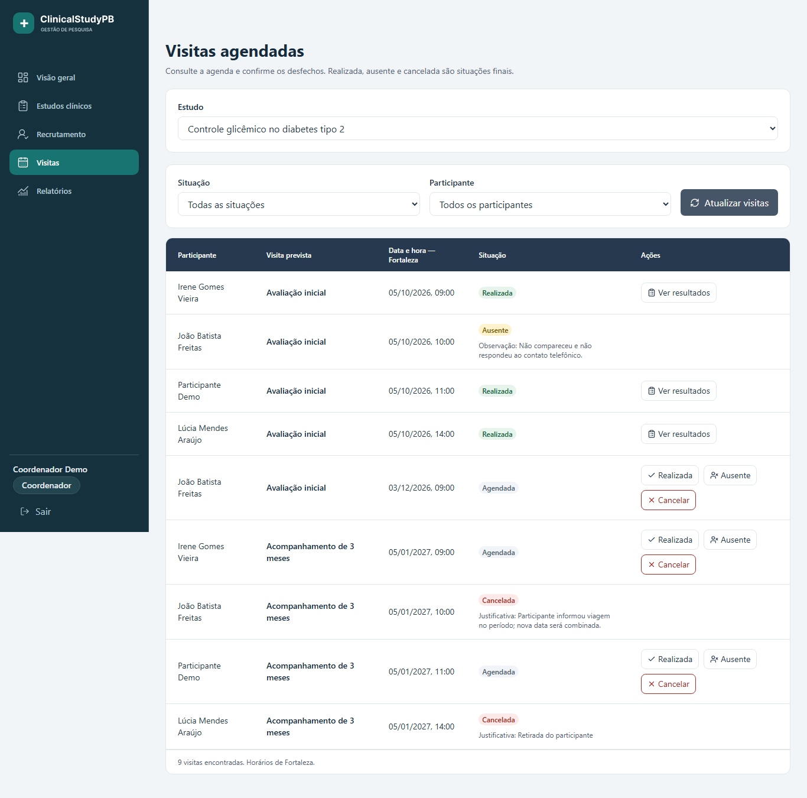
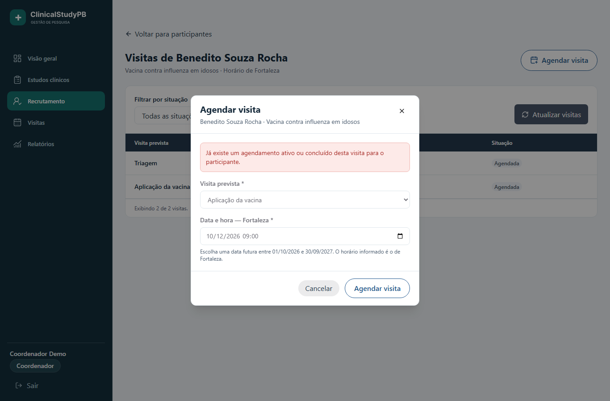
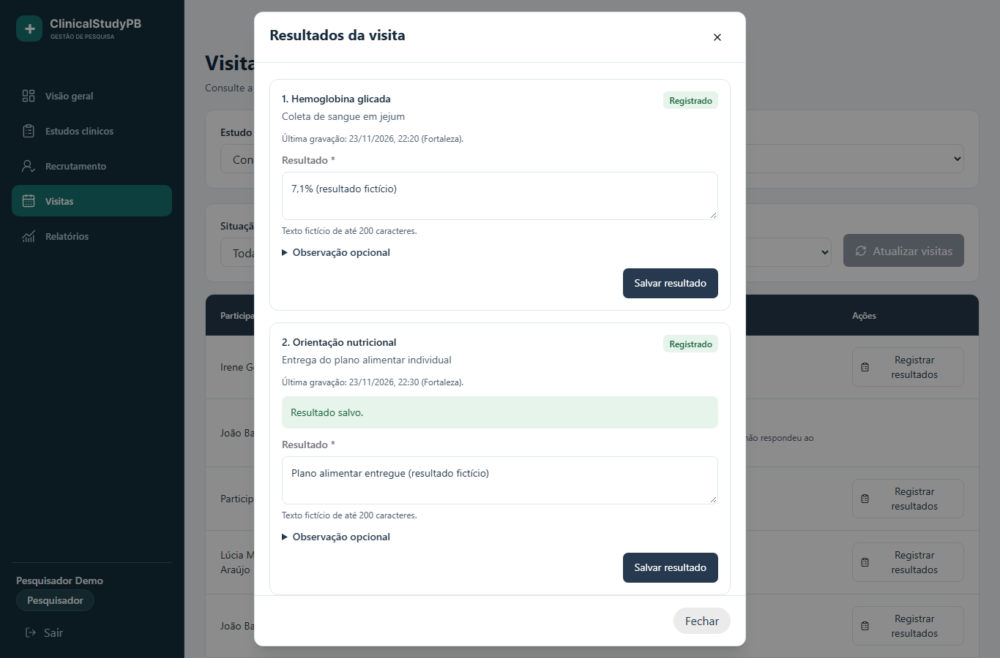
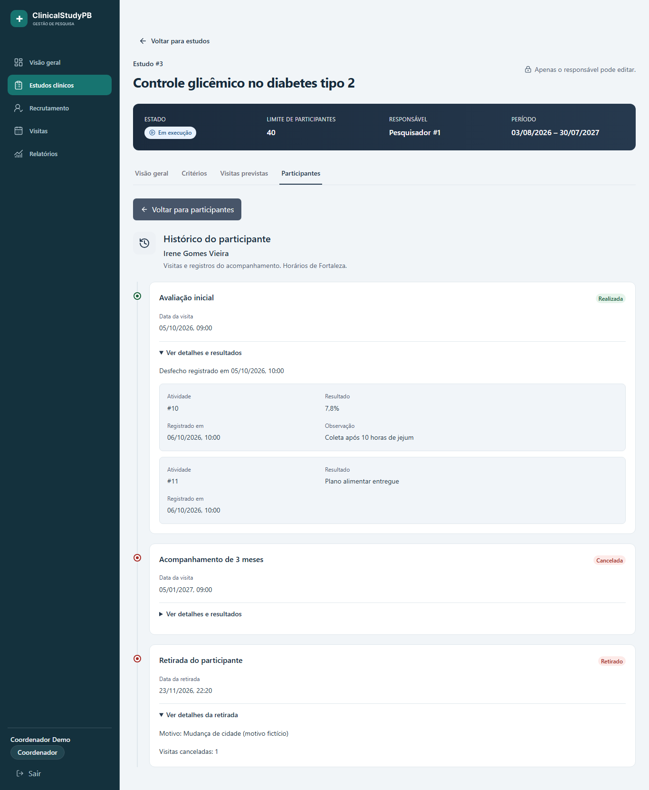
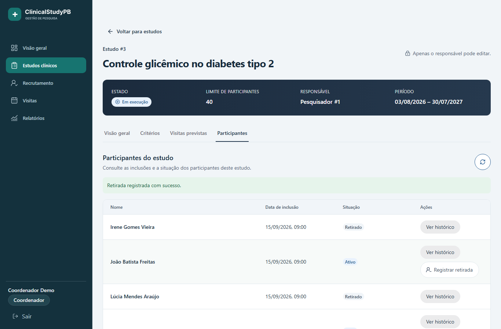
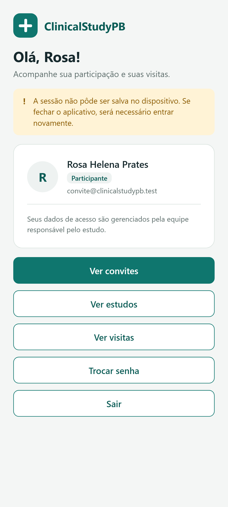
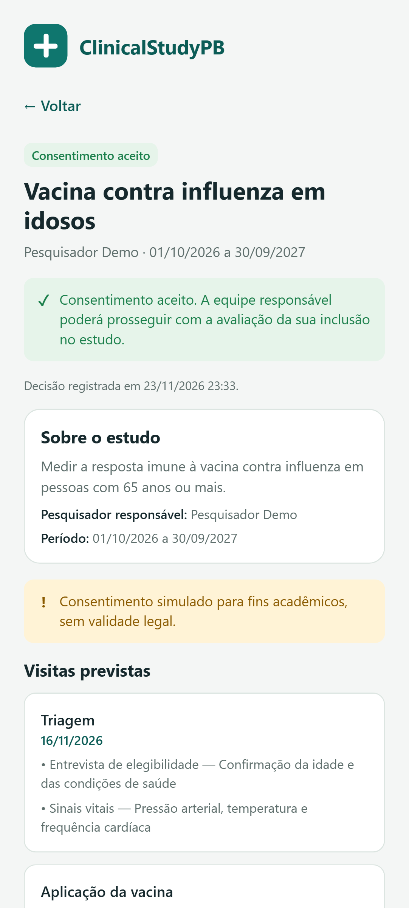
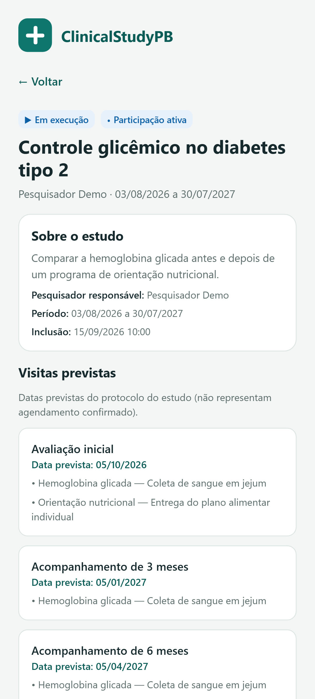
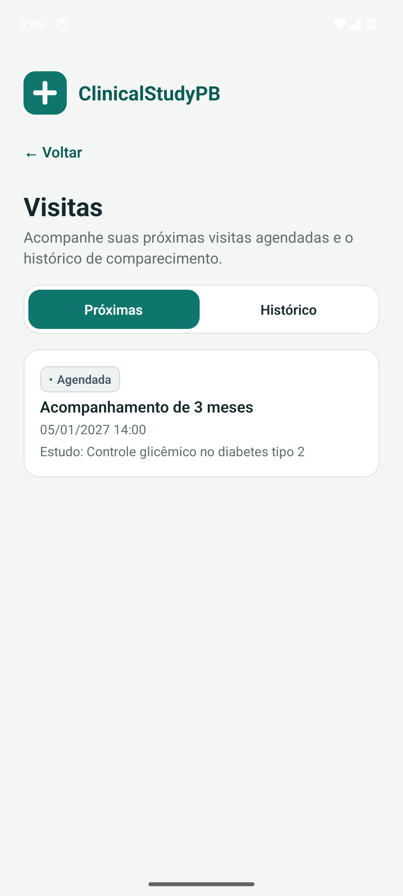

# Capturas da Release 2 — Sprint 3

[Voltar à Release 2](../README.md) · [Testes](../tests/README.md)

Capturas obtidas entre 23 e 24/11/2026 (America/Fortaleza) para a T25.2, sobre o commit avaliado `development` **e975d92**, o mesmo da [CI do fechamento da sprint](../tests/ci-e975d92/README.md). Nenhuma resposta HTTP foi interceptada.

- **Backend e banco:** stack descartável de [`compose.e2e.yaml`](../../../compose.e2e.yaml), construída de `e975d92`, com as quatro cargas de `backend/dev/` (usuários, estudos, recrutamento e acompanhamento), como no [roteiro de demonstração](../README.md#roteiro-de-demonstração).
- **Web:** build de produção de `e975d92` servido pelo `vite preview`, com proxy para a API. Janela de 1366 px de largura.
- **Aplicativo:** RF02, RF03, RF10 e RF17 foram capturados com o código de `e975d92` executado pelo Expo para web (`react-native-web`), numa janela de celular de 412 × 915 px, com as chamadas à API passando por um proxy local, sem alteração de código. O RF18 usa as capturas do emulador Android feitas pelo [E2E mobile da CI](../tests/ci-e975d92/README.md#e2e-mobile-no-emulador-android).
- **Dados:** contas, estudos, candidatos e resultados são fictícios. Os registros criados na sessão (candidatas "Candidata Evidência Release 2", agendamentos, resultados e motivo de retirada) também são fictícios.

**Sem credenciais.** Os campos de senha aparecem mascarados. No cadastro de candidato (RF08), o código de ativação exibido pela tela foi substituído pelo texto "código ocultado na captura" antes da captura; é a única alteração de conteúdo. Os e-mails visíveis são contas fictícias de demonstração.

**Aviso exclusivo da versão web do aplicativo.** No navegador não existe o armazenamento seguro do dispositivo, então o início do aplicativo mostra "A sessão não pôde ser salva no dispositivo". No Android e no iOS a sessão é gravada e o aviso não aparece.

## Evidências por requisito

Cada requisito da Sprint 3 tem pelo menos uma captura. O prefixo do arquivo indica o RF; `app` indica o aplicativo e a ausência dele, a web.

| RF | Evidência | Situação | Como reproduzir e resultado |
| --- | --- | --- | --- |
| RF02 | [Credenciais inválidas no app](rf02-app-erro-credenciais.png) | Erro | Entrar com `participante@…` e senha errada: mensagem genérica, sem indicar qual campo errou. |
| RF02 | [Código de ativação inválido](rf02-app-erro-codigo-ativacao.png) | Erro | Em **Primeiro acesso**, informar `convite@…` e um código inexistente: ativação recusada. |
| RF02 | [Confirmação de senha diferente](rf02-app-erro-confirmacao-senha.png) | Erro | Após ativar com o código da carga, digitar senhas diferentes: a troca não é enviada. |
| RF02 | [Senha definida e início do app](rf02-app-sucesso-senha-definida.png) | Sucesso | Confirmar a nova senha: a conta de Rosa Helena Prates entra no início do aplicativo. |
| RF03 | [Perfil sem acesso ao app](rf03-app-erro-perfil-sem-acesso.png) | Erro | Entrar no aplicativo como coordenador: "Acesso negado a este aplicativo". |
| RF03 | [Participante na web](rf03-erro-participante-na-web.png) | Erro | Entrar na web como participante: página 403, perfil sem permissão. |
| RF08 | [Campos obrigatórios](rf08-erro-campos-obrigatorios.png) | Erro | Em **Recrutamento → Novo candidato**, enviar o formulário vazio: nome, e-mail, telefone e idade obrigatórios. |
| RF08 | [Candidato com convite emitido](rf08-sucesso-candidato-com-convite.png) | Sucesso | Cadastrar candidata com e-mail e telefone no estudo da vacina: conta criada e código de ativação de 72 horas (ocultado). |
| RF10 | [Decisões na web](rf10-consulta-decisoes-na-web.png) | Consulta | Coordenador vê Aceitou, Recusou, Aguardando decisão e Convidado, sem poder registrar a decisão. |
| RF10 | [Convites pendentes](rf10-app-convites-pendentes.png) | Consulta | Rosa abre **Ver convites**: o convite da vacina aparece como pendente. |
| RF10 | [Detalhe do convite](rf10-app-detalhe-convite.png) | Consulta | Resumo do estudo, termo simulado e visitas previstas antes da decisão. |
| RF10 | [Confirmação do aceite](rf10-app-confirmar-aceite.png) | Confirmação | **Aceitar convite** pede confirmação e avisa que a decisão é única. |
| RF10 | [Convite aceito](rf10-app-sucesso-convite-aceito.png) | Sucesso | Após confirmar: "Consentimento aceito", com data e hora; a decisão fica somente leitura. |
| RF10 | [Convite recusado](rf10-app-sucesso-convite-recusado.png) | Sucesso | `participante@…` recusa o convite da vacina: "Consentimento recusado", somente leitura. |
| RF11 | [Limite de vagas](rf11-erro-limite-de-vagas.png) | Erro | Higiene do sono: Vera Lúcia Fonseca ocupa a última vaga; o painel mostra 3 de 3 e a inclusão de Wilson Barbosa Leite fica indisponível. |
| RF12 | [Visita agendada](rf12-sucesso-visita-agendada.png) | Sucesso | Agendar **Aplicação da vacina** de Benedito Souza Rocha para 10/12/2026 09:00: mensagem de sucesso e agenda atualizada. |
| RF12 | [Agendamento duplicado](rf12-erro-agendamento-duplicado.png) | Erro | Agendar a mesma visita de novo: erro da API e formulário preservado. |
| RF13 | [Agenda com os desfechos](rf13-agenda-com-quatro-desfechos.png) | Consulta | Estudo de diabetes em **Visitas**: agendada, realizada, ausente (com observação) e cancelada (com justificativa). |
| RF13 | [Cancelamento sem justificativa](rf13-erro-cancelamento-sem-justificativa.png) | Erro | Confirmar o cancelamento sem justificativa: campo obrigatório, nada é gravado. |
| RF13 | [Confirmação de realizada](rf13-confirmacao-realizada.png) | Confirmação | Avaliação inicial remarcada de João Batista Freitas: confirmação de desfecho final. |
| RF13 | [Visita realizada](rf13-sucesso-visita-realizada.png) | Sucesso | Após confirmar, a visita de 03/12/2026 passa a Realizada e ganha **Ver resultados**. |
| RF14 | [Resultados registrados](rf14-consulta-resultados-registrados.png) | Consulta | Pesquisador abre os resultados de Irene Gomes Vieira: hemoglobina glicada e orientação nutricional. |
| RF14 | [Resultado obrigatório](rf14-erro-resultado-obrigatorio.png) | Erro | Salvar atividade sem resultado na visita de João: mensagem de campo obrigatório. |
| RF14 | [Resultado salvo](rf14-sucesso-resultado-registrado.png) | Sucesso | Salvar as duas atividades da visita de João: selo "Registrado" e "Resultado salvo". |
| RF15 | [Histórico do participante](rf15-historico-participante.png) | Consulta | Histórico de Irene após a retirada: visita realizada com resultados, visita cancelada e retirada com motivo. |
| RF16 | [Motivo obrigatório](rf16-erro-motivo-obrigatorio.png) | Erro | **Registrar retirada** sem motivo: campo obrigatório, nada é gravado. |
| RF16 | [Retirada registrada](rf16-sucesso-retirada-registrada.png) | Sucesso | Retirada de Irene com motivo: situação Retirado; a visita futura é cancelada. |
| RF17 | [Meus estudos](rf17-app-meus-estudos.png) | Consulta | `participante@…` abre **Ver estudos**: estudo de diabetes em execução, participação ativa. |
| RF17 | [Protocolo do estudo](rf17-app-protocolo-do-estudo.png) | Consulta | Detalhe do estudo com objetivo, período e visitas previstas com atividades. |
| RF18 | [Próximas visitas (emulador)](rf18-app-emulador-proximas-visitas.png) | Consulta | Android, E2E mobile da CI: acompanhamento de 3 meses agendado em **Próximas**. |
| RF18 | [Histórico de visitas (emulador)](rf18-app-emulador-historico-visitas.png) | Consulta | Android, E2E mobile da CI: avaliação inicial realizada em **Histórico**. |

As capturas de inclusão, agendamento, desfecho e agendamento duplicado geradas pelo E2E do fluxo de referência ficam em [evidencias/t19-5-fluxo-referencia](../evidencias/t19-5-fluxo-referencia/README.md).

## Web

## Aplicativo

   
