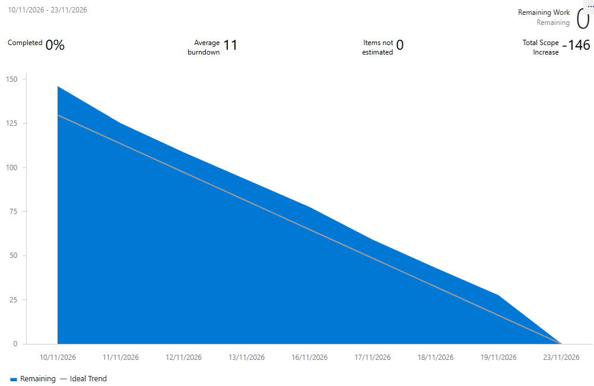
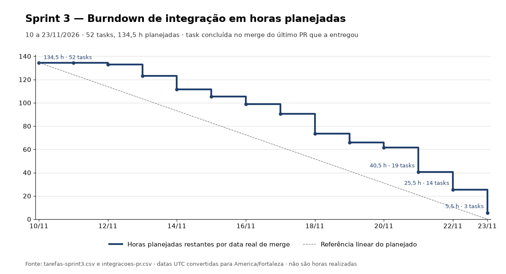

# Processo da Sprint 3

[Release 2](../README.md) · [Board da equipe no Azure DevOps](https://dev.azure.com/engsw2/TEAM5)

## Planejamento e backlog

| Item | Valor |
| --- | --- |
| Período | 10 a 23/11/2026, a partir do Planning de 10/11: 14 dias corridos e 9 dias úteis de referência (20/11 é feriado nacional). |
| Meta | Entregar o escopo obrigatório da Sprint 3 do enunciado (RF12 a RF16 na web, login no aplicativo, RF17 e RF18) e as observações urgentes da professora sobre a Release 1: identidade e consentimento do candidato (PBI-17), UX da web e sessão por aba (PBI-24) e rastreabilidade dos testes (PBI-25). |
| Prioridade | Primeiro o escopo do enunciado, depois as observações urgentes, depois as demais. Se houvesse corte, ele começaria pelo PBI-24 e pelo PBI-25, nunca pelos RF do enunciado. Não houve corte. |
| Backlog | [10 PBIs](backlog-sprint3.csv) e [52 tasks](tarefas-sprint3.csv), além de 6 registros de cerimônias. |

Os CSVs transcrevem o planejamento da equipe (`SprintPlanning03_ClinicalStudyPB.xlsx`, abas Tarefas e PBIs) e acrescentam o PR e a data de integração de cada task. Horas são estimativas de planejamento, não apontamentos de trabalho realizado.

| PBI | Descrição | RF | Horas | Tasks | Integradas até 23/11 |
| --- | --- | :---: | :---: | :---: | :---: |
| PBI-17 | Identidade, primeiro acesso e consentimento do candidato + login mobile | RF01, RF08, RF10, RF11; RF02 e RF03 no app | 34 | 11 | 11 |
| PBI-18 | Agendamento de visitas | RF12 | 14,5 | 5 | 5 |
| PBI-19 | Desfecho de visitas | RF13 | 12,5 | 5 | 5 |
| PBI-20 | Resultados fictícios das avaliações | RF14 | 12,5 | 5 | 5 |
| PBI-21 | Histórico do participante | RF15 | 8,5 | 3 | 3 |
| PBI-22 | Retirada de participante | RF16 | 9,5 | 4 | 4 |
| PBI-23 | Estudos e visitas no aplicativo | RF17 e RF18 | 14 | 5 | 5 |
| PBI-24 | UX urgente da web e sessão por aba | Qualidade | 11 | 5 | 5 |
| PBI-25 | Rastreabilidade de testes e evidências | Qualidade | 5 | 2 | 1 |
| PBI-26 | Linha de base, documentação e registro da Sprint 3 | Qualidade | 13 | 7 | 5 |
| **Total** | | | **134,5** | **52** | **49** |

As três tasks que passaram de 23/11 são de fechamento: a T25.2 (evidências) e a T26.5 (regressão RF01–RF11 e instalação limpa) foram integradas na madrugada de 24/11, pelos PRs [#124](https://github.com/livdenner/ClinicalStudyPB-project/pull/124) e [#126](https://github.com/livdenner/ClinicalStudyPB-project/pull/126); a T26.4 é este registro.

| Composição de carga | Horas |
| --- | :---: |
| Tasks | 134,5 |
| Cerimônias (2 h por papel) | 12 |
| Total de tasks + cerimônias | 146,5 |
| Reserva (2 h por papel) | 12 |
| Alocação total planejada | 158,5 |

A equipe decidiu não limitar o plano pela capacidade histórica: a base da Sprint 2 era de 118 h.

## Papéis e contribuições

Os PRs são os integrados na `development` (e o #91 na `main`) entre 12 e 24/11/2026, do #71 ao #126. Os PRs #105 e #113, abertos pelo bot `clinicalstudypb-ci-reports[bot]`, só versionam relatórios da CI e ficam fora da contagem. A [lista de integrações](integracoes-pr.csv) traz título, tasks, data e revisores de cada PR.

| Pessoa / GitHub | Sprint 1 | Sprint 2 | Sprint 3 | Tasks da Sprint 3 (h) | PRs integrados |
| --- | --- | --- | --- | :---: | --- |
| Allan / `allangrm` | Web 2 | Web 2 | Gerência e PO | 11 (23,5 h) | Contratos: [#71](https://github.com/livdenner/ClinicalStudyPB-project/pull/71), [#73](https://github.com/livdenner/ClinicalStudyPB-project/pull/73), [#74](https://github.com/livdenner/ClinicalStudyPB-project/pull/74), [#75](https://github.com/livdenner/ClinicalStudyPB-project/pull/75), [#78](https://github.com/livdenner/ClinicalStudyPB-project/pull/78). Retirada, `/me` e histórico: [#81](https://github.com/livdenner/ClinicalStudyPB-project/pull/81), [#89](https://github.com/livdenner/ClinicalStudyPB-project/pull/89), [#94](https://github.com/livdenner/ClinicalStudyPB-project/pull/94), [#103](https://github.com/livdenner/ClinicalStudyPB-project/pull/103). Documentação: [#72](https://github.com/livdenner/ClinicalStudyPB-project/pull/72), [#98](https://github.com/livdenner/ClinicalStudyPB-project/pull/98), [#122](https://github.com/livdenner/ClinicalStudyPB-project/pull/122). |
| Lucas / `lucrasn` | Backend | Gerência | Backend | 9 (27,5 h) | Conta, ativação e decisão do candidato: [#76](https://github.com/livdenner/ClinicalStudyPB-project/pull/76), [#77](https://github.com/livdenner/ClinicalStudyPB-project/pull/77), [#93](https://github.com/livdenner/ClinicalStudyPB-project/pull/93), [#85](https://github.com/livdenner/ClinicalStudyPB-project/pull/85). Agenda, desfecho e resultados: [#79](https://github.com/livdenner/ClinicalStudyPB-project/pull/79), [#86](https://github.com/livdenner/ClinicalStudyPB-project/pull/86), [#88](https://github.com/livdenner/ClinicalStudyPB-project/pull/88), [#102](https://github.com/livdenner/ClinicalStudyPB-project/pull/102), [#97](https://github.com/livdenner/ClinicalStudyPB-project/pull/97), [#114](https://github.com/livdenner/ClinicalStudyPB-project/pull/114). Publicação dos relatórios da CI: [#90](https://github.com/livdenner/ClinicalStudyPB-project/pull/90), [#91](https://github.com/livdenner/ClinicalStudyPB-project/pull/91). |
| Raffael / `Raffael-Wagner` | Web 1 | Web 1 | Web 1 | 9 (21,5 h) | UX e sessão: [#87](https://github.com/livdenner/ClinicalStudyPB-project/pull/87), [#80](https://github.com/livdenner/ClinicalStudyPB-project/pull/80), [#101](https://github.com/livdenner/ClinicalStudyPB-project/pull/101), [#92](https://github.com/livdenner/ClinicalStudyPB-project/pull/92), [#115](https://github.com/livdenner/ClinicalStudyPB-project/pull/115). Histórico e retirada: [#119](https://github.com/livdenner/ClinicalStudyPB-project/pull/119), [#120](https://github.com/livdenner/ClinicalStudyPB-project/pull/120), [#110](https://github.com/livdenner/ClinicalStudyPB-project/pull/110), [#111](https://github.com/livdenner/ClinicalStudyPB-project/pull/111). |
| Lívia / `livdenner` | Gerência | Backend | Web 2 | 9 (21,5 h) | Candidato e convite: [#84](https://github.com/livdenner/ClinicalStudyPB-project/pull/84), [#96](https://github.com/livdenner/ClinicalStudyPB-project/pull/96). Agenda, desfecho e resultados: [#99](https://github.com/livdenner/ClinicalStudyPB-project/pull/99), [#100](https://github.com/livdenner/ClinicalStudyPB-project/pull/100), [#104](https://github.com/livdenner/ClinicalStudyPB-project/pull/104). Testes: [#116](https://github.com/livdenner/ClinicalStudyPB-project/pull/116). |
| Júlio / `julioP-dev` | Mobile | Mobile | Mobile | 6 (21,5 h) | Login, ativação e convites: [#95](https://github.com/livdenner/ClinicalStudyPB-project/pull/95), [#109](https://github.com/livdenner/ClinicalStudyPB-project/pull/109). Estudos e visitas: [#112](https://github.com/livdenner/ClinicalStudyPB-project/pull/112), [#117](https://github.com/livdenner/ClinicalStudyPB-project/pull/117). Testes e documentação: [#118](https://github.com/livdenner/ClinicalStudyPB-project/pull/118), [#123](https://github.com/livdenner/ClinicalStudyPB-project/pull/123). |
| Júlia / `juliaPamplona` | QA/DevOps | QA/DevOps | QA/DevOps | 8 (19 h) | Relatório por execução e matriz do candidato: [#82](https://github.com/livdenner/ClinicalStudyPB-project/pull/82), [#83](https://github.com/livdenner/ClinicalStudyPB-project/pull/83). E2E web e mobile: [#106](https://github.com/livdenner/ClinicalStudyPB-project/pull/106), [#108](https://github.com/livdenner/ClinicalStudyPB-project/pull/108), [#121](https://github.com/livdenner/ClinicalStudyPB-project/pull/121). Seeds, evidências e regressão: [#107](https://github.com/livdenner/ClinicalStudyPB-project/pull/107), [#124](https://github.com/livdenner/ClinicalStudyPB-project/pull/124), [#126](https://github.com/livdenner/ClinicalStudyPB-project/pull/126). |

O #85 não tem task própria no planejamento: fecha o ajuste de RF01 (proteção da própria conta e do último administrador ativo) apontado na revisão do #76. O #91 foi integrado direto na `main` porque o workflow que publica os relatórios é disparado por `workflow_run`, que usa a versão do workflow da branch padrão.

## Revisão cruzada

Todos os 53 PRs tiveram revisão registrada no GitHub por pelo menos uma pessoa de outro papel antes do merge: 37 com um revisor, 14 com dois e 2 com três, num total de 71 revisões. Contam aprovações, pedidos de mudança e comentários de revisão; comentários soltos na conversa do PR não entram.

| Revisor \ autor | Gerência | Backend | Web 1 | Web 2 | Mobile | QA | Total |
| --- | :---: | :---: | :---: | :---: | :---: | :---: | :---: |
| Gerência | — | 11 | 9 | 4 | 3 | 5 | **32** |
| Backend | 12 | — | 0 | 1 | 4 | 3 | **20** |
| Web 1 | 1 | 0 | — | 3 | 2 | 1 | **7** |
| Web 2 | 0 | 1 | 2 | — | 0 | 0 | **3** |
| Mobile | 1 | 0 | 1 | 1 | — | 1 | **4** |
| QA | 0 | 3 | 0 | 2 | 0 | — | **5** |

Cada frente teve o trabalho revisado por outra, mas a carga ficou concentrada: Gerência e Backend fizeram 52 das 71 revisões. A distribuição das revisões é uma das ações da [retrospectiva](#retrospectiva).

## Burndown

### Burndown do Azure DevOps

Captura do widget de burndown da Sprint 3 no [Azure DevOps](https://dev.azure.com/engsw2/TEAM5), feita no fechamento. O gráfico usa o trabalho restante (*Remaining Work*) apontado pela equipe nas tasks, com as cerimônias: começa em cerca de 146 h, as 146,5 h do planejamento, e chega a zero em 23/11, com média de 11 h por dia. O eixo pula os dias sem expediente (14, 15 e 20 a 22/11).

| Data | Azure: trabalho restante | Integração: horas planejadas ainda não integradas |
| --- | :---: | :---: |
| 10/11 | 146 | 134,5 |
| 13/11 | 93 | 123,0 |
| 16/11 | 77,5 | 99,0 |
| 19/11 | 27,5 | 66,0 |
| 23/11 | 0 | 5,5 |

Os valores do Azure foram lidos no gráfico e arredondados. A coluna de integração vem do [burndown de integração](#burndown-de-integração), que não inclui as 12 h de cerimônias.

**Planejado x realizado.** Pelo trabalho apontado no Azure, a sprint consumiu todo o planejado até 23/11. O restante ficou um pouco acima da tendência ideal o tempo todo e a alcançou no último dia. O apontamento, porém, andou bem à frente dos merges: em 19/11 o Azure tinha cerca de 27,5 h restantes, enquanto 66 h planejadas ainda não estavam integradas na `development`. A diferença é trabalho dado como feito que ainda esperava revisão, ajuste ou merge, o que confirma o principal impedimento da [retrospectiva](#retrospectiva).

O widget também mostra "Completed 0%" e "Total Scope Increase −146": para o Azure, as horas saíram do escopo em vez de serem contadas como concluídas. Isso acontece quando o trabalho restante é zerado sem que as tasks passem para *Done*. O estado das tasks no quadro precisa ser conferido antes da Review.

### Burndown de integração

O gráfico é reconstruído das datas públicas de merge, como na [Release 1](../../release1/processo/README.md#burndown-de-integração), mas em **horas planejadas restantes**, para poder ser comparado ao do Azure. Cada task sai do saldo, com as horas que tinha no planejamento, no dia do merge do último PR que a entregou. As datas UTC do GitHub foram convertidas para America/Fortaleza. A reta cinza é só a referência linear entre o total e zero. Não são horas realizadas.

| Data | Horas planejadas restantes | Tasks restantes | Referência linear |
| --- | :---: | :---: | :---: |
| 13/11 | 123,0 | 47 | 103,5 |
| 16/11 | 99,0 | 40 | 72,4 |
| 20/11 | 61,5 | 26 | 31,0 |
| 23/11 | 5,5 | 3 | 0 |

A série diária completa está no [CSV](burndown-sprint3.csv).

**Planejado x integrado.** A sprint integrou 49 das 52 tasks (129 das 134,5 h planejadas). Os PBIs do enunciado (17 a 23) e o PBI-24 terminaram completos. Ficaram 5,5 h, todas de fechamento: T25.2 (1 h) e T26.5 (2 h), integradas na madrugada de 24/11, e T26.4 (2,5 h), este registro.

**Ritmo.** Os três contratos OpenAPI (T17.1, T18.1 e T20.1) estavam integrados em 13/11 e destravaram as frentes. Na metade do período, em 16/11, restavam 99 h, contra 72,4 h na referência. A integração se concentrou no fim: de 21 a 23/11 entraram 23 tasks (56 h planejadas), 11 delas em 23/11. Parte disso estava prevista: o planejamento deixava para 19–23/11 os E2E, as seeds, a regressão e a documentação, que dependem das telas e da API prontas.

## Linha de base da Sprint 3 (T26.2)

Verificação feita em 12/11/2026 para garantir que a Sprint 3 parte da versão publicada da Release 1, sem PRs pendentes nem migrações inconsistentes.

| Item | Resultado |
| --- | --- |
| Commit base | `development` **72bfdd4** (merge do PR #68). `main` **8e88d15**, com a tag `release1` (PR #70). |
| Divergência entre `development` e `main` | Nenhuma além do merge: `development` não tem commits fora de `main`; `main` tem só o commit de merge do PR #70. |
| CI no GitHub | [Execução do push em 72bfdd4](https://github.com/livdenner/ClinicalStudyPB-project/actions/runs/42756752300) (10/11/2026): Backend, Web, E2E e Mobile com sucesso. |
| Migrações | Flyway V1–V10; a Release 1 termina em `V10__create_participants.sql`. A próxima livre é V11, a combinar entre as frentes antes de criar. |
| PRs da Sprint 2 | Nenhum aberto em 12/11/2026. O único PR aberto é o #71, da Sprint 3. |
| Bloqueios | Nenhum. |

### Execução local dos quatro jobs da CI

Mesmos comandos de [`.github/workflows/ci.yml`](../../../.github/workflows/ci.yml), executados sobre uma cópia limpa de 72bfdd4 em 12/11/2026 (Windows 11, Node.js 24, Java 21, Docker 29.9.2, Compose 5.6.1).

| Job | Comandos | Resultado |
| --- | --- | --- |
| Backend | `./mvnw -B -ntp verify` | 487 testes, 0 falhas; Checkstyle sem violações; JaCoCo 97,27% de linhas (891/916), regras de cobertura atendidas. |
| Web | `npm ci`, `format:check`, `lint`, `test:coverage`, `build` | Formatação, lint e build sem erros; Vitest com 25 arquivos e 200 testes aprovados; 86,75% de linhas. |
| Mobile | `npm ci`, `npm test -- --ci --coverage` | 2 suítes e 2 testes aprovados. |
| E2E | `npx playwright install chromium`, `e2e:stack:up`, `test:e2e`, `e2e:stack:down` | 8 testes aprovados contra backend e PostgreSQL reais. |

Na primeira execução local, o `test:coverage` da web falhou por sobrecarga da máquina, que rodava os outros jobs e o Docker ao mesmo tempo: três arquivos de teste não iniciaram (timeout do worker do Vitest) e um teste de login excedeu o tempo de espera. Repetido isoladamente, passou por completo. A CI do GitHub aprovou o mesmo commit.

### Compose do zero e migrações (apenas testes)

Os dois cenários cobrem as duas situações de quem instala ou atualiza o projeto: começar com um banco vazio ou continuar com o banco que já tem. Ambos foram testados com o `compose.yaml` da raiz, em projetos Docker temporários e separados do ambiente de desenvolvimento, com credenciais fictícias; os contêineres, volumes e imagens de teste foram removidos ao final.

| Cenário | O que comprova | Resultado |
| --- | --- | --- |
| Banco novo (instalação limpa) | Uma instalação do zero chega ao esquema atual e aceita os seeds. | Imagem do backend construída; Flyway aplicou as 10 migrações (V1–V10); `/v3/api-docs` respondeu 200; os três seeds de `backend/dev/` foram carregados sem erro, como no README principal; login do coordenador de demonstração respondeu 200. |
| Banco existente (atualização) | Quem já tem um banco da Release 1 continua usando o mesmo banco, sem recriá-lo. | Sobre uma cópia de um banco local já em V10, o Flyway validou as 10 migrações, sem nenhuma pendente, e o backend iniciou normalmente. |

As migrações novas da Sprint 3 (a partir de V11) devem passar pelos mesmos dois cenários antes da integração.

### Branches antigas

Em 12/11/2026 o repositório tinha, além de `main`, `development` e da branch do PR #71, uma única branch antiga:

| Branch | Situação | Destino |
| --- | --- | --- |
| `test/3458-study-transitions` | Sem PR; um commit de 07/11/2026 com dois testes de estados do estudo na web, em conflito com a `development`. | Encerrada por decisão do Gerente em 12/11/2026. Os dois casos (estudo encerrado sem botões de edição ou transição; cancelar a confirmação sem enviar transição) passam para os testes do PBI-24, que reorganiza os botões dos estudos. |

## Correção documental da Release 1 (T26.1)

Em 18/11/2026, o [README da Release 1](../../release1/README.md) foi corrigido para refletir a versão realmente publicada.

| Item | Correção |
| --- | --- |
| Versão | Tag `release1` e [GitHub Release](https://github.com/livdenner/ClinicalStudyPB-project/releases/tag/release1) publicadas em 10/11/2026, sobre `main` **8e88d15** (PR #70). |
| Matriz RF09–RF11 | Testes de componentes de elegibilidade, consentimento, modal de inclusão e painel de vagas (PRs #68 e #69); consentimento consultado na API pela lista de candidatos (PR #67); E2E do fluxo completo (PR #65). |
| Testes | Números de uma execução nova na tag, em [tests/tag-release1](../../release1/tests/tag-release1/); os da consolidação anterior ficam como histórico. |
| Pendências | Ficaram só o login e os fluxos mobile e os rótulos do consentimento; E2E completo, testes de componentes e publicação da tag foram retirados por estarem concluídos. |
| Processo e galeria | Registram o fechamento da release depois do corte da Sprint 2 e que as capturas são anteriores à tag. |

Alteração apenas documental, integrada pela `development`: o conteúdo da tag `release1` não mudou.

## Revisão da Sprint 3

O incremento liga o recrutamento ao acompanhamento. O candidato passou a ter conta, ativa o acesso no aplicativo e decide o consentimento ali; o coordenador inclui, agenda visitas e registra desfechos; o pesquisador registra resultados; o histórico reúne tudo; a retirada cancela as visitas futuras. No aplicativo, o participante vê os próprios estudos e visitas. A [matriz de requisitos](../README.md#rastreabilidade-dos-requisitos) liga cada RF à implementação, aos testes e às capturas.

A demonstração segue o [roteiro da Release 2](../README.md#roteiro-de-demonstração), só com a carga fictícia, e cobre do PBI-17 ao PBI-24. A Review é apresentada à professora em vídeo de até 10 minutos, gravado pela equipe, com os requisitos implementados, a estrutura do código, os relatórios de teste e as atualizações do Git.

Na coleta de evidências (T25.2) apareceu um defeito: no histórico do participante (RF15), os resultados mostram o identificador da atividade ("Atividade #10") em vez do nome, porque a resposta do histórico não traz o nome da atividade. Ele passa para a Sprint 4.

## Retrospectiva

Os impedimentos abaixo têm registro no repositório. As ações valem para a Sprint 4.

| Impedimento | Evidência | Ação para a Sprint 4 |
| --- | --- | --- |
| Migração com colunas obrigatórias quebrou testes de outra frente. | A `V11` tornou e-mail, telefone e conta obrigatórios no candidato; o fixture de agendamento do #79 ainda inseria candidatos sem esses campos e o PR recebeu pedido de mudanças em 14/11. | Quem cria coluna obrigatória ajusta fixtures, seeds e E2E no mesmo PR e avisa as frentes antes do merge. |
| Resolução de conflito desfez trechos do README principal. | O merge `66c9d90`, no PR #122, gravou uma versão antiga do `README.md`: perderam-se trechos da T26.3, da T26.7 e a seção de testes do #116. Corrigido neste registro (T26.4). | Depois de resolver um conflito, comparar o arquivo com as duas versões de origem antes do commit. Manter no README principal só instalação e visão geral; detalhes de task ficam no README da release. |
| Revisões concentradas em dois papéis. | Gerência e Backend fizeram 52 das 71 revisões ([revisão cruzada](#revisão-cruzada)). | Rodízio de revisores: cada PR com pelo menos um revisor de uma frente que não seja Gerência nem Backend. |
| Vitest falha por timeout em máquina sobrecarregada. | Registros da T26.2 e da T24.5: workers que não iniciam quando Docker e outros jobs rodam juntos; os mesmos testes passam isolados e na CI. | Rodar localmente com `--maxWorkers=1` (já no README) e tratar a CI como referência. |

**O que funcionou e continua:** contratos OpenAPI antes das implementações; revisão por outra frente em todos os PRs; relatório de testes por execução, gerado pela CI; cobertura do backend em 97,96% das linhas; E2E web e mobile na CI.
